# DiffFLIM – Project Log

## Current status

*Last updated: 2026-11-22*

The project has two simulators. Simulator v2 (`src/data/simulate.py`) produces smooth blob-shaped cells with a Gaussian IRF and was used to train DiffFLIM v1. Simulator v3 (`src/data/simulate_v3.py`) follows the FLIMngo simulation (Human Protein Atlas (HPA) crops, up to four lifetime components per pixel, Perlin-noise amplitudes, twelve IRFs with laser jitter) but with real photon counts. The 350 complete HPA samples are split into 30 fixed test IDs, 20 fixed calibration IDs, 54 extra calibration IDs that DiffFLIM v2 never saw, and 246 training IDs (the exact list DiffFLIM v2 was trained on). The v3 test set (40 images per level) and both v3 calibration sets (100 images per level each) are paired across photon levels.

DiffFLIM v2 (v1 architecture, trained on v3 data) is the most accurate lifetime estimator on the v3 test set at every photon level. In the main comparison every method gets the same information: FLIMngo uses a background mask computed from the counts, DiffFLIM and the MLE get no mask. The strongest deterministic baseline is the FLIMngo architecture retrained on the same 246 training cells for the same 3 hours as the 3-hour DiffFLIM v2 checkpoint. Lifetime error (median absolute relative error, all foreground pixels, 40 images per level):

| Photons per fg pixel | MLE | Binned MLE 5 × 5 | FLIMngo pretrained | FLIMngo retrained v3 | DiffFLIM v2 (3 h) | DiffFLIM v2 (6 h) |
|---|---|---|---|---|---|---|
| 10 | 32.8 % | 15.2 % | 19.8 % | 14.0 % | 10.1 % | 9.8 % |
| 100 | 14.1 % | 12.6 % | 12.7 % | 9.9 % | 6.9 % | 6.6 % |
| 1000 | 7.6 % | 12.3 % | 10.3 % | 8.1 % | 4.7 % | 4.3 % |

With the ground-truth mask the pretrained FLIMngo reaches 12.4, 8.9 and 7.0 %, still behind DiffFLIM v2. The retrained FLIMngo has a positive bias of +4.5 to +6.9 %. FLIMngo needs 6 ms per 64 × 64 image on the laptop GPU. DiffFLIM v2 needs 0.52 s with 10 samples of 50 DDIM steps, but 0.11 s with 10 samples of 10 steps at the same accuracy and, after recalibration, the same coverage; only DiffFLIM gives an intensity map and a per-pixel uncertainty.

The uncalibrated DiffFLIM v2 intervals are too narrow (78 % lifetime and 83 % intensity coverage of the nominal 90 % interval). Calibrated on all 74 calibration cells, the pooled coverage at 90 % is 89.8 % for the lifetime (95 % interval over test cells [88.3, 91.0] %) and 88.1 % for the intensity ([85.7, 90.4] %); at 68 % it is 67.8 % and 66.1 %. At the level of cells all four values are consistent with nominal. Per photon level only the per-level factors are consistent with 90 %; a single global factor under-covers the intensity at 10 to 50 photons and over-covers it at 500 and 1000 photons.

Open problems:

- The mask computed from the counts misses 19 to 26 % of the true foreground pixels on the test set, which is a large part of the FLIMngo error under equal information.
- The v3 ground truth contains per-pixel lifetime jitter (median 4.4 % of τ on the foreground), close to the DiffFLIM v2 error at 1000 photons; the predicted mean maps are smooth.
- The mono-exponential baselines follow the intensity-weighted rather than the amplitude-weighted lifetime; no multi-exponential baseline exists. There is no U-Net baseline and no real data yet.

Next steps: test DiffFLIM v2 (10 DDIM steps, 10 samples) and both FLIMngo models on real `.sdt` data, check the FLIMngo baselines with a mask of higher recall, and add a U-Net trained on the same v3 data.

## Decisions

**Own simulator instead of the FLIMngo training data.** The FLIMngo data on Hugging Face store each decay curve normalised to the range 0 to 1, so the absolute photon counts are lost. Photon thinning, a Poisson likelihood and calibration at a known photon level all need raw counts, so the author wrote an own simulator with exact ground truth. FLIMngo remains a baseline and a source of reference settings (256 time bins of 0.0977 ns, 25 ns window at 40 MHz).

**Photon level defined per foreground pixel.** In simulator v1 the photon level was the mean over the whole image. With a variable fraction of dark background, the same nominal level then meant very different cell brightness from image to image. From v2 on, the photon level is the mean expected signal photons per foreground (cell) pixel, which is also how experimental photon counts are usually reported.

**Metrics on foreground pixels only.** Background pixels contain few photons and have no biologically meaningful lifetime. Including them would let the dark areas dominate the median errors, so all errors and coverage values are computed on the foreground mask.

**MLE uses the same forward model as the simulator.** The MLE baseline fits exactly the truncated, IRF-convolved, bin-integrated mono-exponential model of the simulator, with the known background. Its errors are therefore caused by photon noise and not by model mismatch, which makes it the strongest possible per-pixel reference on these data.

**v-prediction instead of epsilon-prediction.** The first DiffFLIM training run predicted the noise (epsilon). With this objective the loss hardly penalises a wrong estimate of the clean maps at high noise levels, so the network learned to copy signal from the noisy input instead of reading it from the photon counts, and sampling from pure noise failed. With v-prediction the target at high noise is close to the clean maps themselves, which forces the network to use the counts. Details are in the entries of 2026-11-21 below.

**No physics or data-consistency step in v1.** DiffFLIM v1 is a purely learned conditional model on purpose. It shows what the learned prior alone achieves and gives a reference point before a Poisson-likelihood guidance step with the IRF is added in a later version.

**Split-conformal calibration on a separate calibration set.** Split conformal prediction gives a coverage guarantee without assumptions on the error distribution. The factors are fitted on a separate simulated calibration set with its own seeds, so the fixed test set is never used for fitting.

**Simulator v3 follows FLIMngo, including two properties of its data.** The author kept the FLIMngo rules unchanged so that the v3 data match the data FLIMngo was trained on. Two of these rules shape the data strongly. First, the foreground is every pixel whose HPA channel sum is above zero; faint HPA background is rarely exactly zero, so the foreground covers on average 76 % of a 64 × 64 crop (up to 97 %). Second, each channel lifetime gets independent per-pixel jitter of up to 2 ns, so the true lifetime map is rough on the pixel scale (median deviation from the 3 × 3 neighbourhood median about 0.2 ns, or 4 %). Both are treated as properties of the data and not as errors.

**Two pixel sets for evaluation.** All metrics are reported on all foreground pixels and on "bright" foreground pixels. The bright set was first defined as pixels with at least 20 % of the crop's maximum true intensity. On v3 this selects every foreground pixel, because FLIMngo maps the channel sum linearly to [min, min + delta] photons, so the dimmest foreground pixel always has 28 to 84 % of the crop maximum. After discussion the definition was changed to at least 20 % of the crop's intensity range above its dimmest foreground pixel, which selects about half of the foreground on v3 and 73 % on v2.

**Mono-exponential baselines on multi-exponential data.** On v3 data the MLE, binned MLE and phasor use the exact v3 forward model with the image's own IRF, but with a single exponential. This is a deliberate simplification: v3 pixels contain up to four components, and the amplitude-weighted ground truth differs from what a mono-exponential fit measures.

**HPA images as a source of cell structure.** For a more realistic simulator, the author chose a subset of the Human Protein Atlas images from the Kaggle competition "Human Protein Atlas Image Classification". FLIMngo also builds its simulated data on HPA images, so the two models will be compared on similar structures. The images are for academic use only and are never committed.

**Extra calibration cells are not training data.** The 54 HPA samples in `data/splits/hpa_calib_extra_v2.txt` were downloaded after DiffFLIM v2 started training and were never seen by it, so they serve as extra calibration cells for v2. They are excluded from `train_ids()` by default (`allow_calib_extra=False`). A future model may only be trained on them if the log entry of that run says so explicitly; the extra calibration set then no longer counts as unseen data for that model and a new calibration set from other cells is needed. The 246 IDs DiffFLIM v2 was trained on are kept as a frozen record in `data/splits/hpa_train_diffflim_v2.txt`, and from now on every checkpoint stores its own training IDs.

**FLIMngo is run with its own preprocessing and the ground-truth mask.** The pretrained FLIMngo network is evaluated as published: per-pixel decays divided by their maximum, background pixels set to zero and no IRF input. The background is masked with the ground-truth foreground, because FLIMngo's own simulated data have exactly zero background and the metrics are computed on the same pixels. This gives FLIMngo information that DiffFLIM does not get; with a mask from the counts alone (Otsu) FLIMngo is 0.5 to 3 percentage points worse. (Replaced for the main comparison by the next decision.)

**All methods get the same information: a mask computed from the counts.** From the entry "FLIMngo retrained on v3, cell-level coverage intervals and DiffFLIM v2 speed trade-off" on, FLIMngo (pretrained and retrained) gets the background mask `foreground_mask(counts.sum(0), "otsu_adaptive")` from `src/evaluation/calibration.py`, in training and at evaluation, because the true mask is not available for real data and DiffFLIM does not get it either. The ground-truth-mask results are kept as an upper bound for FLIMngo. The retrained FLIMngo uses the same 246 training IDs, the same photon range and the same training time as the 3-hour DiffFLIM v2 checkpoint.

**Coverage uncertainty is reported at the level of cells.** Images of the same HPA cell are not independent (same crop source, and the same scene at every photon level in the paired sets). Confidence intervals for coverage therefore resample test cells (`hpa_id`), and the joint interval also resamples the calibration cells and refits the factors. Image-level bootstrap intervals in earlier entries are about half as wide and too optimistic.

## Log

### 2026-11-21 – Folder status check

Goal: The author wanted a reliable picture of the project folder before writing new code, because the state of the folder after earlier work was unclear.

Changes:
- `STATUS_REPORT.md` (new): status report of the folder.

Settings: read-only inspection; no files were changed apart from the report.

Results: The folder was a clean skeleton of about 32 KB in 26 files, 22 of which were empty placeholders. A central path module (`src/paths.py`), a FLIMngo loader for `.h5` files and scripts to download FLIMngo data, inspect one sample and make fixed data splits existed. There was no data, no simulator, no baseline, no model and no result. The environment had Python 3.11.0, PyTorch 2.5.1 with CUDA 12.1, NumPy 2.4.5 and SciPy 1.17.1, and an NVIDIA RTX 4060 Laptop GPU with 8 GB.

Compared to before: first recorded state of the project.

Problems and fixes: `h5py`, `tifffile` and `huggingface_hub` were listed in `requirements.txt` but not installed, so the FLIMngo scripts could not run. `sdtfile` (real `.sdt` data) and `diffusers` were neither listed nor installed. The report also noted that the FLIMngo loader returns no intensity target and that the normalised FLIMngo decays lose photon counts.

Next: write an own simulator with exact ground truth for lifetime and intensity.

### 2026-11-21 – Simulator v1 and first test set

Goal: The author needed simulated TCSPC data with exact ground truth for lifetime and intensity and with raw photon counts, which the FLIMngo data do not provide.

Changes:
- `src/data/simulate.py` (new): ground-truth maps, decay model, Poisson sampling, photon thinning, dataset generation and saving.
- `scripts/simulate_preview.py` (new): preview figure of one simulated image.
- `tests/test_simulate.py` (new): sanity tests.

Settings:
- 64 × 64 pixels, 256 time bins of 0.0977 ns (25 ns window, as in FLIMngo).
- Ground truth: 3 to 8 blurred ellipses ("cells") with lifetimes drawn uniformly from 0.5 to 5 ns, on a dim floor (5 % brightness) with its own lifetime; mild smooth intensity texture.
- Decay: mono-exponential convolved with a Gaussian IRF (FWHM 0.2 ns, centred at 1.0 ns), integrated exactly over each bin with the closed-form exponentially modified Gaussian CDF and renormalised inside the window; constant background of 2 % of the photon level.
- Photon level: mean signal photons per pixel over the whole image.
- Test set: 5 levels (10, 50, 100, 500, 1000) × 40 images, seeds 12345 + level, 41 MB in `data/raw/own/sim_test/`.

Results: All six tests passed. Averaged over 200 Poisson draws, the total counts per pixel matched intensity plus background (largest deviation 3.0 standard errors). At 10^5 photons the mean arrival time minus the IRF position matched τ within 1 % for τ from 0.5 to 5 ns. Thinning gave mean and variance p·λ, as expected for a Poisson process. Preview: `results/figures/simulate_preview_p1000.png`.

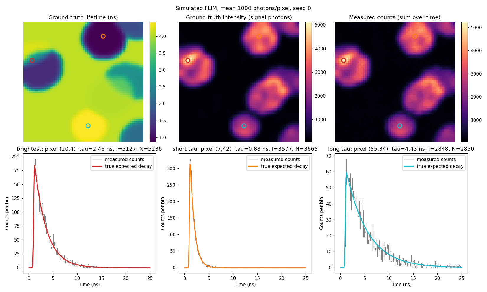

Compared to before: the project had no data before.

Problems and fixes: The simulator drops the part of a decay that falls beyond the 25 ns window and does not model pile-up from the previous laser pulse. For τ = 5 ns the mean arrival time is therefore 4.80 ns instead of 5 ns. The author kept this simplification and made sure that the MLE baseline uses the same truncated model.

Next: redefine the photon level per foreground pixel and add a foreground mask.

### 2026-11-21 – Simulator v2: photon level per foreground pixel, mask and training generator

Goal: In v1 the cells of an image with a large dark area received several times more photons than the nominal level (about 300 to 500 photons per cell pixel at a nominal 100). The author redefined the photon level per foreground pixel and added a foreground mask, so that errors can be measured on cells only, and added a generator for training data.

Changes:
- `src/data/simulate.py` (changed): foreground mask, new photon-level definition, `training_samples()` generator, `irf_curve()`, `config_from_metadata()`, mask stored in the `.npz` files.
- `tests/test_simulate.py` (changed): tests for the mask, the new scaling and the generator.
- `scripts/simulate_preview.py` (changed): mask outline in the preview.

Settings:
- Foreground: cell signal above 0.25 (five times the floor brightness).
- Photon level: mean expected signal photons per foreground pixel.
- `training_samples()`: endless stream, photon level log-uniform in 10 to 1000.
- Test set regenerated with `force=True`: 6 levels (10, 20, 50, 100, 500, 1000) × 40 images, seeds 12345 + level, 31 MB.

Results: All seven simulator tests passed. In the preview image the mask covered 38 % of the image, and cell pixels received about 100 to 220 photons at a nominal level of 100. Preview: `results/figures/simulate_preview_p100.png`.

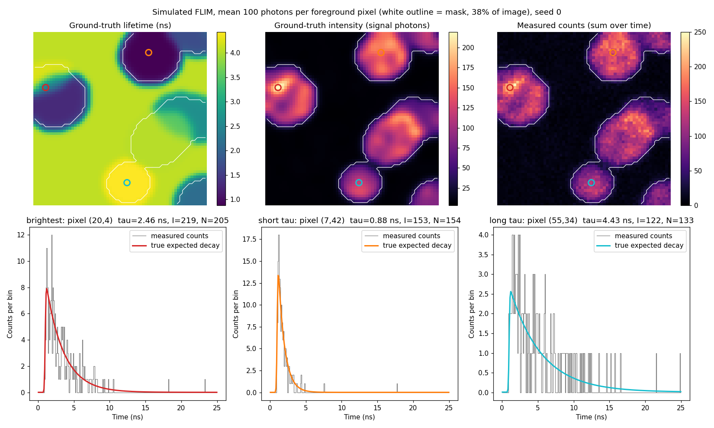

Compared to before: photon levels now describe the brightness of the cells, independent of how much background an image contains.

Problems and fixes: none. The v1 test set was overwritten; results from v1 data are not comparable with later numbers.

Next: implement the MLE and phasor baselines.

### 2026-11-21 – MLE and phasor baselines

Goal: The author needed classical per-pixel baselines and a common evaluation before training any network.

Changes:
- `src/baselines/mle.py` (new): per-pixel Poisson MLE of lifetime and intensity.
- `src/baselines/phasor.py` (new): phasor lifetime with background subtraction and IRF correction.
- `src/evaluation/metrics.py` (new): median absolute relative error, median bias and invalid fraction on foreground pixels.
- `scripts/eval_baselines.py` (new): evaluation on the test set, table and figure.
- `tests/test_baselines.py` (new): recovery, speed and consistency tests.

Settings:
- MLE: the simulator's truncated forward model with known background. τ on a log-spaced grid of 200 values from 0.1 to 8 ns with parabolic refinement; intensity from a few Newton steps on the exact likelihood equation at the fitted τ.
- Phasor: 40 MHz (period equal to the 25 ns window), background subtracted per bin, IRF phasor removed by complex division, phase lifetime τ = s / (g ω).
- Test set: all 40 images per level, foreground pixels only.

Results (median absolute relative error and median bias, `results/tables/baselines.csv`):

| Photons | MLE τ error | MLE τ bias | Phasor τ error | Phasor τ bias | MLE intensity error | Phasor intensity error |
|---|---|---|---|---|---|---|
| 10 | 24.3 % | −3.3 % | 28.8 % | −3.8 % | 22.3 % | 22.4 % |
| 20 | 17.2 % | −1.5 % | 20.6 % | −0.9 % | 15.8 % | 15.9 % |
| 50 | 10.8 % | −0.5 % | 12.7 % | −0.3 % | 9.9 % | 10.0 % |
| 100 | 7.6 % | −0.2 % | 9.2 % | +0.0 % | 7.0 % | 7.1 % |
| 500 | 3.4 % | −0.0 % | 4.0 % | −0.0 % | 3.2 % | 3.2 % |
| 1000 | 2.4 % | +0.0 % | 2.9 % | +0.1 % | 2.3 % | 2.3 % |

The MLE lifetime error was 15 to 20 % lower than the phasor error at every level, and both fell roughly as one over the square root of the photon count. Both intensity estimates were at the per-pixel Poisson limit. The grid MLE agreed with a reference fit by `scipy.optimize.minimize_scalar` within 0.2 % and took about 1.1 s per 64 × 64 image; the phasor took 0.01 s. The sanity check passed: at 1000 photons the MLE lifetime error was 2.4 % with no measurable bias. Figure: `results/figures/error_vs_photons.png`.

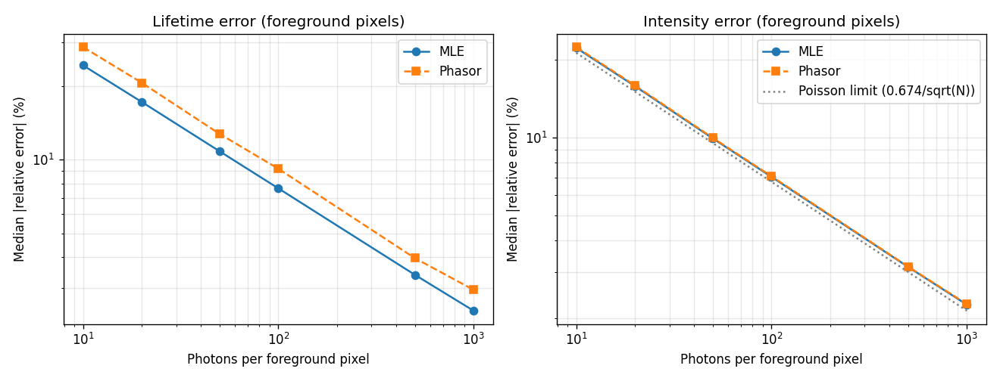

Compared to before: first quantitative reference for later models.

Problems and fixes: At 10 photons, 0.3 % of the foreground pixels contained no photon. The MLE returns NaN there, and these pixels are left out of the error and reported as an invalid fraction. The phasor produced a harmless numerical warning for pixels with zero net signal; the author suppressed it.

Next: train the first conditional diffusion model.

### 2026-11-21 – DiffFLIM v1 with epsilon-prediction (failed)

Goal: The author built and trained the first conditional diffusion model that maps low-photon TCSPC counts to lifetime and intensity maps, following the standard DDPM recipe with noise (epsilon) prediction.

Changes:
- `src/models/diffflim.py` (new): target normalisation, condition encoder, U-Net denoiser, DDPM loss, DDIM sampler, `sample()` and `load_model()`.
- `src/data/stream.py` (new): PyTorch `IterableDataset` that streams freshly simulated samples, with one seed per worker.
- `scripts/train_diffflim.py` (new): time-limited training with bf16, AdamW, EMA, checkpoints and a loss log.
- `scripts/eval_diffflim.py` (new): evaluation script (used in the next entry).
- `tests/test_diffflim.py` (new): normalisation, binning, schedule and overfitting tests.

Settings:
- Targets: log(τ) and log1p(intensity), each mapped to about [−1, 1] with fixed constants.
- Condition: 256 time bins summed to 32, log1p, plus a log1p total-count channel; four 3 × 3 convolutions to 64 feature channels.
- Denoiser: U-Net with base 64 channels, 3 levels (64, 128, 128), 2 residual blocks per level, sinusoidal time embedding; 4.76 M parameters in total.
- Diffusion: 1000 steps, cosine schedule, epsilon-prediction, MSE weighted 1 on foreground and 0.1 elsewhere; DDIM sampling with 50 steps.
- Training: data generated on the fly (64 × 64, photon level log-uniform 10 to 1000), batch 16, AdamW with learning rate 2e-4 and 500 warm-up steps, EMA 0.999, bf16 autocast, 16 data workers, 60 minutes.
- Checkpoint: `checkpoints/diffflim_v1_eps.pt`; log: `logs/diffflim_v1_eps.csv`.

Results: Training ran without errors: 19,599 steps in 60 minutes (5.4 iterations per second) with a peak GPU memory of 1.0 GB, and the loss fell from 0.28 after one minute to 0.0040 at the end. Sampling, however, failed. On a test image at 100 photons the lifetime error was 47.5 % and the intensity error 9,769 %, compared with 7.4 % lifetime error for MLE on the same image.

Compared to before: no improvement over the baselines; the model was not usable.

Problems and fixes: The author first looked at training speed. With 8 data workers the GPU waited for data 71 % of the time (4.5 iterations per second); 16 workers raised the speed to about 5.9 iterations per second, which was kept. The two-minute smoke test had already shown poor sampling errors (36 % lifetime, 420 % intensity), but the author attributed them to the short training and started the full run, so the problem was only found after one hour.

To find the cause, the author noised test targets to a known step and measured how well a single denoising step recovered them. Up to step 800 the error in the recovered clean maps was about 0.03 in normalised units, but at step 990 it was 0.57 for lifetime and 0.84 for intensity. With epsilon-prediction, the clean maps are recovered as (x_t − √(1 − ᾱ)·ε) / √ᾱ, and √ᾱ is about 0.01 at these steps, so small errors in ε become large errors in the maps. The epsilon loss at step 990 was only 0.0002, so the network was never pushed to predict the maps from the counts at high noise. Starting DDIM at a lower step (950 to 600) did not help (errors of about 0.33), which showed that the network relied on the signal already present in the noisy input rather than on the counts. The fix was to switch to v-prediction (next entry).

Next: retrain with v-prediction.

### 2026-11-21 – DiffFLIM v1 with v-prediction

Goal: The author replaced epsilon-prediction with v-prediction, v = √ᾱ·ε − √(1 − ᾱ)·x0 (Salimans and Ho, 2022). At high noise v is close to −x0, so the loss directly penalises wrong maps and forces the network to use the photon counts.

Changes:
- `src/models/diffflim.py` (changed): option `prediction` ("v" by default, "eps" kept); checkpoints without this setting load as epsilon models.
- `scripts/train_diffflim.py` (changed): `--prediction` argument.

Settings: as in the previous entry, but with v-prediction; 60 minutes of training; checkpoint `checkpoints/diffflim_v1.pt`, log `logs/diffflim_v1.csv`. Evaluation: first 8 test images per level, 10 DDIM samples (50 steps) per image; the mean of the samples is the prediction and their standard deviation the uncertainty.

Results: A five-minute check run already gave 1.9 % lifetime error on the test image at 100 photons. The full run reached 17,963 steps in 60 minutes (5.0 iterations per second), and the loss fell from 0.23 after one minute to 0.0083 after ten minutes and 0.0045 at the end, still decreasing slowly. Errors on foreground pixels where MLE is valid (`results/tables/diffflim_v1.csv`; on all foreground pixels the values were the same within 0.01 %):

| Photons | DiffFLIM τ error | MLE τ error | Phasor τ error | DiffFLIM intensity error | MLE intensity error | DiffFLIM τ / intensity bias |
|---|---|---|---|---|---|---|
| 10 | 2.6 % | 24.9 % | 29.4 % | 5.8 % | 22.4 % | +1.0 % / +0.7 % |
| 20 | 2.0 % | 17.3 % | 21.4 % | 4.4 % | 15.6 % | −0.5 % / +0.5 % |
| 50 | 1.4 % | 11.0 % | 12.8 % | 3.4 % | 10.1 % | −0.2 % / −0.8 % |
| 100 | 1.1 % | 7.7 % | 9.0 % | 2.6 % | 7.0 % | +0.4 % / −1.0 % |
| 500 | 0.7 % | 3.3 % | 4.0 % | 1.7 % | 3.2 % | +0.3 % / −1.0 % |
| 1000 | 0.7 % | 2.5 % | 3.2 % | 1.9 % | 2.3 % | +0.2 % / −1.6 % |

Coverage of mean ± 1.645·std (nominal 90 %) on foreground pixels (`results/tables/coverage_v1.csv`) was 0.87 for lifetime and 0.81 for intensity at 10 photons, rising to 0.98 for both at 1000 photons. The median relative standard deviation of τ changed only from 3.9 % to 2.0 % over this range, so the intervals were too narrow at low and too wide at high photon counts. Figures: `results/figures/error_vs_photons_v1.png` and `results/figures/diffflim_v1_examples.png`.

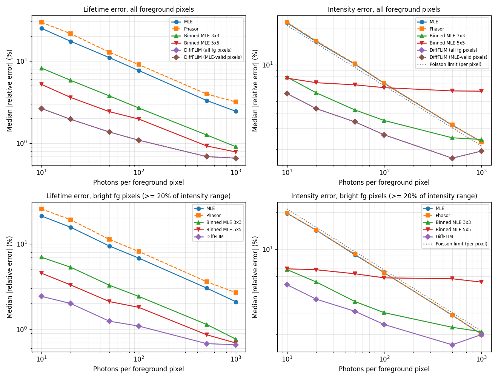

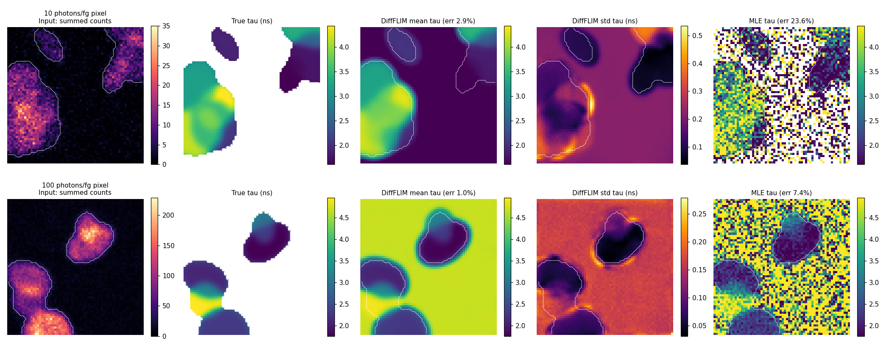

In the examples, the MLE map at 10 photons is dominated by noise, while the DiffFLIM mean reproduces the cell structure; the predicted standard deviation is highest at cell borders.

Compared to before: the lifetime error was 4 to 10 times lower than that of MLE at every photon level, and the intensity error was below the per-pixel Poisson limit.

Problems and fixes: These numbers are optimistic. The simulated lifetime maps are almost constant inside each cell, so a spatial model can average over many pixels, which is also the reason why the intensity error falls below the per-pixel Poisson limit. Real samples have more texture and the gap to MLE will shrink. The intensity bias of −1.6 % and the slight increase of the intensity error from 500 to 1000 photons suggest that the bright end is undertrained. The uncertainty was not calibrated across photon levels (next entry).

Next: calibrate the predicted uncertainty.

### 2026-11-21 – Split-conformal calibration of DiffFLIM v1

Goal: The v1 intervals mean ± 1.645·std covered only 81 to 87 % of the true values at 10 to 20 photons but 97 to 99 % at 500 to 1000 photons, because the predicted standard deviation hardly changes with the photon level. The author calibrated the intervals with split conformal prediction, in a way that can be reused unchanged for later simulator versions and models.

Changes:
- `src/evaluation/calibration.py` (new): conformal scores, finite-sample quantile, global and per-level factors, photon-level estimate from the counts, coverage and interval width.
- `scripts/calibrate_diffflim.py` (new): calibration set, cached predictions, fitting, evaluation, tables and figures.
- `tests/test_calibration.py` (new): tests on synthetic data and of the photon-level estimate.
- `docs/PROJECT_LOG.md` (new): first log entry, rewritten in the present form on the same day.

Settings:
- Calibration set: 6 levels × 20 images in `data/raw/own/sim_calib/`, seeds 54321 + level (the test set uses 12345 + level).
- Predictions: 10 samples per image, cached in `data/processed/preds_v1_calib.npz` and `preds_v1_test.npz`; all 40 test images per level.
- Score per foreground pixel: |true − mean| / std. Factor q: the ceil((n + 1)(1 − α))-th smallest score, for α = 0.10 (90 %) and α = 0.32 (68 %).
- Variant (a): one global factor per quantity. Variant (b): one factor per photon level, interpolated linearly in log(photons) at the photon level estimated from the summed counts (Otsu threshold on smoothed log counts, mean count inside the foreground).

Results: The global 90 % factor was 1.32 for lifetime (smaller than the Gaussian 1.645, so the v1 lifetime intervals were too wide overall) and 1.66 for intensity. The per-level 90 % factors fell from 1.44 at 10 photons to 1.04 at 1000 photons for lifetime and from 2.06 to 1.15 for intensity (`results/tables/calibration_factors_v1.csv`). Coverage on the test set at 90 % nominal (uncalibrated / global / per level, `results/tables/coverage_calibrated_v1.csv`):

| Photons | Lifetime | Intensity |
|---|---|---|
| 10 | 0.86 / 0.77 / 0.81 | 0.82 / 0.82 / 0.90 |
| 20 | 0.90 / 0.83 / 0.84 | 0.83 / 0.84 / 0.90 |
| 50 | 0.94 / 0.89 / 0.92 | 0.87 / 0.87 / 0.90 |
| 100 | 0.95 / 0.90 / 0.89 | 0.90 / 0.90 / 0.90 |
| 500 | 0.98 / 0.95 / 0.95 | 0.95 / 0.95 / 0.87 |
| 1000 | 0.98 / 0.95 / 0.91 | 0.95 / 0.95 / 0.85 |

With all photon levels pooled, both calibrated variants lay on the diagonal of promised against observed coverage from 10 to 95 % (`results/figures/calibration_v1.png`). The per-level variant brought the intensity coverage to 0.90 at 10 to 100 photons, with intervals about 25 % wider at 10 photons, and made the lifetime intervals 36 % narrower at 1000 photons at a coverage of 0.91. The photon-level estimate was on average 8 % below the true level (range 0.78 to 1.03 of the true level); this bias cancels because the calibration levels are placed at their estimated values as well.

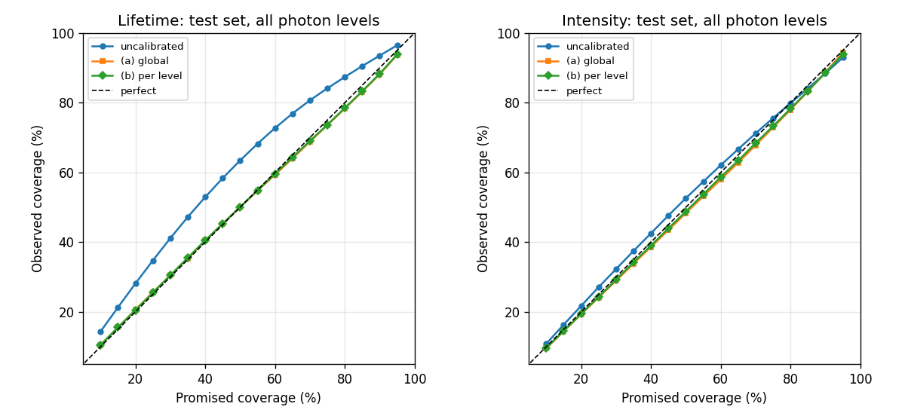

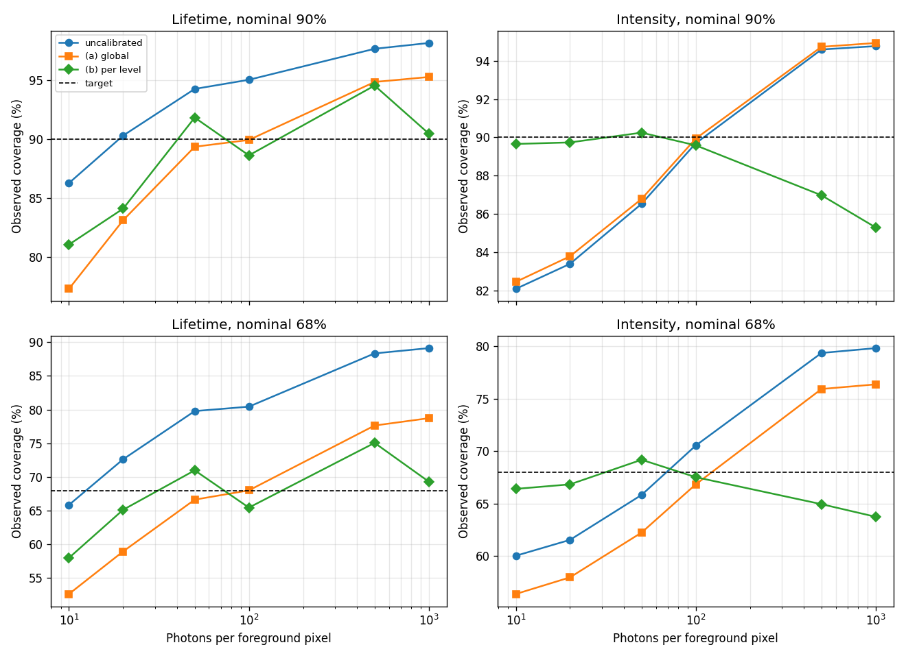

Compared to before: pooled coverage became correct at every nominal level. A single global factor did not fix the trend with photon level and made the lifetime coverage at 10 photons worse (0.77).

Problems and fixes: Per level, the calibrated coverage still scattered by 5 to 9 percentage points around the target. Pixels within one image are strongly correlated (same cells, same noise realisation), so the conformal guarantee holds for a random pixel on average over images, not per image and not tightly per level. The factor needed by a single test image varied widely (for lifetime at 10 photons, from 1.07 to 2.38 between the 10th and 90th percentile of images), so 20 calibration images per level give noisy factors: a bootstrap over calibration images gave a 90 % range of 1.26 to 1.63 for the lifetime factor at 10 photons, while the test set needed 1.83. The effective sample size is closer to the number of images than to the number of pixels. The author recorded this limitation and did not try to fix it in this step.

Next: use about 100 calibration images per level or fit a smooth factor curve over the photon level, and report coverage with image-level bootstrap intervals.

### 2026-11-21 – HPA image subset from Kaggle

Goal: For a more realistic simulator (v3), the author needed real cell and organelle structures instead of blurred ellipses. The Human Protein Atlas images of the Kaggle competition "Human Protein Atlas Image Classification" were chosen because FLIMngo also builds its simulated data on HPA images.

Changes:
- `scripts/download_hpa_subset.py` (new): downloads a random subset of HPA training samples, file by file, with the Kaggle command-line tool.

Settings:
- Source: competition `human-protein-atlas-image-classification`; the list of sample IDs is read from `train.csv`.
- Each sample has four 512 × 512 PNG channels (red, green, blue, yellow).
- Random subset with seed 0; the chosen IDs are written to `data/raw/hpa/subset_ids.txt` (1000 IDs in the current file).
- Output: `data/raw/hpa/train/`, which is git-ignored.

Results: At the time of writing, 192 complete samples (768 PNG files, 86 MB) were present in `data/raw/hpa/train/`.

Compared to before: the project had no real image data.

Problems and fixes: Kaggle limits the request rate when many single files are downloaded. The script waits 1.5 s after each file and, after an HTTP 429 response, waits 60 s and doubles the waiting time up to 900 s, with at most six attempts per file. The download had not finished when this entry was written. The images are licensed for academic use only; they must not be committed, shared or copied outside `data/raw/hpa/`.

Next: finish the download and use the HPA channels as structure maps for simulator v3.

### 2026-11-21 – Project log and PDF export

Goal: The author set up a project log with fixed rules, so that every later change to code, data, models or results is documented in the same style and is available as a PDF for the supervisor, the talk and the paper.

Changes:
- `CLAUDE.md` (new, git-ignored): standing rules for the project log, writing style and data handling.
- `.gitignore` (changed): `CLAUDE.md` added.
- `docs/PROJECT_LOG.md` (rewritten): "Current status", "Decisions" and one entry per task, reconstructed from the existing files, the git history and `STATUS_REPORT.md`.
- `scripts/export_log.py` (new): converts the log into `docs/PROJECT_LOG.pdf`.
- `requirements.txt` (changed): `markdown` and `xhtml2pdf` added.

Settings: A4 pages with a title page, page numbers, tables and the figures referenced in the log; Arial from the Windows font folder for Greek letters and mathematical symbols, with Helvetica as a fallback.

Results: `docs/PROJECT_LOG.pdf`.

Compared to before: the earlier log contained only the calibration entry, written in a different style.

Problems and fixes: The early entries were reconstructed after the fact. The git history contains a single commit (d3b0c1d, 2026-11-21), so the order of the entries follows the file contents and `STATUS_REPORT.md`, and all entries carry the same date. The preview figure of simulator v1 at 100 photons was overwritten by the v2 version; the v1 entry therefore shows the 1000-photon preview.

Next: simulator v3 with HPA structures.

### 2026-11-21 – Simulator v3 (FLIMngo method, real photon counts) and baselines on v3

Goal: The blob simulator (v2) makes the task too easy: lifetimes are almost constant inside each cell, there is one exponential per pixel and one Gaussian IRF. The author built simulator v3 that follows the FLIMngo simulation (README, `utils_simulation.py` and the three notebooks in `external/FLIMngo/data_simulation/`, read but not modified) as closely as reasonable, while keeping real photon counts and exact ground truth. The classical baselines and the existing DiffFLIM v1 model were then evaluated on a fixed v3 test set.

Changes:
- `src/data/simulate_v3.py` (new): HPA crops, FLIMngo lifetimes and amplitudes, IRF library with laser jitter, multi-exponential decays, fixed HPA train/test split, `training_samples()`, `make_test_set()`.
- `data/splits/hpa_test.txt` (new, fixed): 30 HPA test sample IDs; `data/splits/hpa_train.txt` (new, reference copy of the current training IDs).
- `tests/test_simulate_v3.py` (new): 8 tests.
- `scripts/simulate_v3_preview.py` (new): preview figure.
- `src/baselines/binned.py` (new): binned MLE (k × k summed histograms).
- `src/baselines/common.py` (new): runs all baselines with the forward model that matches the data set.
- `src/baselines/mle.py` (changed): optional `decay_fn` for other forward models; default behaviour unchanged.
- `src/baselines/phasor.py` (changed): optional exact inversion for point-sampled decays.
- `src/evaluation/metrics.py` (changed): `bright_mask` and `local_jitter` / `jitter_summary`.
- `scripts/eval_baselines.py` (changed): `--test-set`, `--tag`, binned MLE, parallel workers, fg and bright pixel sets, ground-truth jitter.
- `scripts/eval_diffflim.py` (changed): `--test-set`, binned MLE, bright pixel set and coverage, ground-truth jitter.
- `tests/test_baselines.py` (changed): recovery test on the v3 forward model.
- `requirements.txt` (changed): `sdtfile` added; `h5py` and `sdtfile` installed after the user allowed it.

Settings:
- HPA split: complete samples only (all four channel PNGs present and decodable); 30 test IDs drawn once with seed 2026 and never rewritten; training IDs = all other complete samples, computed at run time (currently 162). New downloads therefore go to training only.
- Crop: 64 × 64 at a random position of a 512 × 512 sample, random 90° rotation and flip; crops with less than 5 % foreground are redrawn (FLIMngo threshold).
- Foreground mask: four-channel sum above zero (FLIMngo rule).
- Lifetimes: per channel a base value U(0.1, 10) ns and a spread U(0.2, 2) ns; every pixel gets base + U(0, 1) × spread, independently; a channel contributes only where its own value is above zero.
- Amplitudes: Perlin noise p (3 to 5 octaves, persistence 0.3 to 0.9); the k-th contributing channel gets p(1 − p)^k, the last one the remainder (FLIMngo `calculate_ratio`).
- Ground truth: amplitude-weighted mean lifetime Σ a_i τ_i, as in FLIMngo notebook 3; the intensity-weighted mean Σ a_i τ_i² / Σ a_i τ_i is stored as well.
- Decay: Σ a_i exp(−t/τ_i) at t_k = k × 0.0977 ns, discretely convolved with the IRF and truncated to 256 bins (FLIMngo); computed with an exact first-order recursion instead of exponentials and an FFT.
- Intensity: four-channel sum, min-max normalised and mapped to [min, min + delta] photons with min ~ U(10, 60) and delta ~ U(10, 40) (FLIMngo "low" setting), then scaled so that the foreground mean equals the photon level; background 2 % of the photon level, as in v2.
- IRFs: all 12 FLIMngo IRFs (6 simulated skew-normal, in-house PMT, DLT, DL4FLI, FPFLI, in-house APD, flimfit), each normalised to sum 1, with FLIMngo laser jitter (earlier by 1 to 8 bins or later by 0 to 24 bins; APD and flimfit 1 to 35 and 0 to 2 bins). IRF_DLT was resampled physically from 5 ps channels; the others have 256 points and are used bin for bin, as in FLIMngo.
- Test set: `data/raw/own/sim_v3_test/`, 6 levels × 40 images, seeds 31000 + level, test IDs only, 49 MB.
- Baselines on v3: mono-exponential MLE with the image's IRF and τ bounds 0.05 to 15 ns; binned MLE with 3 × 3 and 5 × 5 neighbourhoods (reflected borders); phasor with the image's IRF and the exact point-sampled inversion. All 40 images per level.
- Pixel sets: all foreground pixels, and "bright" foreground pixels with at least 20 % of the crop's intensity range above its dimmest foreground pixel (48 to 58 % of the foreground on v3).
- DiffFLIM v1 (`checkpoints/diffflim_v1.pt`, trained on v2 data only) on the v3 test set without retraining: 8 images per level, 10 samples, 50 DDIM steps (tag `v1_on_v3`).

Results: The simulator produced 20.6 samples per second in one process (49 ms per 64 × 64 sample, against 58 ms for v2). All 8 v3 tests passed: total counts matched intensity plus background (largest deviation 3.3 standard errors), the mean arrival time of single-component decays matched the expected value within 0.3 % (it is dt / (exp(dt/τ) − 1), about 0.05 ns below τ because FLIMngo samples the exponential at the start of each bin), the 12 IRFs and all jittered IRFs summed to one, a fixed seed reproduced the data, and the training and test IDs did not overlap. The preview is in `results/figures/simulate_v3_preview.png`; it shows 64 × 64 crops of HPA images (academic use only).

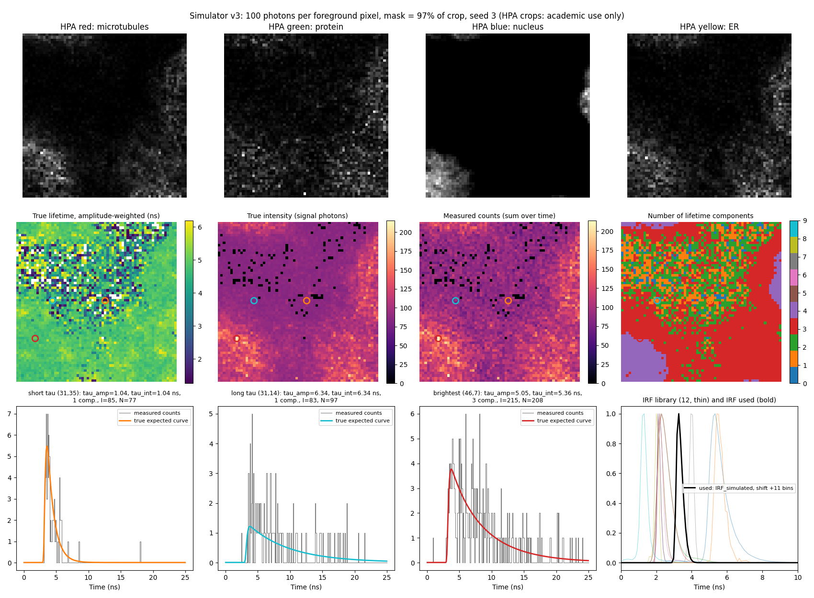

The ground-truth lifetime of a foreground pixel differed from the median of its 3 × 3 neighbourhood by 0.19 to 0.24 ns in the median (3.7 to 4.9 %; bright pixels 3.0 to 4.2 %). An estimator that averages over neighbouring pixels cannot recover this part of the map.

Lifetime error of the baselines on the v3 test set (`results/tables/baselines_v3.csv`, all foreground / bright pixels):

| Photons | MLE | Phasor | Binned MLE 3 × 3 | Binned MLE 5 × 5 | MLE bias (fg) |
|---|---|---|---|---|---|
| 10 | 31.0 / 30.2 % | 46.4 / 44.9 % | 15.2 / 14.4 % | 12.4 / 11.7 % | +5.9 % |
| 20 | 24.5 / 24.8 % | 35.8 / 34.0 % | 16.1 / 15.6 % | 14.7 / 14.2 % | +11.0 % |
| 50 | 15.3 / 15.1 % | 23.9 / 22.5 % | 10.1 / 9.1 % | 9.1 / 8.0 % | +6.1 % |
| 100 | 11.6 / 11.6 % | 17.7 / 17.7 % | 9.1 / 8.1 % | 8.8 / 7.6 % | +6.1 % |
| 500 | 8.5 / 9.6 % | 8.8 / 9.3 % | 10.9 / 9.2 % | 11.6 / 9.3 % | +7.5 % |
| 1000 | 5.7 / 7.2 % | 7.1 / 7.8 % | 8.7 / 7.9 % | 9.3 / 7.9 % | +4.9 % |

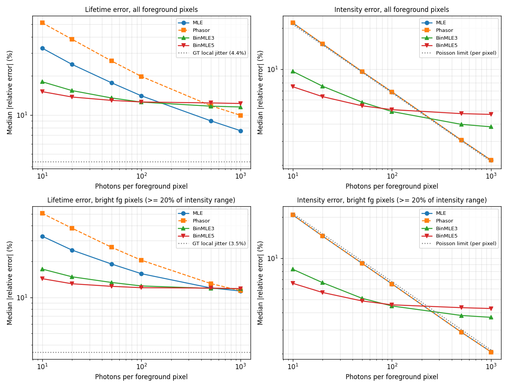

The intensity error of MLE and phasor was at the per-pixel Poisson limit (21.8 % at 10 photons, 2.2 % at 1000). The binned MLE reduced it to 6.4 % at 10 photons (5 × 5) but was worse than the per-pixel fit above about 200 photons (4.3 % at 1000 photons), because binning blurs the intensity structure.

DiffFLIM v1 on the v3 test set (`results/tables/diffflim_v1_on_v3.csv`, MLE-valid foreground pixels, 8 images per level; the baselines were run on the same images):

| Photons | DiffFLIM v1 τ error | τ bias | Intensity error | MLE τ error | Binned MLE 5 × 5 τ error | Coverage of 90 % interval (τ / intensity) |
|---|---|---|---|---|---|---|
| 10 | 39.7 % | +37.8 % | 14.6 % | 30.1 % | 12.5 % | 0.22 / 0.90 |
| 20 | 22.8 % | +14.1 % | 18.2 % | 26.5 % | 17.5 % | 0.24 / 0.60 |
| 50 | 21.9 % | +7.0 % | 50.7 % | 15.0 % | 9.7 % | 0.40 / 0.37 |
| 100 | 16.0 % | +8.3 % | 31.2 % | 12.3 % | 9.3 % | 0.41 / 0.28 |
| 500 | 44.4 % | +40.5 % | 51.8 % | 7.8 % | 9.0 % | 0.32 / 0.21 |
| 1000 | 38.7 % | +33.0 % | 94.2 % | 4.9 % | 9.0 % | 0.47 / 0.19 |

All DiffFLIM intensity biases were negative (−11 % at 10 photons to −94 % at 1000). Figures: `results/figures/error_vs_photons_v1_on_v3.png` and `results/figures/diffflim_v1_on_v3_examples.png`.

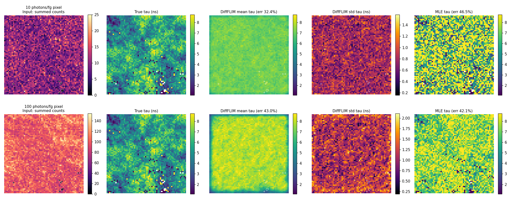

On the v2 test set, the binned MLE added to the v1 comparison (`results/tables/diffflim_v1.csv`, same 8 images per level as before, MLE-valid / bright pixels) gave the following lifetime errors:

| Photons | DiffFLIM v1 | MLE | Binned MLE 3 × 3 | Binned MLE 5 × 5 |
|---|---|---|---|---|
| 10 | 2.6 / 2.4 % | 24.9 / 21.2 % | 8.2 / 7.0 % | 5.2 / 4.5 % |
| 20 | 2.0 / 2.0 % | 17.3 / 15.6 % | 5.8 / 5.3 % | 3.6 / 3.3 % |
| 50 | 1.4 / 1.2 % | 11.0 / 9.4 % | 3.8 / 3.3 % | 2.4 / 2.1 % |
| 100 | 1.1 / 1.1 % | 7.7 / 6.8 % | 2.7 / 2.4 % | 2.0 / 1.8 % |
| 500 | 0.7 / 0.7 % | 3.3 / 3.0 % | 1.3 / 1.1 % | 0.9 / 0.9 % |
| 1000 | 0.7 / 0.7 % | 2.4 / 2.1 % | 0.9 / 0.8 % | 0.8 / 0.7 % |

The DiffFLIM v1 numbers were the same as in the earlier evaluation. The 5 × 5 binned MLE had an intensity error of 6.1 to 7.8 % with a bias of −3.3 to −4.4 % at all levels, compared with 1.9 to 5.8 % for DiffFLIM v1.

Compared to before: On v2 data, most of the advantage of DiffFLIM v1 over the per-pixel MLE came from using neighbouring pixels: a 5 × 5 binned MLE was only about twice as inaccurate at 10 photons and equal at 500 to 1000 photons. On v3 data all methods were much less accurate than on v2. The binned MLE was the best lifetime estimator up to 100 photons and the per-pixel MLE above that. DiffFLIM v1, trained only on v2, did not transfer: its lifetime error was higher than that of MLE at most levels, its intensity was strongly underestimated, and its 90 % intervals covered only 19 to 47 % of the true values. At 100 photons it produced an almost flat lifetime map.

Problems and fixes: Two FLIMngo IRFs (in-house PMT in `.sdt` format, FPFLI as a MATLAB v7.3 file) could not be read at first because `sdtfile` and `h5py` were not installed. The author first planned to leave them out; after the user allowed installing these packages, all 12 IRFs were used. No test set had been generated before this change.

The first version computed the decays with exponentials and an FFT convolution (92 ms per sample, 11 samples per second). Because a point-sampled exponential is a geometric sequence, its convolution with the IRF obeys y[n] = r·y[n − 1] + irf[n] with r = exp(−dt/τ); this recursion gave identical curves (difference 5e-17) at 49 ms per sample.

The plain phasor formula gave 0.754 ns for a true lifetime of 0.8 ns on v3 data, because the phasor of a point-sampled exponential corresponds to about τ − dt/2. The author added the exact inversion for geometric sequences, which brought short lifetimes within 0.6 %. A bias of +4 % remains at 6 ns, because v3 decays are cut off at the end of the window while the phasor assumes a periodic signal; it grows with τ and was kept.

The mono-exponential MLE was biased by +5 to +11 % on v3 data. Part of this is the model mismatch: on multi-component pixels a mono-exponential fit follows the intensity-weighted rather than the amplitude-weighted mean lifetime (the MLE error against the intensity-weighted lifetime was 4.8 % at 1000 photons instead of 5.7 %). This was reported and not fixed.

The bright pixel set was first specified as at least 20 % of the crop's maximum intensity. On v3 this selected 100 % of the foreground, because the FLIMngo intensity mapping gives every foreground pixel at least 28 % of the maximum. With the user's agreement the definition was changed to 20 % of the intensity range above the dimmest foreground pixel.

The error curves of the binned MLE rise again at 20 and 500 photons. Every photon level of the test set uses different random crops of the 30 test samples, so the content (for example the share of long lifetimes) differs between levels; the curves therefore are not strictly monotonic.

Simulated test data and figures derived from HPA images inherit the academic-use restriction. `data/raw/` is git-ignored (checked with `git check-ignore`); the decoded HPA images are cached in memory only.

Next: train DiffFLIM on v3 data from training IDs only, run the pretrained FLIMngo model as a baseline on the v3 test set, and build a v3 calibration set from training IDs.

### 2026-11-22 – DiffFLIM v2: 6-hour training on simulator v3, evaluation and calibration

Goal: Train the DiffFLIM model on simulator v3 data in a long run, evaluate it against all baselines on a corrected (paired) v3 test set, and calibrate its uncertainty with a v3 calibration set built from separate HPA cells.

Changes:

- `src/data/simulate_v3.py`: `calib_ids()` (20 fixed calibration IDs, seed 2027, drawn once from the complete samples outside the test IDs and never rewritten), `train_ids()` now excludes test and calibration IDs, `make_scene` / `render_scene` split, `generate_paired_dataset`, `make_test_set` (paired, 40 images per level) and `make_calib_set` (paired, 100 images per level); `training_samples` raises an error if it is given a test or calibration ID.
- `data/splits/hpa_calib.txt` (new, 20 IDs), `data/raw/own/sim_v3_test/` (regenerated), `data/raw/own/sim_v3_calib/` (new, 600 images, about 160 MB).
- `src/data/stream.py`: v3 option; the lifetime outside the mask is set to the geometric centre of the lifetime range.
- `src/models/diffflim.py`: lifetime normalisation range as a model setting (`tau_range`), stored in the checkpoint.
- `scripts/train_diffflim.py`: `--simulator v3`, `--tau-range`, `--snapshot-at`, `--ckpt-every`, `--workers`; logs the fraction of time spent waiting for data.
- `scripts/calibrate_diffflim.py`: `--calib-dir`, `--smooth` (quadratic curve in log photons for the per-level factors) and image-level bootstrap confidence intervals.
- `tests/test_simulate_v3.py`: tests for disjoint and fixed splits including calibration IDs, and for paired photon levels.
- Results: `checkpoints/diffflim_v2.pt`, `checkpoints/diffflim_v2_180min.pt`, `logs/diffflim_v2.csv`, `results/tables/{baselines_v3, diffflim_v1_on_v3, diffflim_v2, diffflim_v2_3h, coverage_v2, coverage_v2_3h, calibration_factors_v2, coverage_calibrated_v2}.csv`, `results/figures/{loss_v2, error_vs_photons_baselines_v3, error_vs_photons_v2, diffflim_v2_examples, calibration_v2, calibration_v2_vs_photons}.png`.

Settings:

- Model: as DiffFLIM v1 (U-Net base 64, 4.76 M parameters, cosine schedule with 1000 steps, v-prediction, background weight 0.1), lifetime normalisation range 0.1 to 12 ns (v1: 0.5 to 5 ns), lifetime outside the mask set to √(0.1 · 12) = 1.1 ns.
- Training: AdamW, learning rate 2e-4 with 500 warm-up steps, EMA 0.999, batch 16, bf16, photon levels drawn from 10 to 1000, 16 data workers, 360 minutes, checkpoint every 30 minutes, snapshot after 180 minutes.
- Training data: v3 `training_samples()` from the 246 training IDs that were complete when the run started.
- Test set: 30 test IDs, 40 images per level, levels 10, 20, 50, 100, 500, 1000; scene seed shared by all levels, noise seed per level.
- Calibration set: 20 calibration IDs, 100 images per level at the same six levels, paired in the same way.
- Evaluation: 10 samples per image, 50 DDIM steps, all 40 images per level; calibration with 10 samples per image on all 600 calibration images.

Results: The data were regenerated first. The new test set uses the same 40 scenes (crops, lifetimes, IRFs, IRF shifts) at every photon level; IDs are assigned round-robin, so all 30 test IDs appear. The median foreground fraction is 0.67 on the test set and 0.70 on the calibration set. The median per-pixel lifetime jitter of the ground truth is now the same at every level: 4.39 % of τ on all foreground pixels and 3.49 to 3.50 % on bright pixels (bright = 45 % of the foreground).

A 2-minute smoke test ran at 8.1 to 9.4 iterations per second with 14 to 25 % data wait, so no extra caching was needed. The 6-hour run made 186 116 steps (8.6 it/s, peak GPU memory 1.04 GB). The GPU waited for data 17 % of the time on average and never more than 33 % in any logged interval after the first minute, below the 50 % limit. The running median of the loss fell from 0.051 after 5 minutes to 0.023 after 60 minutes, 0.020 after 180 minutes and 0.020 after 360 minutes; most of the decrease happened in the first hour.

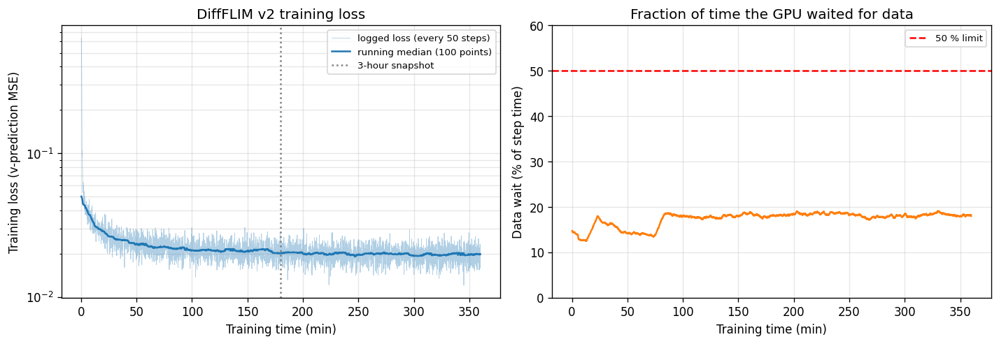

Lifetime error on the v3 test set (median absolute relative error, all foreground / bright pixels; for the baselines all foreground means MLE-valid foreground, which was every foreground pixel at every level):

| Photons | MLE | Phasor | Binned MLE 3 × 3 | Binned MLE 5 × 5 | DiffFLIM v2 (3 h) | DiffFLIM v2 (6 h) |
|---|---|---|---|---|---|---|
| 10 | 32.8 / 32.6 % | 51.4 / 50.7 % | 18.1 / 17.3 % | 15.2 / 14.4 % | 10.1 / 9.1 % | 9.8 / 8.7 % |
| 20 | 24.6 / 24.9 % | 38.4 / 38.0 % | 15.4 / 14.9 % | 13.8 / 13.0 % | 8.9 / 8.0 % | 8.6 / 7.6 % |
| 50 | 17.7 / 19.1 % | 26.1 / 26.4 % | 13.6 / 13.4 % | 13.0 / 12.4 % | 8.0 / 7.3 % | 7.6 / 6.9 % |
| 100 | 14.1 / 15.8 % | 19.8 / 20.5 % | 12.6 / 12.5 % | 12.6 / 12.1 % | 6.9 / 6.4 % | 6.6 / 6.0 % |
| 500 | 9.0 / 12.0 % | 11.8 / 13.1 % | 11.7 / 11.9 % | 12.4 / 12.0 % | 5.1 / 4.9 % | 4.8 / 4.6 % |
| 1000 | 7.6 / 11.3 % | 10.0 / 11.4 % | 11.5 / 11.8 % | 12.3 / 11.9 % | 4.7 / 4.8 % | 4.3 / 4.4 % |

The lifetime bias of DiffFLIM v2 was +1.0 to +3.1 % on all foreground pixels and +1.7 to +3.8 % on bright pixels, compared with +7 to +11 % for MLE and +8 to +11 % for the binned MLE. Measured against the intensity-weighted lifetime, which a mono-exponential fit follows more closely, the best baseline errors were 11.0 % at 10 photons (binned MLE 5 × 5) and 5.1 % at 1000 photons (MLE), still above DiffFLIM v2 (9.8 % and 4.3 % against its own amplitude-weighted target).

Intensity error (all foreground / bright pixels):

| Photons | MLE | Binned MLE 3 × 3 | Binned MLE 5 × 5 | DiffFLIM v2 (6 h) |
|---|---|---|---|---|
| 10 | 21.9 / 20.8 % | 9.7 / 8.3 % | 7.5 / 6.6 % | 4.5 / 5.0 % |
| 20 | 15.3 / 14.5 % | 7.5 / 6.6 % | 6.3 / 5.6 % | 3.6 / 5.0 % |
| 50 | 9.6 / 9.2 % | 5.8 / 5.1 % | 5.4 / 4.9 % | 3.2 / 4.3 % |
| 100 | 6.9 / 6.5 % | 4.9 / 4.5 % | 5.1 / 4.6 % | 2.9 / 3.9 % |
| 500 | 3.1 / 2.9 % | 4.0 / 3.8 % | 4.8 / 4.4 % | 2.1 / 2.5 % |
| 1000 | 2.2 / 2.1 % | 3.8 / 3.7 % | 4.7 / 4.3 % | 2.1 / 2.6 % |

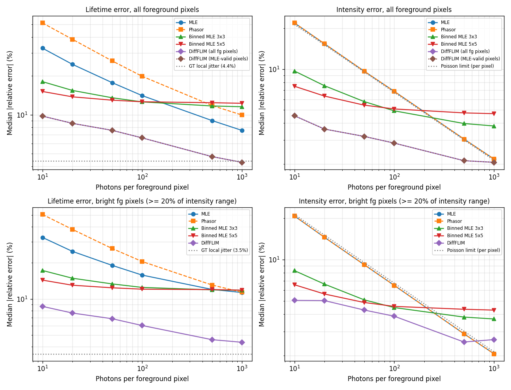

The 6-hour model was better than the 3-hour snapshot at every level, by 0.3 to 0.4 percentage points in lifetime error (for example 10.1 % to 9.8 % at 10 photons and 4.7 % to 4.3 % at 1000 photons) and by 0.1 to 0.2 points in intensity error. The gain was larger at high photon levels in relative terms (8 % fewer errors at 1000 photons, 4 % at 10 photons), although the training loss had hardly changed between 3 and 6 hours.

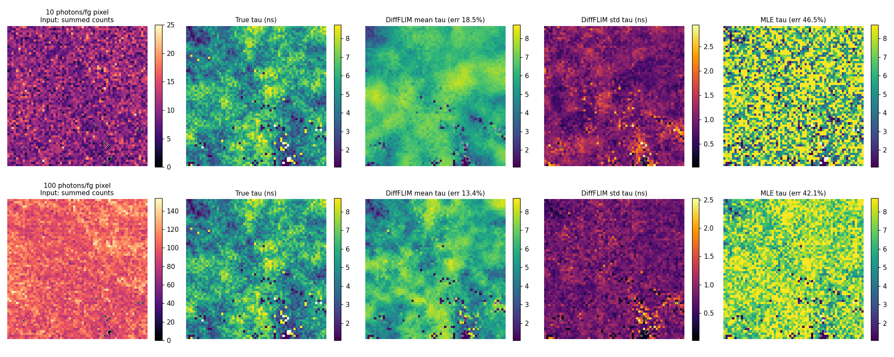

In the examples, the DiffFLIM mean map follows the large-scale lifetime pattern of the ground truth but is smooth, while the ground truth has per-pixel jitter; the standard deviation is highest at the edges of structures and in the dim parts of the crop.

Coverage of the DiffFLIM v2 intervals on the test set, nominal 90 % (95 % image-bootstrap confidence interval; relative interval width in the last column for uncalibrated / global / per level):

| Photons | Quantity | Uncalibrated | Global factor | Per-level factor | Relative width |
|---|---|---|---|---|---|
| 10 | τ | 74.9 [70.1, 78.6] % | 87.0 [83.2, 89.7] % | 88.6 [85.2, 91.1] % | 0.47 / 0.67 / 0.70 |
| 100 | τ | 78.3 [76.5, 80.2] % | 90.0 [88.9, 91.1] % | 90.2 [89.2, 91.4] % | 0.30 / 0.42 / 0.42 |
| 1000 | τ | 80.6 [76.9, 84.4] % | 91.8 [90.1, 93.9] % | 89.4 [86.8, 92.0] % | 0.19 / 0.27 / 0.25 |
| all | τ | 78.1 [77.1, 79.1] % | 89.8 [89.0, 90.6] % | 89.8 [89.0, 90.6] % | 0.32 / 0.45 / 0.46 |
| 10 | intensity | 77.7 [74.1, 81.2] % | 84.0 [80.9, 87.0] % | 88.1 [85.3, 90.6] % | 0.19 / 0.22 / 0.25 |
| 100 | intensity | 81.5 [78.3, 84.5] % | 86.8 [84.5, 89.2] % | 87.5 [85.0, 89.8] % | 0.14 / 0.16 / 0.17 |
| 1000 | intensity | 90.1 [86.9, 93.2] % | 93.7 [91.4, 95.6] % | 86.9 [83.4, 90.2] % | 0.13 / 0.15 / 0.11 |
| all | intensity | 82.6 [81.3, 84.0] % | 87.7 [86.6, 88.8] % | 87.6 [86.5, 88.7] % | 0.15 / 0.17 / 0.18 |

At the nominal 68 % level, the lifetime coverage over all levels was 55.8 % uncalibrated, 68.2 % with the global factor and 68.2 % with per-level factors; the intensity coverage was 63.5 %, 65.1 % and 65.1 %. The global factors were 2.31 (τ) and 1.95 (intensity) at 90 %, compared with the Gaussian value 1.645. The per-level lifetime factor fell from 2.45 at 10 photons to 2.09 at 1000 photons; the intensity factor fell from 2.23 to 1.47, so at high photon levels the intensity spread was larger than needed on the calibration set.

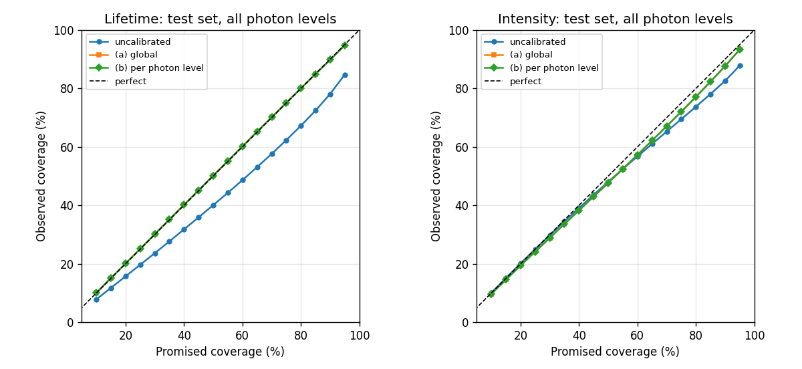

Correction to the entry "Simulator v3 (FLIMngo method, real photon counts) and baselines on v3": the baseline table and the DiffFLIM v1 on v3 table in that entry were computed on the first v3 test set, in which every photon level used different random crops and only 19 of the 30 test IDs appeared. Both evaluations were rerun on the paired test set and the files `results/tables/baselines_v3.csv` and `results/tables/diffflim_v1_on_v3.csv` were overwritten. The new lifetime errors of the baselines are those in the table above; they are higher than before at most levels (for example binned MLE 5 × 5 at 100 photons 12.6 % instead of 8.8 %, MLE at 1000 photons 7.6 % instead of 5.7 %), because the scene content differs. The error curves of the binned MLE are now monotonic. DiffFLIM v1 (trained on v2) on the paired test set (8 images per level) had lifetime errors of 27.7 to 35.6 %, intensity biases of −10.6 to −85.4 % and 90 % lifetime coverage of 20 to 43 %; the conclusion that v1 does not transfer to v3 data is unchanged.

Compared to before: DiffFLIM v1, trained on v2 data, had 28 to 36 % lifetime error on the v3 test set and 20 to 43 % coverage. Training the same model on v3 data reduced the lifetime error to 4.3 to 9.8 %, between 1.55 and 1.9 times lower than the best baseline at each level (binned MLE 5 × 5 up to 50 photons, binned MLE 3 × 3 at 100 photons, per-pixel MLE at 500 and 1000 photons). The intensity error was the lowest of all methods on all foreground pixels; on bright pixels the per-pixel MLE was better at 1000 photons (2.1 % versus 2.6 %). Unlike on v2 data, where a 5 × 5 binned MLE was within a factor of two of DiffFLIM v1, the binned MLE on v3 data stays above 11 % lifetime error even at 1000 photons, because binning mixes neighbouring pixels with different lifetimes. After calibration, the lifetime coverage on v3 matched the nominal level within the confidence intervals, as it did for v1 on v2 data.

Problems and fixes: The calibrated intensity intervals under-covered on the test set (87.7 % instead of 90 % with the global factor, 65.1 % instead of 68 %). By construction, the global factor gives 90 % coverage on the calibration set; on the test set, the 90 % quantile of the normalised intensity errors was 2.14 instead of 1.95. The lifetime quantiles agreed (2.33 versus 2.31). The calibration and test images come from different HPA cells (20 and 30 IDs), and the image-level bootstrap does not include the variation between cells, so this shift is larger than the confidence intervals suggest. It was not fixed; possible remedies are more calibration IDs or factors that depend on local intensity structure.

The photon-level estimate from the counts (Otsu threshold on the smoothed photon image) was more than 20 % below the nominal level for 14 % of calibration images and 13 % of test images, mainly crops with a small or fragmented foreground. Several variants of the estimator were tried earlier and none removed these outliers, so it was left unchanged. It affects only the per-level calibration, which therefore did not improve on the global factor overall (89.8 % for both, lifetime).

The background job that waited for the training run returned exit code 1 a few minutes after the start, because it tested for a status file that is written only at the end of training. Training and the following evaluation and calibration steps were not affected; all four steps of the chain exited with code 0 (`logs/diffflim_v2_chain.txt`).

At high photon levels DiffFLIM v2 is limited by the per-pixel lifetime jitter of the ground truth (median 4.4 % of τ on the foreground): its error at 1000 photons (4.3 %) is close to this value, because the predicted mean map is smooth.

The HPA download was still running during this task. The training ID list was computed once at the start of the run (246 IDs); samples completed later were not used.

Next: run the pretrained FLIMngo model on the paired v3 test set as the main learned baseline, investigate the intensity calibration shift between calibration and test cells, and test DiffFLIM v2 on real `.sdt` data.

### 2026-11-22 – FLIMngo baseline on v3 and recalibration of DiffFLIM v2 with unseen cells

Goal: (A) Add the pretrained FLIMngo network as a learned baseline on the paired v3 test set, with its own preprocessing. (B) Recalibrate DiffFLIM v2 with additional HPA cells that it never saw during training, and improve the photon-level estimate used for the per-level factors.

Changes:

- `src/baselines/flimngo_baseline.py` (new): imports the FLIMngo network class read-only from `external/FLIMngo/backbone/flimngo_net.py`, loads `flimngo_pretrained_v13102024.pth`, re-implements their per-pixel max normalisation, optional masks (ground truth, Otsu, none), optional zero-padding and timing.
- `scripts/eval_flimngo.py` (new): FLIMngo on the v3 test set with five preprocessing variants; writes `results/tables/flimngo_v3.csv` and `results/figures/error_vs_photons_v2_flimngo.png`.
- `tests/test_flimngo.py` (new): the wrapper must reproduce the six MSE values stored in FLIMngo's demo notebook `predict_simulated.ipynb`, and accept 64 × 64 input.
- `src/data/simulate_v3.py`: `diffflim_v2_train_ids()`, `calib_extra_v2_ids()`, `held_out_ids()`, `make_calib_extra_set()`; `train_ids()` and `training_samples()` now exclude the extra calibration IDs unless `allow_calib_extra=True`.
- `data/splits/hpa_train_diffflim_v2.txt` (new, 246 IDs, frozen copy of `hpa_train.txt`), `data/splits/hpa_calib_extra_v2.txt` (new, 54 IDs), `data/raw/own/sim_v3_calib_extra/` (new, 600 images, 123 MB).
- `src/evaluation/calibration.py`: `estimate_photon_level(..., method="otsu_adaptive")`; the old estimator stays the default for reproducibility.
- `scripts/calibrate_diffflim.py`: several calibration folders (`--calib-dir a,b`), `--preds-tag` to reuse cached predictions, `--photon-estimator`.
- `scripts/train_diffflim.py`: the list of training IDs is stored in every checkpoint (`args["train_ids"]`).
- `tests/test_simulate_v3.py`: split test extended to the extra calibration IDs.
- Results: `results/tables/{flimngo_v3, calibration_factors_v2_extra, coverage_calibrated_v2_extra, coverage_calibrated_v2_newest, coverage_calibrated_v2_extra_oldest, coverage_calibrated_v2_extraonly}.csv`, `results/figures/{error_vs_photons_v2_flimngo, calibration_v2_extra, calibration_v2_extra_vs_photons}.png`.

Settings:

- FLIMngo: pretrained weights `flimngo_pretrained_v13102024.pth` (9.44 M parameters), width multiple 0.5, 256 input channels, bin width 0.0977 ns (output scaled by 0.0977 / 0.09765625), image size 64, batch 8, bf16 not used (float32).
- FLIMngo main preprocessing: counts outside the ground-truth mask set to zero, each pixel divided by its maximum over time, no IRF; sensitivity variants: zero-padded to 256 × 256, Otsu mask from the counts, no mask, no normalisation.
- Extra calibration set: 54 IDs, 100 images per level at 10, 20, 50, 100, 500 and 1000 photons, scene seed 51000, noise seed 51000 + level, paired across levels.
- Recalibration: the same DiffFLIM v2 checkpoint, 10 samples and 50 DDIM steps per image; cached predictions of the first calibration set and the test set reused; per-level factors as a quadratic curve in log(estimated photons).

Results (A, FLIMngo): The README requires 256 time bins and an even, square image; the network was trained on 256 × 256 images. Its `imageSize` option only sets the target sizes of the three upsampling steps (size/4, size/2, size), which match the three stride-2 stages of the encoder for any multiple of 8, so 64 × 64 crops were accepted directly. As a check, the wrapper was run on FLIMngo's three simulated demo samples at 10 and 100 photons; the MSE values (0.361, 0.157, 0.131, 0.082, 0.183, 0.090 ns²) matched those printed in their notebook (0.360, 0.157, 0.131, 0.081, 0.183, 0.090), so the preprocessing is the same as theirs.

Lifetime error on the v3 test set (median absolute relative error, all foreground / bright pixels; MLE, binned MLE and DiffFLIM v2 from the previous entry):

| Photons | MLE | Binned MLE 3 × 3 | Binned MLE 5 × 5 | FLIMngo | FLIMngo bias (fg) | DiffFLIM v2 |
|---|---|---|---|---|---|---|
| 10 | 32.8 / 32.6 % | 18.1 / 17.3 % | 15.2 / 14.4 % | 12.4 / 11.1 % | +0.8 % | 9.8 / 8.7 % |
| 20 | 24.6 / 24.9 % | 15.4 / 14.9 % | 13.8 / 13.0 % | 10.7 / 9.5 % | +0.6 % | 8.6 / 7.6 % |
| 50 | 17.7 / 19.1 % | 13.6 / 13.4 % | 13.0 / 12.4 % | 9.3 / 8.2 % | −0.4 % | 7.6 / 6.9 % |
| 100 | 14.1 / 15.8 % | 12.6 / 12.5 % | 12.6 / 12.1 % | 8.9 / 8.0 % | −1.9 % | 6.6 / 6.0 % |
| 500 | 9.0 / 12.0 % | 11.7 / 11.9 % | 12.4 / 12.0 % | 7.5 / 7.0 % | −2.8 % | 4.8 / 4.6 % |
| 1000 | 7.6 / 11.3 % | 11.5 / 11.8 % | 12.3 / 11.9 % | 7.0 / 6.5 % | −2.6 % | 4.3 / 4.4 % |

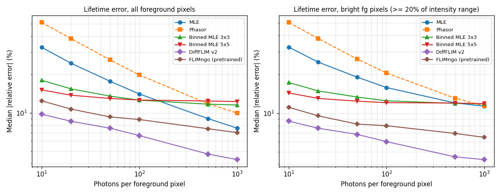

FLIMngo was the best baseline at every photon level and had a small bias (−2.8 to +0.8 %), unlike the mono-exponential fits (+7 to +11 %). Its error against the intensity-weighted lifetime was 15 to 16 %, much larger than against the amplitude-weighted one, so it estimates the same quantity as the ground truth and as DiffFLIM. DiffFLIM v2 was more accurate at every level, by a factor of 1.27 at 10 photons, 1.35 at 100 photons and 1.63 at 1000 photons. FLIMngo predicted exactly 0 ns (its output ReLU) for at most 0.3 % of foreground pixels.

Sensitivity to the preprocessing (lifetime error, all foreground pixels, 10 / 100 / 1000 photons):

| Variant | 10 | 100 | 1000 |
|---|---|---|---|
| Main (ground-truth mask, normalised, 64 × 64) | 12.4 % | 8.9 % | 7.0 % |
| Zero-padded to 256 × 256 | 12.6 % | 8.8 % | 6.9 % |
| Otsu mask from the counts | 15.4 % | 10.3 % | 7.5 % |
| No mask (background counts kept) | 12.9 % | 12.1 % | 14.3 % |
| No normalisation (raw counts) | 12.6 % | 18.2 % | 78.8 % |

Padding to the training size changed the error by at most 0.15 percentage points, so the 64 × 64 input is not a disadvantage. The per-pixel normalisation is necessary: on raw counts the network fails at high photon numbers (78.8 % error, 43 % of pixels predicted as 0 ns at 1000 photons). Without a mask, the background photons (2 % of the photon level, uniform in time) bias the lifetime downwards by up to −12 % at 500 to 1000 photons. The Otsu mask set 4 to 9 % of the true foreground pixels to zero, which then count as errors.

Speed on the laptop GPU (RTX 4060, batch 1, network only): 6.1 ms per 64 × 64 image and 26.0 ms for a padded 256 × 256 image, plus 2.9 ms of preprocessing on the CPU. DiffFLIM v2 needed 0.53 s per image for 10 samples of 50 DDIM steps (from the calibration run), about 90 times longer, but it also returns the intensity and an uncertainty.

Results (B, recalibration): The DiffFLIM v2 checkpoint does not store its training IDs, but `data/splits/hpa_train.txt` was written by `train_ids()` at the start of the run (file time 2026-11-21 21:31:31, the same second the training log was created) and was not changed afterwards; it contains the 246 IDs reported in the training output. It was copied to `data/splits/hpa_train_diffflim_v2.txt`. At this point 350 HPA samples were complete. The 54 that are neither in this list nor test or calibration IDs were written to `data/splits/hpa_calib_extra_v2.txt`; a check confirmed that the four groups are disjoint and cover all 350 samples. The extra paired calibration set was built from them in 58 s.

The photon-level estimate was examined on the first calibration set before any change. In the images where it was more than 20 % too low, the true foreground covered only 17 % of the crop (median) and 45 % of the pixels labelled as foreground by the Otsu threshold were background: the smoothing (σ = 1.5 pixels) spreads small and thin structures into the background, and on the log scale the threshold then falls into the background mode. A percentile rule (foreground above 10 to 20 % of the 99th percentile) did not help (11 to 26 % of images outside ±20 %). An Otsu threshold on the linear photon image with less smoothing did: without smoothing no image was underestimated, but at 10 photons the noise then makes the threshold select only bright pixels (17 % overestimated). The final rule, chosen on the calibration set only, smooths with σ = 1 if the 99th percentile of the summed counts is below 30, with σ = 0.5 below 300, and not at all above. It reduced the share of images outside ±20 % from 14.0 % to 5.2 % on the calibration sets (1.8 % too low, 3.4 % too high) and from 13.3 % to 5.4 % on the test set.

Coverage on the test set over all photon levels (95 % image-bootstrap interval), for the previous calibration and the new variants:

| Calibration | Cells | Photon estimate | τ 90 % | Intensity 90 % | τ 68 % | Intensity 68 % |
|---|---|---|---|---|---|---|
| Uncalibrated | – | – | 78.1 [76.8, 79.3] % | 82.6 [81.0, 84.0] % | 55.8 [54.4, 57.1] % | 63.5 [61.5, 65.6] % |
| Previous, global factor | 20 | old | 89.8 [89.0, 90.6] % | 87.7 [86.5, 88.9] % | 68.2 [66.9, 69.5] % | 65.1 [63.2, 67.3] % |
| Previous, per level | 20 | old | 89.8 [89.0, 90.6] % | 87.6 [86.5, 88.8] % | 68.2 [66.8, 69.5] % | 65.1 [63.4, 66.9] % |
| Per level, new estimate | 20 | new | 89.8 [88.9, 90.5] % | 87.5 [86.4, 88.8] % | 68.1 [66.8, 69.4] % | 65.0 [63.2, 66.8] % |
| Extra cells only, global | 54 | – | 89.7 [88.9, 90.5] % | 88.5 [87.4, 89.6] % | 67.4 [66.1, 68.8] % | 67.0 [65.1, 69.1] % |
| All cells, global | 74 | – | 89.8 [88.9, 90.5] % | 88.1 [87.0, 89.3] % | 67.8 [66.5, 69.1] % | 66.1 [64.2, 68.3] % |
| All cells, per level | 74 | new | 89.7 [88.9, 90.5] % | 88.0 [86.9, 89.2] % | 67.7 [66.4, 69.0] % | 66.0 [64.3, 67.8] % |

The last row is the new main calibration (`results/tables/coverage_calibrated_v2_extra.csv`). Its global factors at 90 % were 2.31 (τ) and 1.98 (intensity), compared with 2.31 and 1.95 before.

Coverage per photon level with all 74 cells, nominal 90 % (global factor / per-level factor):

| Photons | τ | Intensity |
|---|---|---|
| 10 | 87.0 / 88.4 % | 84.5 / 88.5 % |
| 20 | 88.9 / 90.0 % | 84.0 / 87.4 % |
| 50 | 89.6 / 90.2 % | 85.4 / 87.4 % |
| 100 | 90.0 / 90.1 % | 87.2 / 87.8 % |
| 500 | 91.2 / 90.0 % | 93.6 / 89.7 % |
| 1000 | 91.8 / 89.8 % | 94.0 / 87.2 % |

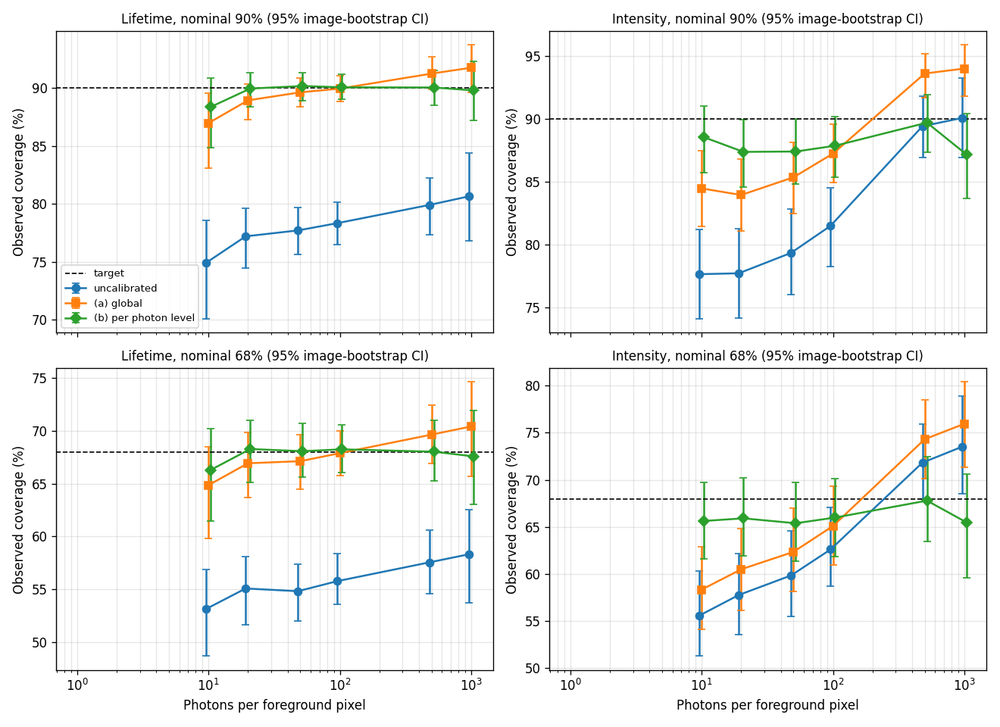

Pooled over all levels, the per-level factors did not beat the global factor (89.7 versus 89.8 % for τ, 88.0 versus 88.1 % for intensity), as in the previous calibration. Per level, they did: the largest deviation from 90 % over the six levels fell from 3.0 to 1.6 percentage points for the lifetime and from 6.0 to 2.8 points for the intensity; at 68 % from 3.2 to 1.7 points (τ) and from 9.7 to 2.6 points (intensity). The global factor over-covers at high and under-covers at low photon levels, which cancels in the pooled number.

Compared to before: FLIMngo is the first learned baseline. It reduced the lifetime error of the best classical method by 18 to 29 % up to 100 photons and by 8 % at 1000 photons (7.0 versus 7.6 % for the per-pixel MLE), but DiffFLIM v2 remained more accurate at every level. With 74 instead of 20 calibration cells, the intensity coverage at 90 % rose from 87.7 to 88.1 % (global factor) and from 65.1 to 66.1 % at 68 %; the lifetime coverage stayed at 89.8 %. The improved photon estimate removed most outliers but changed the coverage by at most 0.1 percentage points.

Problems and fixes: The intensity intervals still under-cover by about 2 percentage points at 90 %. The 90 % quantile of the normalised intensity errors was 1.95 on the first calibration cells, 2.01 on the extra cells and 2.14 on the test cells; for the lifetime the three values were 2.31, 2.30 and 2.33. The per-image 90 % quantile of the intensity scores varied strongly between images (interquartile range 1.44 to 2.33 on the extra calibration set), so the difference between groups of 20 to 54 cells is plausible as variation between cells; the 30 test cells appear to be harder than average for the intensity. This is not covered by the image-level bootstrap intervals, which resample images of the same cells.

The better photon estimate hardly changed the per-level coverage, because the per-level factors change slowly with the photon level: between 10 and 1000 photons the lifetime factor falls only from 2.43 to 2.13, so a 20 % error in the photon estimate changes the factor by about 0.01 to 0.03. The outliers of the old estimator were therefore not the reason why the per-level factors did not improve the pooled coverage.

Two edits of `src/data/simulate_v3.py` written through a shell here-document lost their escaped newline characters and broke the file; this was noticed at the next import, fixed with the editor and confirmed by the tests (`tests/test_simulate_v3.py`, 9 tests, `tests/test_flimngo.py`, 2 tests, `tests/test_calibration.py`, 3 tests, all passed).

`tifffile` (listed in `requirements.txt`) was not installed. Instead of installing it, the FLIMngo demo TIFF files were read with Pillow for the consistency test.

Correction to the entry "DiffFLIM v2: 6-hour training on simulator v3, evaluation and calibration": in the coverage table of that entry, 12 bootstrap interval bounds differ by 0.1 to 0.5 percentage points from the saved file `results/tables/coverage_calibrated_v2.csv`, because they were transcribed from rounded console output instead of the file (the coverage values themselves are correct). The intervals from the file are: 10 photons τ uncalibrated [70.0, 78.6] %, global [83.2, 89.6] %; 100 photons τ per level [89.2, 91.3] %; 1000 photons τ uncalibrated [76.8, 84.4] %, global [89.6, 93.8] %, per level [86.7, 92.0] %; all levels τ uncalibrated [76.8, 79.3] %; 10 photons intensity per level [85.2, 90.6] %; 1000 photons intensity per level [83.4, 90.3] %; all levels intensity uncalibrated [81.0, 84.0] %, global [86.5, 88.9] %, per level [86.5, 88.8] %. The tables in this entry were generated from the files.

Next: run DiffFLIM v2 and FLIMngo on real `.sdt` data, train a deterministic U-Net on the same v3 data as a further learned baseline, and test a calibration score normalised per cell to close the intensity gap.

### 2026-11-22 – FLIMngo retrained on v3, cell-level coverage intervals and DiffFLIM v2 speed trade-off

Goal: (A) A fair deterministic baseline: the FLIMngo architecture trained from scratch on the same v3 training data and for the same time as the 3-hour DiffFLIM v2 checkpoint, with all learned methods evaluated with a background mask computed from the counts instead of the ground-truth mask. (B) Confidence intervals for the calibrated coverage of DiffFLIM v2 that resample test cells instead of images, to decide whether the intensity coverage of 88 % is consistent with the nominal 90 %. (C) The effect of fewer DDIM steps and fewer samples on the error, the calibrated coverage and the time per image of DiffFLIM v2.

Changes:

- `src/models/flimngo_arch.py` (new): builds the FLIMngo network with random weights (class imported unchanged from `external/FLIMngo/backbone/flimngo_net.py`, citation in the docstring) and applies FLIMngo's preprocessing on the GPU (background zeroed, each pixel divided by its maximum over time).
- `scripts/train_flimngo.py` (new): training on streamed v3 samples of the 246 DiffFLIM v2 training IDs; validation every 10 minutes; best and last checkpoint.
- `src/evaluation/calibration.py`: new function `foreground_mask(counts_sum, method)` with the two Otsu variants of the previous entry; `estimate_photon_level()` now uses it (results unchanged).
- `scripts/eval_compare_v2.py` (new): both FLIMngo models with the computed mask on the full v3 test set, merged with the MLE, binned MLE and DiffFLIM v2 results; writes `results/tables/compare_v2.csv` and `results/figures/error_vs_photons_compare_v2.png`.
- `scripts/coverage_cell_bootstrap.py` (new): cell-level bootstrap of the calibrated coverage; writes `results/tables/coverage_cellboot_v2.csv`.
- `scripts/speed_tradeoff_v2.py` (new): DiffFLIM v2 with 50, 20 and 10 DDIM steps and 10 and 5 samples, each recalibrated; writes `results/tables/speed_tradeoff_v2.csv` and `results/figures/speed_tradeoff_v2.png`.
- New checkpoints `checkpoints/flimngo_v3.pt` (best validation) and `checkpoints/flimngo_v3_last.pt`; logs `logs/flimngo_v3.csv`, `logs/flimngo_v3_val.csv`; figure `results/figures/training_flimngo_v3.png`.
- New cached calibration predictions `data/processed/preds_v2_s{steps}_n{samples}_{calib, calib_sim_v3_calib_extra}.npz` for the five reduced settings.

Settings:

- FLIMngo retrained: 9.44 M parameters, PyTorch default initialisation (seed 0), image size 64, bin width 0.0977 ns, float32.
- Loss as in FLIMngo's `train.py`: mean squared error of the lifetime in ns over all pixels, target 0 outside the true foreground. AdamW, learning rate 0.01 (constant), weight decay 1e-8, batch 16, 180 minutes.
- Data: `simulate_v3.training_samples()` with the 246 IDs in `data/splits/hpa_train_diffflim_v2.txt`, photon level log-uniform in [10, 1000], 64 × 64 crops, 16 data-loader workers.
- Mask in training and evaluation: `foreground_mask(counts.sum(0), "otsu_adaptive")`.
- Validation: 64 fixed images from training cells (seed 777), every 10 minutes; the checkpoint with the lowest validation MSE is kept.
- Cell bootstrap: unit `hpa_id`; 5000 replicates over the 30 test cells with fixed factors, and 500 joint replicates over the 74 calibration cells and the 30 test cells with refitted factors.
- Speed: first 10 test images per level (60 images, 10 cells, the same images and noise seeds for every setting), each setting recalibrated on all 1200 calibration images (74 cells) with the global and the per-level factor; time per image as the median over the 60 images, batch of samples on the GPU, including the copy to the CPU.

Results (A, fair baseline): FLIMngo's `train.py` uses MSE in ns over the full image, with zero input and zero target in the background, AdamW with lr 0.01 and weight decay 1e-8, batch 10 and early stopping on a 20 % validation split. The author kept this recipe with three deviations: batch 16 (the same number of images per step as DiffFLIM v2), a fixed time budget instead of epochs because the data are streamed, and the computed mask instead of the exact background of their simulation. True foreground pixels outside the computed mask keep their true lifetime as target, so the network can fill them in from the neighbourhood. No intensity head was added: the per-pixel max normalisation removes the photon count from the input, so an intensity output would need a change of FLIMngo's preprocessing.

A 2-minute smoke test ran at 8.8 iterations per second with 12 to 21 % of the time spent waiting for data, and the validation error fell from 22.6 to 17.4 % (peak GPU memory 1.61 GB). The 3-hour run made 88 837 steps (8.2 per second on average, 21 % data wait), about 1.42 M images. The validation error fell to 7.7 % after 50 minutes and then stayed between 7.5 and 8.5 %; the lowest validation MSE, 0.921 ns², was reached after 130 minutes (step 67 126), and this checkpoint was used. The training loss decreased slowly until the end (about 1.0 ns² at 180 minutes).

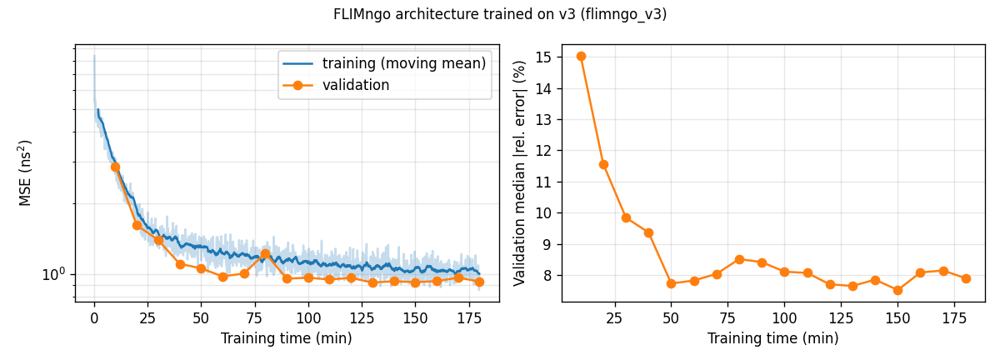

Lifetime error on the v3 test set, all foreground pixels (median absolute relative error, 40 images per level; FLIMngo with the computed mask, DiffFLIM, MLE and binned MLE without any mask):

| Photons | MLE | Binned MLE 5 × 5 | FLIMngo pretrained | FLIMngo retrained v3 | DiffFLIM v2 (3 h) | DiffFLIM v2 (6 h) |
|---|---|---|---|---|---|---|
| 10 | 32.8 % | 15.2 % | 19.8 % | 14.0 % | 10.1 % | 9.8 % |
| 20 | 24.6 % | 13.8 % | 19.2 % | 12.4 % | 8.9 % | 8.6 % |
| 50 | 17.7 % | 13.0 % | 14.1 % | 11.0 % | 8.0 % | 7.6 % |
| 100 | 14.1 % | 12.6 % | 12.7 % | 9.9 % | 6.9 % | 6.6 % |
| 500 | 9.0 % | 12.4 % | 10.8 % | 8.5 % | 5.1 % | 4.7 % |
| 1000 | 7.6 % | 12.3 % | 10.3 % | 8.1 % | 4.7 % | 4.3 % |

On bright foreground pixels the values were 15.6, 17.0, 13.1, 11.6, 10.3 and 9.8 % for the pretrained FLIMngo, 12.6, 11.8, 10.7, 9.7, 8.8 and 8.5 % for the retrained FLIMngo and 8.7, 7.6, 6.9, 6.0, 4.6 and 4.4 % for DiffFLIM v2 (6 h). The bias of the retrained FLIMngo on all foreground pixels was +5.5, +6.9, +6.0, +5.2, +4.7 and +4.5 % (bright pixels +6.6 to +9.6 %), that of the pretrained FLIMngo with the computed mask −5.4 to −2.6 %, and that of DiffFLIM v2 (6 h) +1.0 to +3.1 %.

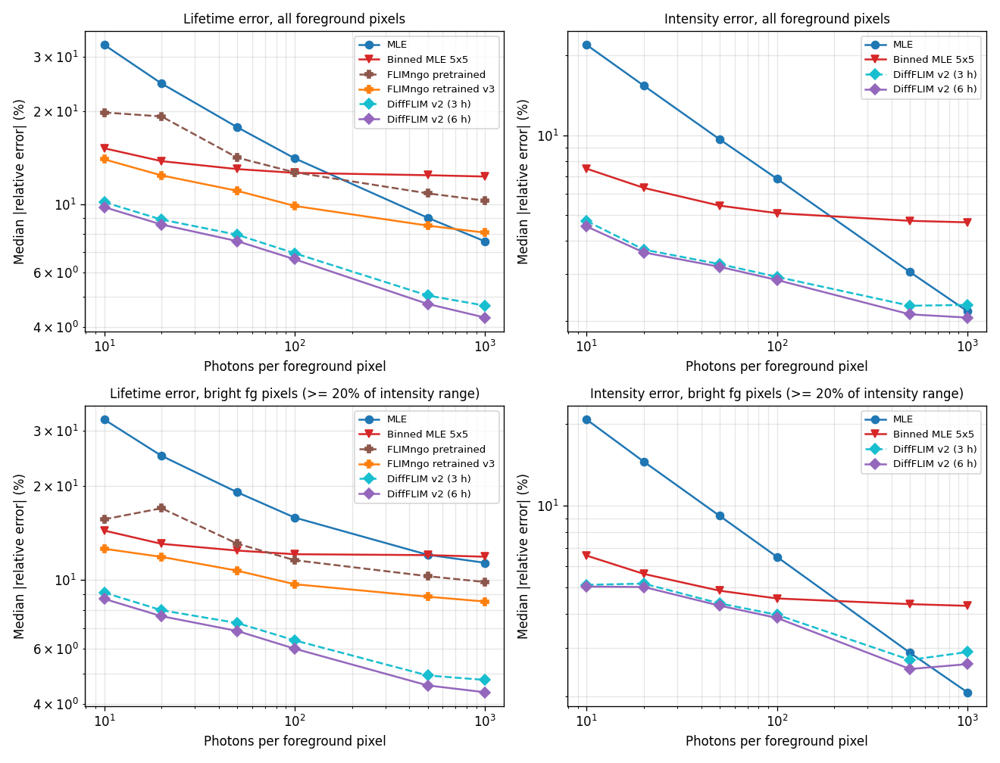

At equal training time, DiffFLIM v2 (3 h) had a 1.38 to 1.42 times lower lifetime error than the retrained FLIMngo from 10 to 100 photons and a 1.68 to 1.72 times lower error at 500 and 1000 photons. Training on v3 data reduced the error of the FLIMngo architecture by 21 to 36 % compared with the pretrained weights under the same mask. The retrained FLIMngo was better than the binned MLE at every level and better than the per-pixel MLE up to 500 photons, but worse than the MLE at 1000 photons (8.1 versus 7.6 %). Retrained FLIMngo needed 6.1 ms per 64 × 64 image (batch 1, network only), the same as the pretrained one.

The computed mask is a large part of the FLIMngo error. On the test set it kept 74 to 81 % of the true foreground pixels (recall 0.738 at 10 photons, 0.81 from 50 photons on) with a precision of 0.97 to 1.00; it was tuned in the previous entry for the photon estimate, where precision matters more than recall. The older `otsu_log` mask had a recall of 0.83 and a precision of 0.88 to 0.92 on the same images. Inside the computed mask, the errors were 12.5, 12.1, 10.4, 9.5, 8.1 and 7.7 % (pretrained) and 12.0, 11.2, 10.1, 9.1, 7.7 and 7.3 % (retrained). Even this favourable subset gives both FLIMngo models a higher error than DiffFLIM v2 on all foreground pixels. The pretrained network with the ground-truth mask (previous entry: 12.4, 10.7, 9.3, 8.9, 7.5 and 7.0 %) was about as accurate as the retrained network inside the computed mask (on different pixel sets), so three hours of training on v3 did not produce a better FLIMngo than the published weights; the gain of the retrained model under the computed mask comes mainly from filling in the masked-out foreground pixels.

Results (B, cell-level coverage intervals): The calibration was the main calibration of the previous entry (74 calibration cells, photon estimate `otsu_adaptive`, per-level factors as a quadratic curve in log photons). The test set contains 30 cells; each scene appears at all six photon levels, so each cell contributes 8 of the 240 images on average. Coverage on the test set over all photon levels:

| Quantity | Nominal | Calibration | Coverage | Test-cell 95 % CI | Joint 95 % CI |
|---|---|---|---|---|---|
| τ | 90 % | none | 78.1 % | [75.8, 80.2] % | – |
| τ | 90 % | global | 89.8 % | [88.3, 91.0] % | [88.1, 91.2] % |
| τ | 90 % | per level | 89.7 % | [88.3, 91.1] % | [88.1, 91.2] % |
| τ | 68 % | none | 55.8 % | [53.1, 58.3] % | – |
| τ | 68 % | global | 67.8 % | [65.2, 70.3] % | [64.8, 70.8] % |
| τ | 68 % | per level | 67.7 % | [65.1, 70.2] % | [64.7, 70.8] % |
| Intensity | 90 % | none | 82.6 % | [79.6, 85.6] % | – |
| Intensity | 90 % | global | 88.1 % | [85.7, 90.4] % | [85.2, 90.7] % |
| Intensity | 90 % | per level | 88.0 % | [85.5, 90.5] % | [85.0, 90.8] % |
| Intensity | 68 % | none | 63.5 % | [59.4, 67.8] % | – |
| Intensity | 68 % | global | 66.1 % | [62.0, 70.3] % | [61.0, 70.4] % |
| Intensity | 68 % | per level | 66.0 % | [61.8, 70.3] % | [60.8, 70.4] % |

The test-cell intervals were about twice as wide as the image-level intervals of the previous entry (intensity, 90 %, global factor: [85.7, 90.4] % instead of [87.0, 89.3] %). Refitting the factors on resampled calibration cells (joint interval) widened them only by a further 0.4 to 1.1 percentage points, so the variation between test cells dominates. The pooled intensity coverage of 88.1 % at 90 % and 66.1 % at 68 % is therefore consistent with the nominal values at the cell level: both nominal values lie inside both intervals. The earlier conclusion that the intensity intervals under-cover was based on image-level intervals that treated images of the same cell as independent.

Coverage per photon level at 90 % (test-cell CI, joint CI):

| Photons | τ, global | τ, per level | Intensity, global | Intensity, per level |
|---|---|---|---|---|
| 10 | 87.0 [83.1, 89.6] [82.8, 89.7] | 88.4 [84.7, 90.8] [84.3, 90.8] | 84.5 [81.1, 87.5] [80.7, 87.7] | 88.5 [85.6, 91.1] [85.5, 91.3] |
| 20 | 88.9 [87.2, 90.5] [87.0, 90.5] | 90.0 [88.3, 91.4] [88.1, 91.4] | 84.0 [80.7, 86.9] [80.2, 87.3] | 87.4 [84.6, 89.9] [84.1, 90.1] |
| 50 | 89.6 [88.4, 90.7] [88.1, 90.9] | 90.2 [89.0, 91.2] [88.7, 91.3] | 85.4 [82.5, 88.1] [82.0, 88.5] | 87.4 [84.8, 89.9] [84.5, 90.2] |
| 100 | 90.0 [88.9, 90.9] [88.5, 91.2] | 90.1 [89.1, 91.0] [88.7, 91.3] | 87.2 [84.7, 89.6] [84.4, 90.0] | 87.8 [85.5, 90.2] [85.0, 90.4] |
| 500 | 91.2 [89.9, 92.7] [89.6, 92.7] | 90.0 [88.6, 91.6] [88.1, 91.6] | 93.6 [91.7, 95.3] [91.5, 95.3] | 89.7 [87.2, 92.0] [86.8, 92.3] |
| 1000 | 91.8 [89.8, 93.7] [89.7, 93.8] | 89.8 [87.5, 92.1] [87.1, 92.3] | 94.0 [91.9, 95.9] [91.7, 95.9] | 87.2 [83.6, 90.7] [83.0, 90.9] |

Per level, the global factor is not consistent with 90 %: for the intensity, the intervals exclude 90 % at 10, 20 and 50 photons (under-coverage) and at 500 and 1000 photons (over-coverage), for the lifetime at 10 photons. With the per-level factors, all joint intervals contain 90 %; the test-cell intervals at 20 and 50 photons for the intensity end at 89.9 %, just below. The per-level factors are therefore the calibration to report per photon level, while the pooled numbers of the two variants are the same.

Results (C, speed trade-off): DiffFLIM v2 (6 h) on the 60 speed-test images, all levels pooled (lifetime and intensity error: median absolute relative error on the true foreground; coverage of the 90 % interval before calibration and after calibration with the global and the per-level factor):

| DDIM steps | Samples | Time per image | τ error | Intensity error | τ coverage (none / global / per level) | Intensity coverage (none / global / per level) | Global factor τ / intensity |
|---|---|---|---|---|---|---|---|
| 50 | 10 | 522 ms | 7.26 % | 2.72 % | 81.0 / 91.8 / 91.8 % | 85.7 / 90.8 / 90.7 % | 2.31 / 1.98 |
| 50 | 5 | 391 ms | 7.37 % | 2.87 % | 76.6 / 92.3 / 92.3 % | 77.6 / 88.9 / 88.9 % | 2.82 / 2.44 |
| 20 | 10 | 233 ms | 7.22 % | 2.70 % | 73.9 / 92.1 / 92.0 % | 81.8 / 91.1 / 91.0 % | 2.78 / 2.28 |
| 20 | 5 | 182 ms | 7.26 % | 2.83 % | 70.0 / 92.9 / 92.9 % | 73.4 / 89.2 / 89.1 % | 3.37 / 2.79 |
| 10 | 10 | 111 ms | 7.21 % | 2.70 % | 65.5 / 92.0 / 91.9 % | 78.0 / 91.3 / 91.1 % | 3.35 / 2.59 |
| 10 | 5 | 94 ms | 7.22 % | 2.82 % | 62.2 / 93.0 / 93.0 % | 69.6 / 89.4 / 89.2 % | 4.04 / 3.16 |

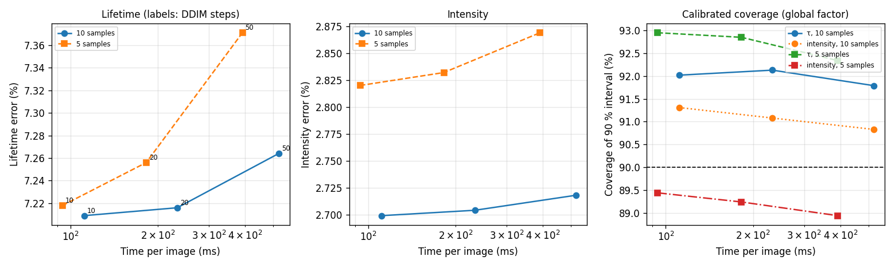

Reducing the DDIM steps from 50 to 10 made DiffFLIM v2 4.7 times faster (522 to 111 ms per image with 10 samples) without a loss in accuracy: the lifetime error changed from 7.26 to 7.21 % and the intensity error from 2.72 to 2.70 %; the same held at every photon level (at 10 photons 11.56 versus 11.34 % for the lifetime). Fewer steps made the samples less diverse: the uncalibrated lifetime coverage fell from 81.0 to 65.5 % and the global factor rose from 2.31 to 3.35. After recalibration the coverage was again close to nominal. Halving the samples saved less time than reducing the steps (10 steps: 111 to 94 ms) because the samples run as one batch on the GPU, raised the intensity error by 4 to 6 % relative (for example 2.70 to 2.82 % at 10 steps) and lowered the calibrated intensity coverage by about 2 percentage points (89 instead of 91 %), as the standard deviation from five samples is noisy.

These 60 images come from only 10 cells and are easier for the lifetime calibration than the full test set (91.8 % instead of 89.8 % at 50 steps and 10 samples with the same factor), so only the differences between the settings are meaningful, not the absolute coverage. The interval widths were not compared; with fewer steps the standard deviation shrinks and the factor grows, so the calibrated intervals are not necessarily narrower or wider.

Compared to before: The pretrained FLIMngo was evaluated with the ground-truth mask in the previous entry (12.4 to 7.0 % lifetime error); with the computed mask, as DiffFLIM, its error was 19.8 to 10.3 %. The retrained FLIMngo (14.0 to 8.1 %) is the strongest deterministic baseline under equal information, and DiffFLIM v2 remains more accurate by a factor of 1.4 to 1.9 (6 h). The coverage intervals now resample cells; with them the intensity coverage is consistent with 90 % and 68 %. DiffFLIM v2 with 10 DDIM steps and 10 samples is as accurate as with 50 steps and needs 0.11 instead of 0.52 s per image.

Problems and fixes: The retrained FLIMngo has a positive lifetime bias of +4.5 to +6.9 % on all foreground pixels. The loss is an MSE in ns, so the long lifetimes dominate it; the learning rate was constant, and the validation MSE varied by up to 30 % between checks (1.23 ns² at 80 minutes after 0.98 ns² at 60 minutes). The cause of the bias was not investigated further. The validation set (64 images from training cells) was too small to rank the checkpoints after the first hour.

The plot in `scripts/speed_tradeoff_v2.py` failed after all timings were finished, because the line style for intensity was made by replacing "-" with ":" in "s--", which gave the invalid style "s::". The table had already been written. The plot was moved into a function that reads the saved table, called with `--plot-only`, so no timing was repeated.

The tests (`tests/test_calibration.py`, `tests/test_simulate_v3.py`, `tests/test_flimngo.py`, 14 tests) all passed after the change of `calibration.py`. `pytest` is not installed; the test files were run directly.

Next: run DiffFLIM v2 (10 DDIM steps, 10 samples) and both FLIMngo models on real `.sdt` data, use a mask with higher recall for the deterministic baselines as a sensitivity check, and add a U-Net trained on the same v3 data.
