# DiffFLIM: Uncertainty-Aware Fluorescence Lifetime Imaging from Low-Photon Data using Conditional Diffusion Models – Technical Report

## 1. About this report

This report describes the DiffFLIM system as it stands on 22 November 2026: what problem it addresses, how every part of the code works, which data and external sources it uses, which experiments were run and what they showed, and how every result file in `results/` was produced. It is written for a reader who knows the basics of deep learning (convolutional networks, training with a loss function, train/test splits) but not fluorescence lifetime imaging or diffusion models. Technical terms are explained when they first appear; a glossary is given in the appendix.

The report complements the project log (`docs/PROJECT_LOG.md`). The log records the work in chronological order, including failed attempts and corrections; this report explains the system and its outputs. Where the two differ in emphasis, the numbers are always taken from the result files in `results/tables/`, and the log is the record of how they came about.

Almost all work so far uses simulated data. The only measured (real) data processed so far are FLIMngo's 12 raw recordings of *C. elegans* (Section 6.17), for which no ground truth exists. All run times refer to one laptop (Section 10). The project is the work of one student, Matheshwaran Prakash, at Otto-von-Guericke-Universität Magdeburg, referred to as "the author" throughout.

## 2. Problem and background

### 2.1 Fluorescence lifetime imaging (FLIM)

A fluorescent molecule absorbs a short laser pulse and, after a random delay, emits a photon. The delay follows an exponential distribution, and its mean is called the **fluorescence lifetime**, written τ (tau). Typical lifetimes lie between about 0.1 and 10 nanoseconds (ns). The lifetime depends on the molecule and on its surroundings (for example pH, ion concentration, binding to other molecules or protein aggregation), which makes it a useful measurement in cell biology: two regions can be equally bright but differ in lifetime. **Fluorescence lifetime imaging microscopy (FLIM)** measures the lifetime in every pixel of an image. Next to the lifetime, every pixel has an **intensity**, here defined as the expected number of detected signal photons in that pixel.

### 2.2 TCSPC histograms

The most common FLIM technique is **time-correlated single photon counting (TCSPC)** (Becker, 2005). The laser fires pulses at a fixed rate (here 40 MHz, one pulse every 25 ns). For each detected photon, the electronics record the time between the laser pulse and the photon's arrival. Over many pulses, these arrival times are collected into a **histogram** per pixel: the 25 ns window is divided into time bins (here 256 bins of 0.0977 ns), and each bin counts how many photons arrived in that interval. A FLIM image is therefore a three-dimensional array of counts with shape (time bins, height, width), here (256, 64, 64). Summing a pixel's histogram over time gives its total photon count, which is the intensity measurement.

For a single fluorescent species, the expected histogram is a decaying exponential exp(−t/τ). Real samples often contain several species in one pixel, so the decay is a weighted sum of exponentials ("multi-exponential"). In that case a single number for the lifetime must be defined; this project uses the **amplitude-weighted mean lifetime** Σ a_i τ_i (the weights a_i are the relative amplitudes of the components), as FLIMngo does.

### 2.3 Instrument response function (IRF)

The laser pulse is not infinitely short, and the detector and electronics add their own timing spread. The measured histogram is therefore the true decay **convolved** with (smeared by) the **instrument response function (IRF)**, the histogram one would record for a lifetime of zero. Typical IRFs are 0.1 to 0.8 ns wide and may have a tail or a secondary peak. The position of the IRF in the window can also shift slightly between measurements (laser jitter). Any lifetime estimate has to account for the IRF.

### 2.4 Poisson noise and the low-photon problem

Photon detection is a counting process: the number of photons in a time bin follows a **Poisson distribution**, whose variance equals its mean. With few photons per pixel the histogram is very noisy. A rule of thumb from the literature (Köllner and Wolfrum, 1992) is that even an ideal estimator needs on the order of a hundred photons per pixel to determine a mono-exponential lifetime to about 10 %; the relative error of the best possible per-pixel estimate falls only as one over the square root of the photon number,

relative error of τ  ≈  c / √N,

with N the number of photons in the pixel and c a constant of order one that depends on τ, the IRF and the time window. At 10 photons per pixel a per-pixel fit therefore has a typical error of about 30 %. Fast imaging, imaging of living organisms and low-toxicity imaging all produce such low photon counts, so methods that work at 10 to 100 photons per pixel are of practical interest.

There are two ways around the √N limit. One can pool photons from neighbouring pixels ("binning"), which trades spatial resolution for precision. Or one can learn, from many examples, what lifetime maps typically look like and use that knowledge (a "prior") to fill in what the noisy data cannot determine. Deep-learning methods such as FLIMngo (Kapsiani et al., 2025) and the diffusion model in this project take the second route.

### 2.5 Why uncertainty matters

A learned prior can produce lifetime maps that look clean and plausible even where the data contain almost no information. A biologist who sees such a map cannot tell which parts are supported by the photons and which are the network's guess. A per-pixel **uncertainty** (for example an interval that contains the true lifetime with 90 % probability) addresses this: where the data are weak, the interval is wide. For this to be useful, the uncertainty must be **calibrated**: a "90 % interval" must contain the truth in about 90 % of cases. Checking and correcting this is the second main topic of the project.

### 2.6 Diffusion models in brief

A **diffusion model** is a generative neural network that learns to produce samples from a distribution of images (Ho et al., 2020). It is trained with two processes:

- **Forward process (adding noise).** A clean image x0 is gradually mixed with Gaussian noise over T = 1000 steps. At step t the noisy image is x_t = √ᾱ_t · x0 + √(1 − ᾱ_t) · ε, where ε is standard Gaussian noise and ᾱ_t falls from almost 1 (clean) to almost 0 (pure noise). The schedule ᾱ_t used here is the cosine schedule of Nichol and Dhariwal (2021).
- **Reverse process (removing noise).** A network is trained to undo one noising step: given x_t and t, it estimates the clean image. Starting from pure noise and applying the network repeatedly produces a new sample.

A **conditional** diffusion model receives additional input, here the measured photon histograms, and learns to produce lifetime and intensity maps that are consistent with that input. Because the reverse process starts from random noise, running it several times for the same measurement gives several different, equally plausible answers. Their **mean** serves as the prediction and their **standard deviation** as the uncertainty.

What the network predicts is a design choice. In the original formulation (DDPM, "epsilon-prediction") it predicts the noise ε. In **v-prediction** (Salimans and Ho, 2022) it predicts v = √ᾱ · ε − √(1 − ᾱ) · x0, a mixture that is close to the clean image when the noise is strong. The project's first model used epsilon-prediction and failed for a reason explained in Section 6.3; v-prediction fixed it.

Sampling with all 1000 steps is slow. **DDIM** (Song et al., 2021) is a deterministic sampler that skips steps: it jumps directly between, for example, 10 or 50 selected time steps and gives samples of similar quality. DiffFLIM uses DDIM with 10 steps by default (50 before 22 November 2026).

### 2.7 Split-conformal calibration in brief

**Split conformal prediction** (Vovk et al., 2005; Angelopoulos and Bates, 2023) turns any predicted uncertainty into intervals with a coverage guarantee. A separate **calibration set** with known ground truth is used. For each calibration pixel, a score measures how many predicted standard deviations the truth lies away from the prediction:

s = |truth − mean| / std.

The factor q is the ceil((n + 1)(1 − α))-th smallest of the n calibration scores (α = 0.10 for a 90 % interval). The calibrated interval for a new pixel is mean ± q · std. If calibration and test data are exchangeable (drawn from the same distribution), this interval contains the truth with probability at least 1 − α. The method makes no assumption about the shape of the error distribution; it only rescales the model's own standard deviation. In this project q is either one global number per quantity or a smooth function of the photon level ("per-level factors").

## 3. System overview

### 3.1 Pipeline

The whole system runs on simulated data with exact ground truth. The diagram shows the main path for DiffFLIM; the baselines (Section 5.4) branch off after the simulator.

```
 HPA images (data/raw/hpa)    FLIMngo IRF library (external/FLIMngo)
            \                     /
             v                   v
   +-----------------------------------------+
   | Simulator v3  (src/data/simulate_v3.py) |  crops, lifetimes, amplitudes, IRF,
   |  scene -> expected counts -> Poisson    |  photon level, background, noise
   +-----------------------------------------+
        |                       |                         |
        | streamed, training    | fixed sets (.npz)       |
        | cells only            | test / calib / extra    |
        v                       v                         |
   +------------------+   +---------------------------+   |
   | Training         |   | Sampling (DDIM, 10 steps) |   |
   | train_diffflim.py|-->| 10 samples per image      |   |
   | (v-prediction)   |   +---------------------------+   |
   +------------------+                |                  |
                                       v                  |
                        +------------------------------+  |
                        | mean (prediction), std       |  |
                        | (uncertainty) per pixel      |  |
                        +------------------------------+  |
                            |                 |           |
              calibration   |                 | test set  |
              set           v                 v           v
                 +-------------------+   +-------------------------------+
                 | Calibration       |-->| Evaluation                    |
                 | conformal factors |   | errors, bias, coverage,       |
                 | (global, per lvl) |   | cell-level bootstrap, figures |
                 +-------------------+   +-------------------------------+
                                              ^
                    Baselines: MLE, phasor, binned MLE, FLIMngo (pretrained/retrained)
```

### 3.2 Folder structure

```
diffflim/
  src/              library code (imported by scripts and tests)
    data/           simulators v2 and v3, training stream, FLIMngo .h5 loader
    models/         DiffFLIM network and diffusion model; FLIMngo architecture wrapper
    baselines/      MLE, phasor, binned MLE, pretrained FLIMngo wrapper
    evaluation/     error metrics, masks, conformal calibration
    utils/          empty placeholder package
  scripts/          runnable entry points: data, training, evaluation, figures, PDF export
  tests/            sanity tests, run as plain Python files
  configs/          unet_baseline.yaml (placeholder, not read by any code)
  data/raw/         simulated data sets (own/) and HPA images (hpa/); git-ignored
  data/processed/   cached model predictions (.npz); git-ignored
  data/splits/      fixed HPA ID lists (test, calibration, extra calibration, training)
  checkpoints/      trained model weights (.pt); git-ignored
  logs/             training curves (.csv) and console logs (.txt); git-ignored
  results/figures/  all figures (.png); results/README.md explains every file
  results/tables/   all result tables (.csv)
  docs/             project log and this report (Markdown and PDF)
  external/FLIMngo/ read-only copy of the FLIMngo repository; git-ignored
  notebooks/        empty
```

`src/paths.py` defines all these folders relative to the project root, so no code contains an absolute path.

## 4. Data and sources

### 4.1 External sources

**FLIMngo repository and paper.** S. Kapsiani, N. F. Läubli, E. N. Ward, A. Fernandez-Villegas, B. Mazumder, C. F. Kaminski, G. S. Kaminski Schierle, "Deep learning for fluorescence lifetime predictions enables high-throughput in vivo imaging", Journal of the American Chemical Society 147, 22609–22621 (2025), doi:10.1021/jacs.5c03749. Code: https://github.com/SofiaKapsiani/FLIMngo, MIT licence (copyright 2024 Sofia Kapsiani). A local copy is kept read-only in `external/FLIMngo/` and is not committed. The project uses from it:

- the **simulation method**: the README, `data_simulation/utils_simulation.py` and the three simulation notebooks were read, and simulator v3 re-implements their rules (lifetime ranges, Perlin-noise amplitudes, intensity mapping, IRF jitter, amplitude-weighted ground truth); no FLIMngo code is copied into the simulator;
- the **IRF files** in `data_simulation/data/irfs/` (six measured IRFs; the six simulated IRFs are re-computed from the parameters in notebook 2);
- the **network class** `FLIMngo` in `backbone/flimngo_net.py` (imported unchanged, never copied) and the **pretrained weights** `flimngo_pretrained_v13102024.pth`;
- the **training recipe** in `train.py` (loss, optimiser, learning rate, weight decay, batch size, early stopping), followed for the retrained FLIMngo;
- the raw **C. elegans recordings** `sample_data/celegans/raw_data/*.sdt` and their manual masks, used for the first real-data evaluation (Section 6.17);
- the **demo data** `sample_data/simulated_data/*.tiff` and the MSE values printed in `demo_notebooks/predict_simulated.ipynb`, used only in `tests/test_flimngo.py` to check the wrapper.

The FLIMngo training data set on Hugging Face (`SofiaKaps/FLIMngo_data`, CC-BY-4.0 according to the dataset card) was **not** downloaded or used: its decays are normalised to a maximum of 1, so the photon counts that the Poisson likelihood and the calibration need are lost. The download script for it exists (`scripts/download_flimngo.py`) but was never run.

**IRF origins** (from `external/FLIMngo/data_simulation/data/irfs/README.md`): IRF_inhouse_PMT and IRF_inhouse_APD were recorded by the FLIMngo authors with a photomultiplier tube and an avalanche photodiode; IRF_DLT comes from https://github.com/dpscience/DLTReconvolution (file `irf_5ps.dat`); IRF_DL4FLI from https://github.com/jasontsmith2718/DL4FLI (`FLIM_IRF.mat`); IRF_flimfit_py from https://github.com/walshlab/FLIM-fit (`IRF_New.txt`); IRF_FPFLI from https://github.com/Dooongx/FPFLI (`irf_measure.mat`). The author used these files as redistributed in the MIT-licensed FLIMngo repository and did not check the licences of the four original repositories; this should be done before any redistribution.

**Human Protein Atlas (HPA) images.** The cell structures of simulator v3 come from the training images of the Kaggle competition "Human Protein Atlas Image Classification" (competition `human-protein-atlas-image-classification`; Ouyang et al., 2019; HPA: Thul et al., 2017). Each sample has four 512 × 512 PNG channels (red: microtubules, green: protein, blue: nucleus, yellow: endoplasmic reticulum). The images are used under the competition's terms for academic use only. They are kept in `data/raw/hpa/train/`, which is git-ignored, are decoded into memory only, and are never copied, committed or redistributed. Data sets and figures derived from them (the v3 data sets and the example figures) inherit this restriction. FLIMngo builds its simulation on the same image collection.

**Methods from the literature used in the code.**

| Method | Used in | Reference |
|---|---|---|
| Denoising diffusion probabilistic model (training objective, forward process) | `src/models/diffflim.py` | Ho, Jain and Abbeel, "Denoising diffusion probabilistic models", NeurIPS 2020 |
| Cosine noise schedule | `cosine_alphas_cumprod` | Nichol and Dhariwal, "Improved denoising diffusion probabilistic models", ICML 2021 |
| DDIM deterministic sampler | `DiffFLIM.ddim_sample` | Song, Meng and Ermon, "Denoising diffusion implicit models", ICLR 2021 |
| v-prediction | `DiffFLIM.loss`, `predict_x0_eps` | Salimans and Ho, "Progressive distillation for fast sampling of diffusion models", ICLR 2022 |
| Split (inductive) conformal prediction | `src/evaluation/calibration.py` | Vovk, Gammerman and Shafer, "Algorithmic Learning in a Random World", Springer 2005; Angelopoulos and Bates, "Conformal prediction: a gentle introduction", Foundations and Trends in Machine Learning 2023 |
| Otsu threshold | `_otsu_threshold` | Otsu, "A threshold selection method from gray-level histograms", IEEE Trans. Systems, Man, and Cybernetics 1979 |
| Phasor analysis | `src/baselines/phasor.py` | Digman, Caiolfa, Zamai and Gratton, "The phasor approach to fluorescence lifetime imaging analysis", Biophysical Journal 2008 |
| Perlin noise (as in FLIMngo) | `simulate_v3.perlin` | Perlin, "An image synthesizer", SIGGRAPH 1985 |
| YOLOv5-style FLIMngo network | `flimngo_baseline.py`, `flimngo_arch.py` | Kapsiani et al. 2025 (above) |

The Poisson maximum-likelihood fit and the binned fit are standard FLIM analysis techniques and are implemented from first principles, not from a specific paper.

**Related work on the reading list (not implemented).** Four further papers on the author's reading list inform the design but none of their methods is implemented in the current code, and no result depends on them. FLIM_PSR (Casteleiro Costa et al., 2025, "Pixel super-resolved fluorescence lifetime imaging using deep learning") is learned FLIM reconstruction from the FLIM side. DynamicDPS (Kim et al., 2025, "Tackling hallucination from conditional models for medical image reconstruction with DynamicDPS") addresses hallucinations of conditional generative models in medical image reconstruction, the risk described in Section 2.5. PET-DEFT (Webber et al., 2025, "Supervised diffusion-model-based PET image reconstruction", preprint) is a diffusion model conditioned on measurements in another photon-limited imaging modality. Teneggi et al. (2023, "How to trust your diffusion model: a convex optimization approach to conformal risk control") calibrate diffusion-model outputs in imaging with conformal methods and are the closest related work to the calibration step. The last three are also relevant to the planned data-consistency step at sampling time (Section 11).

### 4.2 Simulated data sets

All data sets are stored as compressed NumPy files (`.npz`), one file per photon level, with arrays `counts` (N, 256, 64, 64) uint16, `tau_gt`, `intensity_gt`, `mask` (N, 64, 64), `photons`, `bg_per_bin` and a JSON `metadata` string with every simulator setting. Simulator v3 files also contain `tau_int_gt`, `n_components`, `irf`, `irf_id`, `irf_shift`, `hpa_id` and `crop`.

| Folder | Simulator | Contents | Seeds | Size |
|---|---|---|---|---|
| `data/raw/own/sim_test/` | v2 (blobs) | 6 levels × 40 images | 12345 + level | 30 MB |
| `data/raw/own/sim_calib/` | v2 | 6 levels × 20 images | 54321 + level | 15 MB |
| `data/raw/own/sim_v3_test/` | v3 | 6 levels × 40 images, paired, 30 test cells | scenes 31000, noise 31000 + level | 48 MB |
| `data/raw/own/sim_v3_calib/` | v3 | 6 levels × 100 images, paired, 20 calibration cells | scenes 41000, noise 41000 + level | 114 MB |
| `data/raw/own/sim_v3_calib_extra/` | v3 | 6 levels × 100 images, paired, 54 extra calibration cells | scenes 51000, noise 51000 + level | 123 MB |
| `data/raw/own/sim_v3_test2/` | v3 | 6 levels × 100 images, paired, 100 second-test cells (one image per cell and level); reserved for the final evaluation | scenes 61000, noise 61000 + level | 124 MB |

The photon levels are 10, 20, 50, 100, 500 and 1000 photons per foreground pixel. **Paired** means that the same 40 (or 100) scenes appear at every photon level; only the brightness scaling and the Poisson noise differ. Differences between photon levels are therefore not caused by different image content. Training data are never stored: they are simulated on the fly from the training cells (Section 5.1).

### 4.3 HPA splits

At the time of writing, 1000 HPA sample IDs had been selected at random (seed 0, `data/raw/hpa/subset_ids.txt`) and 566 of them were completely downloaded (2264 PNG files). The splits were fixed when 350 samples were complete:

| Split | File | IDs | How it was made | Used for |
|---|---|---|---|---|
| Test | `data/splits/hpa_test.txt` | 30 | drawn once with seed 2026 from the complete samples | the v3 test set only |
| Calibration | `data/splits/hpa_calib.txt` | 20 | drawn once with seed 2027 from the remaining samples | `sim_v3_calib` |
| Training of DiffFLIM v2 | `data/splits/hpa_train_diffflim_v2.txt` | 246 | all other complete samples at the start of the DiffFLIM v2 run (frozen copy) | DiffFLIM v2 and the retrained FLIMngo |
| Extra calibration | `data/splits/hpa_calib_extra_v2.txt` | 54 | samples completed after the v2 run started, never seen by v2 | `sim_v3_calib_extra` |
| Second test set | `data/splits/hpa_test2.txt` | 100 | drawn once with seed 2028 from the 216 samples that no model or data set had used | `sim_v3_test2`, final evaluation only |
| Training list of the latest run | `data/splits/hpa_train.txt` | 246 | written by `train_ids(write=True)` at the start of a DiffFLIM training run | record (each checkpoint also stores its list) |

The split files are created once and never rewritten: `test_ids()`, `calib_ids()` and `calib_extra_v2_ids()` read the file if it exists and only draw new IDs if it does not. `training_samples()` raises an error if any of its IDs is a test, calibration or extra calibration ID, and `tests/test_simulate_v3.py` checks that the groups are disjoint and that the test and calibration files do not change. The extra calibration cells are excluded from training by default (`allow_calib_extra=False`); a future model may only be trained on them if this is stated in the project log, because they would then no longer be unseen calibration data.

When the splits were extended on 22 November 2026, 216 complete samples had not been used by any model, calibration or data set. 100 of them were fixed as a **second test set** (`test2_ids()`, seed 2028, written once to `hpa_test2.txt`); a paired test set with 100 images per level, one per cell, was built from them in `data/raw/own/sim_v3_test2/`. Nothing has been evaluated on it: it is reserved for the final evaluation, so that the final numbers come from cells that played no role in any design decision. The second test set is always held out from training and calibration (`held_out_ids()` includes it, even with `allow_calib_extra=True`). The other 116 samples became training cells: `train_ids()` now returns 362 IDs (the 246 used by DiffFLIM v2 and the retrained FLIMngo plus these 116). No existing model was trained on them. `train_ids()` writes nothing unless it is called with `write=True`, which only the DiffFLIM training script does at the start of a run.

Split sizes when the splits were extended (566 complete samples):

| Split | IDs |
|---|---|
| Test (`hpa_test.txt`) | 30 |
| Second test (`hpa_test2.txt`), reserved | 100 |
| Calibration (`hpa_calib.txt`) | 20 |
| Extra calibration (`hpa_calib_extra_v2.txt`) | 54 |
| Training (`train_ids()`), of which used by DiffFLIM v2 and the retrained FLIMngo | 362, of which 246 |

The download continued afterwards. When DiffFLIM v3cells was started (22 November 2026, Section 6.18), 590 samples were complete and `train_ids()` returned 386 IDs, which include all 246 IDs of DiffFLIM v2 and none of the 204 held-out IDs; this list is stored in the checkpoint and in `data/splits/hpa_train.txt`. New complete samples become training IDs automatically, so the training list of a future run is always read from its checkpoint.

## 5. Code walkthrough

This section goes through every file in `src/`, `scripts/` and `tests/`. Code excerpts are copied from the files; in a few places long lines were broken to fit the page, without changing the code. Array shapes use T = 256 time bins, H = W = 64 pixels and N images. Commands are run from the project root. Run times refer to the laptop described in Section 10.

### 5.1 Package `src/` (overview)

`src/__init__.py` and the `__init__.py` files of the sub-packages are empty and only mark the folders as Python packages. `src/utils/` contains only its empty `__init__.py`.

**`src/paths.py`.** Defines `ROOT` (the project root, found from the file's own location) and the folders `DATA`, `RAW`, `RAW_FLIMNGO`, `RAW_FLUTE`, `RAW_CONVALLARIA`, `RAW_OWN`, `PROCESSED`, `SPLITS`, `RESULTS`, `FIGURES`, `TABLES`, `CHECKPOINTS`, `LOGS` and `CONFIGS`. Every script imports its paths from here.

### 5.2 Data: `src/data/`

#### `src/data/flimngo.py`

A loader for the FLIMngo training data in `.h5` format: `load_h5(path)` returns the decay array (T, x, y) from key `tpsf` and the lifetime map (x, y) from key `tau_maps`; `read_split(file)` reads a list of paths; `FLIMngoDataset` returns (decay (T, H, W), τ (1, H, W)) tensors. It was written at the start of the project, before the decision to build an own simulator, and is not used by any current script (the FLIMngo data were never downloaded). It returns no intensity target. Its origin is the FLIMngo dataset card.

#### `src/data/simulate.py` (simulators v1 and v2)

Purpose: simple simulated FLIM images with exact ground truth for lifetime and intensity, and raw photon counts. The file was first written as simulator v1 and changed in place to v2 (Section 6.1); only v2 exists now.

Scene: `random_maps(rng, cfg, photons)` draws 3 to 8 soft-edged ellipses ("cells") with lifetimes uniform in 0.5 to 5 ns and brightness 0.5 to 1.5, on a dim floor (5 % brightness) with its own lifetime. The lifetime map is the brightness-weighted average of the cell lifetimes, so it is smooth. The foreground mask marks pixels whose cell signal exceeds 0.25. A smooth random texture modulates the intensity, which is then scaled so that the mean over the foreground equals `photons`. Returns τ (H, W), intensity (H, W) and mask (H, W).

Decay model: a mono-exponential convolved with a Gaussian IRF (FWHM 0.2 ns at 1 ns). The convolution of a Gaussian with an exponential has a closed-form cumulative distribution (the exponentially modified Gaussian), so the probability of each time bin is computed exactly as the difference of this function at the bin edges:

```python
def _emg_cdf(t, tau, mu, sigma):
    """CDF of (Gaussian(mu, sigma) + Exponential(tau)) = IRF convolved with the decay.
    F(t) = Phi(z) - exp(-(t - mu)/tau + sigma^2 / (2 tau^2)) * Phi(z - sigma/tau),
    with z = (t - mu)/sigma. The second term is computed in log space so it never overflows.
    """
    z = (t - mu) / sigma
    log_second = -(t - mu) / tau + sigma**2 / (2 * tau**2) + log_ndtr(z - sigma / tau)
    return ndtr(z) - np.exp(log_second)


def decay_curves(tau, cfg):
    tau = np.asarray(tau, dtype=np.float64)
    sigma = cfg.irf_fwhm_ns * FWHM_TO_SIGMA
    edges = cfg.time_edges.reshape(-1, *([1] * tau.ndim))     # (T+1, 1, ..., 1) for broadcasting
    cdf = _emg_cdf(edges, tau[None], cfg.irf_center_ns, sigma)
    prob = np.clip(np.diff(cdf, axis=0), 0.0, None)            # probability per bin (exact integral)
    return prob / prob.sum(axis=0, keepdims=True)              # renormalise inside the window
```

The part of the decay beyond the 25 ns window is dropped and the curve is renormalised inside the window, so the intensity is exactly the number of photons that can be measured. Photons from the previous laser pulse are not modelled. These simplifications were the author's choices; the MLE baseline uses exactly the same model.

Counts: `expected_counts` returns intensity × decay + background, with a constant background of 2 % of the photon level spread evenly over the 256 bins; `sample_counts` draws Poisson counts and stores them as uint16. `simulate_sample(rng, cfg, photons)` returns one image as a dict (counts (T, H, W), tau_gt, intensity_gt, mask, bg_per_bin, photons).

Photon thinning: `thin(counts, p, rng)` keeps each detected photon independently with probability p. A Poisson(λ) count thinned in this way is exactly Poisson(p·λ), so a high-photon measurement can be turned into a realistic low-photon one. The function is tested but not yet used in an experiment; it is intended for real data.

```python
def thin(counts, p, rng=None):
    if not 0.0 <= p <= 1.0:
        raise ValueError(f"p must be in [0, 1], got {p}")
    rng = np.random.default_rng() if rng is None else rng
    return rng.binomial(counts, p).astype(counts.dtype)
```

Other functions: `training_samples(cfg, photon_range, seed)` is an endless generator with log-uniform photon levels in [10, 1000]; `generate_dataset`, `save_dataset`, `load_dataset` (metadata back as a dict), `config_from_metadata`, `irf_curve` (bin-integrated Gaussian IRF), `test_set_dir()` and `make_test_set()` (6 levels × 40 images, seed 12345 + level).

Run: `python -m src.data.simulate` builds `data/raw/own/sim_test/` (existing files are kept; `--force` overwrites); about 15 s. One sample takes about 58 ms.

#### `src/data/simulate_v3.py` (simulator v3)

Purpose: semi-synthetic data that follow the FLIMngo simulation as closely as reasonable, but with real photon counts, a background and an exact ground truth. The module docstring lists every difference to FLIMngo. Configuration: `SimConfigV3` (64 × 64, 256 bins of 0.0977 ns, base lifetime range 0.1 to 10 ns, spread 0.2 to 2 ns, FLIMngo "low" intensity contrast, Perlin octaves 3 to 5 and persistence 0.3 to 0.9, background 2 %, at least 5 % foreground per crop).

**Splits and HPA loading.** `complete_ids()` lists samples with all four channel PNGs present and decodable. `test_ids()`, `calib_ids()`, `diffflim_v2_train_ids()`, `calib_extra_v2_ids()`, `test2_ids()`, `held_out_ids()` and `train_ids()` implement the splits of Section 4.3; `train_ids()` writes `data/splits/hpa_train.txt` only when called with `write=True`. `load_hpa(sid)` decodes a sample to a (512, 512, 4) uint8 array and caches it in memory only.

**Scene.** `make_scene(rng, cfg, ids, hpa_dir, fixed_id)` creates everything about one image except the photon level and the noise. A 64 × 64 crop is taken at a random position, rotated by a random multiple of 90° and possibly flipped; crops with less than 5 % foreground are redrawn. The foreground is every pixel whose four-channel sum is above zero (FLIMngo rule). Each channel gets a base lifetime and a spread; each pixel of that channel then gets base + U(0, 1) × spread, independently. The amplitudes come from Perlin noise (below). The ground truth is the amplitude-weighted lifetime; the intensity-weighted lifetime Σ a τ² / Σ a τ is stored as well, because a mono-exponential fit follows it more closely.

```python
# lifetimes per channel (base + per-pixel uniform spread), FLIMngo tau_channel
base = rng.uniform(*cfg.tau_base_range, size=4)
spread = rng.uniform(*cfg.tau_spread_range, size=4)
taus = np.where(present,
                base[:, None, None] + rng.random((4, H, W)) * spread[:, None, None], 0.0)

# amplitudes from Perlin noise, FLIMngo calculate_ratio
octaves = int(rng.integers(cfg.perlin_octaves[0], cfg.perlin_octaves[1] + 1))
p = perlin(rng, H, W, octaves, rng.uniform(*cfg.perlin_persistence))
amps = channel_amplitudes(present, p)

tau_gt = (amps * taus).sum(0)                                         # amplitude-weighted
with np.errstate(invalid="ignore", divide="ignore"):
    tau_int = np.where(mask, (amps * taus ** 2).sum(0) / tau_gt, 0.0)  # intensity-weighted
```

**Perlin amplitudes.** `perlin()` sums random grids of decreasing size, each upsampled bilinearly to 64 × 64 and weighted by persistence^(octaves − i), and normalises the result to [0, 1]. This gives smooth random patterns. `channel_amplitudes()` turns the pattern p into amplitudes as in FLIMngo's `calculate_ratio`: the k-th channel present in a pixel gets p(1 − p)^k and the last one the remainder, so the amplitudes sum to one.

```python
def channel_amplitudes(present, p):
    n = present.sum(0)                                   # contributing channels per pixel
    k = np.cumsum(present, axis=0) - 1                   # rank of each channel among them
    amp = np.where(k < (n - 1)[None], p[None] * (1 - p[None]) ** k,
                   (1 - p[None]) ** (n - 1)[None])
    return np.where(present, amp, 0.0)
```

**Intensity.** The four-channel sum is min-max normalised over the crop and mapped linearly to [min, min + delta] with min ~ U(10, 60) and delta ~ U(10, 40) (FLIMngo "low" setting), then rescaled so that the foreground mean is 1 (`rel_intensity`); the photon level is applied later. A consequence of this rule is that the dimmest foreground pixel always has at least about 20 to 85 % of the brightest one's intensity, so foreground and background are easy to separate (Section 6.14).

**IRF library and jitter.** `IRF_LIBRARY` lists the 12 FLIMngo IRFs: six simulated skew-normal curves (narrow, normal and broad, each with and without a small secondary peak; `simulate_irf`) and six measured ones read from the FLIMngo files with format-specific readers (`.sdt` with `sdtfile`, MATLAB v7.3 with `h5py`, other `.mat` with SciPy, text and CSV). IRF_DLT is recorded in 5 ps channels and is integrated into the 0.0977 ns bins; FLIMngo averages it differently (a documented difference). Each IRF is clipped at zero and normalised to sum 1. For every scene one IRF is drawn and shifted by the FLIMngo laser jitter:

```python
def jitter_irf(irf, jitter, rng):
    """FLIMngo laser jitter. Returns (shifted IRF normalised to sum 1, signed shift in bins)."""
    T = len(irf)
    if rng.random() <= 0.5:
        s = 1 + int(rng.integers(0, jitter[0]))
        out = np.concatenate([irf[s:], np.zeros(s)])
        shift = -s
    else:
        s = int(rng.integers(0, jitter[1]))
        out = np.concatenate([np.zeros(s), irf[:T - s]])
        shift = s
    return out / out.sum(), shift
```

**Decay curves by recursive convolution.** FLIMngo samples each exponential at the start of every bin, t_k = k · dt, and convolves the result with the IRF. A point-sampled exponential is a geometric sequence r^k with r = exp(−dt/τ), and its discrete convolution with the IRF obeys y[n] = r · y[n − 1] + irf[n]. The author replaced the exponentials and the FFT convolution by this recursion over the 256 bins; it gives identical curves (difference 5e-17) and halved the simulation time (92 to 49 ms per sample):

```python
def multi_exp_curves(amps, taus, irf, cfg):
    amps = np.asarray(amps, dtype=np.float64)
    taus = np.asarray(taus, dtype=np.float64)
    r = np.where(taus > 0, np.exp(-cfg.bin_width_ns / np.where(taus > 0, taus, 1.0)), 0.0)
    y = np.zeros_like(r)
    out = np.empty((cfg.n_bins, r.shape[1]))
    for n in range(cfg.n_bins):
        y *= r
        y += irf[n]
        np.einsum("cp,cp->p", amps, y, out=out[n])
    out = np.clip(out, 0.0, None)
    return out / out.sum(axis=0, keepdims=True)
```

`amps` and `taus` have shape (C, P) for C = 4 channels and P foreground pixels; the output is (T, P), each column summing to one. `decay_curves_v3(tau, irf, cfg)` is the mono-exponential special case used by the MLE baselines. Because the decay is sampled at the bin start, the mean arrival time of a mono-exponential is dt / (exp(dt/τ) − 1), about 0.05 ns below τ; this is a property of the FLIMngo model and is checked in the tests.

**Photon scaling and Poisson sampling.** `render_scene(scene, cfg, photons, rng)` multiplies the relative intensity by the photon level (so the photon level is the mean number of signal photons per foreground pixel), adds the background (2 % of the level, spread over the bins; FLIMngo has none) and draws Poisson counts:

```python
mask = scene["mask"]
inten = scene["rel_intensity"] * photons
bg = cfg.bg_fraction * photons / cfg.n_bins
expected = np.full((cfg.n_bins,) + mask.shape, bg)
expected[:, mask] += inten[mask][None] * scene["curves"]
counts = sample_counts(expected, rng)
```

**Paired data sets.** `generate_paired_dataset(n, photons, ids, scene_seed, noise_seed)` uses two separate random generators: one for the scenes, seeded with the same `scene_seed` at every photon level, and one for the noise, seeded per level. The scenes are therefore identical across levels. IDs are assigned round-robin over a shuffled list, so all 30 test IDs appear (10 of them twice in 40 images). `make_test_set`, `make_calib_set`, `make_calib_extra_set` and `make_test2_set` write the four fixed v3 sets; `training_samples(cfg, photon_range, seed, ids)` streams new samples from training IDs only and refuses held-out IDs.

Design choices of the author (not from FLIMngo): 64 × 64 random crops with rotation and flip instead of 256 × 256 sliding windows, real photon counts with a background, the photon level per foreground pixel, the recursion, paired data sets, the fixed HPA splits.

Run: `python -m src.data.simulate_v3` prints the split sizes and builds the test, calibration and second test sets if they do not exist (`--force` rebuilds them; this must not be done without asking, because the sets are fixed). It needs the HPA images and changes nothing in `data/splits/`. About 15 s for the test set and 35 s for the calibration set; `make_calib_extra_set()` took 58 s and `make_test2_set()` 65 s. One sample takes about 49 ms in one process.

#### `src/data/stream.py`

`SimStream` is a PyTorch `IterableDataset` that turns either simulator into an endless stream of training items: `binned` (32, H, W) float32 (the 256 bins summed in groups of 8), `target` (2, H, W) (normalised log τ and log1p intensity, Section 5.3) and `mask` (H, W). Each data-loader worker gets the seed `seed · 1000 + worker id`, so workers never produce the same samples. For v3 the lifetime outside the foreground is undefined (stored as 0) and is replaced by the geometric centre of the lifetime range, √(0.1 · 12) = 1.1 ns, which maps to 0 in normalised units; those pixels get a low loss weight anyway. Nothing is stored on disk.

### 5.3 Models: `src/models/`

#### `src/models/diffflim.py` (the DiffFLIM model)

**Target normalisation.** The network works on two maps, log τ and log(1 + intensity), each mapped to about [−1, 1] with fixed constants, so the model never sees statistics of a particular data set. The lifetime range is a model setting stored in the checkpoint: (0.5, 5) ns for v1, (0.1, 12) ns for v2. The intensity constants map 0 to about 3000 photons to [−1, 1].

```python
def normalize_targets(tau, intensity, tau_range=DEFAULT_TAU_RANGE):
    xp = _lib(tau)
    c, sc = _tau_consts(tau_range)
    y_tau = (xp.log(tau) - c) / sc
    y_int = (xp.log1p(intensity) - INT_LOG_CENTER) / INT_LOG_SCALE
    return xp.stack([y_tau, y_int], -3)
```

**Input compression.** `bin_counts` sums groups of 8 time bins, so the 256-bin histogram becomes 32 bins (0.78 ns each). This was the author's choice to keep the network small; its possible cost is discussed in Section 9.

**Condition encoder.** `CondEncoder` takes log(1 + binned counts) (32 channels) plus log(1 + total counts) (1 channel), divides by 4 to keep the inputs in about [0, 2], and applies four 3 × 3 convolutions to 64 feature channels. The features are computed once per image and reused at every sampling step.

```python
def forward(self, binned):
    total = binned.sum(1, keepdim=True)
    x = torch.cat([torch.log1p(binned), torch.log1p(total)], 1) / 4.0   # keep inputs ~[0, 2]
    return self.net(x)
```

**U-Net.** `UNet` is a three-level U-Net (64 → 32 → 16 pixels) with channel widths 64, 128 and 128, two residual blocks per level and two in the middle. Each residual block (`ResBlock`) applies GroupNorm, SiLU and a 3 × 3 convolution twice and adds a learned projection of the time-step embedding in between; the time step t is encoded with the standard sinusoidal embedding (`timestep_embedding`). The input is the concatenation of the noisy maps x_t (2 channels) and the condition features (64 channels); the output has 2 channels. The last layer is initialised to zero. The whole model has 4.76 M parameters.

**Loss and v-prediction.** `DiffFLIM.loss` draws a random step t per image, noises the target, runs the network and compares its output with v (or with ε for the old epsilon models). Foreground pixels have weight 1 and other pixels weight 0.1 (`bg_weight`), because the lifetime outside cells is not meaningful.

```python
def loss(self, binned, target, mask):
    """MSE on v (or eps); foreground pixels weight 1, others bg_weight."""
    B = target.shape[0]
    t = torch.randint(0, self.n_steps, (B,), device=target.device)
    ab = self.alphas_cumprod[t].view(B, 1, 1, 1)
    noise = torch.randn_like(target)
    x_t = ab.sqrt() * target + (1 - ab).sqrt() * noise
    out = self.network(x_t, t, self.encoder(binned)).float()
    goal = ab.sqrt() * noise - (1 - ab).sqrt() * target if self.prediction == "v" else noise
    w = torch.where(mask[:, None], 1.0, self.bg_weight)
    return (w * (out - goal) ** 2).sum() / (w.sum() * target.shape[1])
```

`predict_x0_eps` converts the network output back into estimates of the clean maps x0 and the noise ε: for v-prediction, x0 = √ᾱ · x_t − √(1 − ᾱ) · v.

**DDIM sampler.** `ddim_sample` starts from Gaussian noise and visits `n_steps` evenly spaced time steps from 999 down to 0. At each step it estimates x0, clips it to [−1.5, 1.5] (normalised units), recomputes the noise estimate consistently with the clipped x0, and moves to the next step without adding new noise (η = 0, deterministic):

```python
features = self.encoder(binned)                  # computed once, reused at every step
x = torch.randn((B, 2, H, W), generator=generator, device=binned.device)
ts = torch.linspace(self.n_steps - 1, 0, n_steps, device=binned.device).round().long()
for i, t in enumerate(ts):
    ab = self.alphas_cumprod[t]
    ab_prev = (self.alphas_cumprod[ts[i + 1]] if i + 1 < n_steps
               else torch.tensor(1.0, device=x.device))
    x0, _ = self.predict_x0_eps(x, t.repeat(B), features)
    x0 = x0.clamp(-clip, clip)
    eps = (x - ab.sqrt() * x0) / (1 - ab).sqrt()  # noise estimate consistent with clipped x0
    x = ab_prev.sqrt() * x0 + (1 - ab_prev).sqrt() * eps
return x
```

**Sampling interface.** `sample(counts, n_samples=10, steps=DEFAULT_SAMPLE_STEPS, seed)` takes one image's counts (256, H, W), runs all samples as one batch in bfloat16 on the GPU, converts the output back to physical units and returns an array (n_samples, 2, H, W): channel 0 is τ in ns, channel 1 the intensity in photons. The prediction is the mean over the samples and the uncertainty is their standard deviation (computed by the calling script). `DEFAULT_SAMPLE_STEPS = 10` since 22 November 2026 (it was 50); 10 samples of 10 steps take about 0.11 s per 64 × 64 image. Different seeds give different starting noise and therefore different samples; the same seed gives the same samples.

`load_model(path, device, use_ema=True)` rebuilds the model from the configuration stored in a checkpoint and loads the exponential-moving-average (EMA) weights by default. Checkpoints without the `prediction` key are loaded as epsilon models (the first, failed run).

Sources and own choices: DDPM loss and forward process (Ho et al.), cosine schedule (Nichol and Dhariwal), DDIM (Song et al.), v-prediction (Salimans and Ho). The conditioning by concatenation, the 32-bin compression, the log normalisation, the background weight, the x0 clipping and the small size (to fit an 8 GB laptop GPU) were the author's choices.

#### `src/models/flimngo_arch.py`

Builds the FLIMngo network with fresh random weights (`build_flimngo(image_size=64, bin_width, seed)`), for training on the project's own data. The network class is imported unchanged from `external/FLIMngo/backbone/flimngo_net.py`; the docstring cites the paper. `normalise_batch(counts, mask)` is a GPU version of FLIMngo's preprocessing: background pixels set to zero and each pixel's decay divided by its own maximum over time. `predict(net, counts, mask)` returns lifetime maps (B, H, W) in ns.

```python
def normalise_batch(counts, mask):
    x = counts * mask[:, None].to(counts.dtype)
    mx = x.amax(1, keepdim=True)
    return x / torch.where(mx > 0, mx, torch.ones_like(mx))
```

FLIMngo is a YOLOv5-style encoder-decoder with width multiple 0.5, 256 input channels (one per time bin) and one output channel (lifetime in ns after a ReLU, scaled by bin width / 0.09765625), 9.44 M parameters. No intensity output was added: the per-pixel max normalisation removes the photon count from the input, so an intensity head would need a change of FLIMngo's preprocessing.

### 5.4 Baselines: `src/baselines/`

#### `src/baselines/mle.py` (Poisson maximum likelihood)

For every pixel, the expected counts are λ_t(τ, I) = I · d_t(τ) + b, where d(τ) is the normalised decay curve of the forward model, I the intensity and b the known background per bin. The fit maximises the Poisson likelihood, equivalently minimises Σ_t [λ_t − c_t log λ_t] for the measured counts c. The implementation is vectorised over all pixels of an image:

1. Starting intensity I0 = total counts − b · T. Because the decay curves sum to one, Σ λ_t does not depend on τ, so the τ search only needs the term −Σ c_t log λ_t.
2. τ is evaluated on a log-spaced grid of 200 values and refined with a parabola through the best grid point and its two neighbours.
3. The intensity is refined with a few Newton steps on the exact likelihood equation Σ c_t d_t / (I d_t + b) = 1.

```python
log_grid = np.linspace(np.log(tau_bounds[0]), np.log(tau_bounds[1]), n_grid)
D = curves(np.exp(log_grid)).T.astype(np.float32)            # (G, T)

# NLL(tau_g) for every pixel; sum_t lambda_t = I0 + bT does not depend on tau -> dropped.
nll = np.empty((c.shape[0], n_grid), dtype=np.float64)
for s in range(0, c.shape[0], chunk):
    cc, ii = c[s:s + chunk], i0[s:s + chunk].astype(np.float32)
    lam = ii[:, None, None] * D[None] + np.float32(bg_per_bin) + _EPS   # (p, G, T)
    nll[s:s + chunk] = -np.einsum("pt,pgt->pg", cc, np.log(lam))

# Best grid point + parabolic refinement in log(tau).
k = np.clip(np.argmin(nll, axis=1), 1, n_grid - 2)
rows = np.arange(len(k))
f0, f1, f2 = nll[rows, k - 1], nll[rows, k], nll[rows, k + 1]
curv = f0 - 2 * f1 + f2
h = log_grid[1] - log_grid[0]
offset = np.where(curv > 0, 0.5 * h * (f0 - f2) / np.where(curv > 0, curv, 1.0), 0.0)
log_tau = log_grid[k] + np.clip(offset, -h, h)
```

`fit_mle(counts (T, H, W), cfg, bg_per_bin, tau_bounds, n_grid, chunk, decay_fn)` returns τ and intensity (H, W); pixels without any photon get τ = NaN and are reported as "invalid". `decay_fn` lets the same code use the v3 forward model with the image's own IRF. `fit_pixel_scalar` fits one pixel with `scipy.optimize.minimize_scalar` and serves as a reference in the tests. The MLE always uses the exact forward model of the data with the known background, so on v2 data it is the best possible per-pixel estimator; on v3 data it is a mono-exponential fit to multi-exponential decays (a deliberate simplification). About 1.1 s per 64 × 64 image on v2 data.

#### `src/baselines/phasor.py`

The phasor of a histogram f(t) is the pair g = Σ f cos(ωt) / Σ f, s = Σ f sin(ωt) / Σ f at the laser frequency ω = 2π / 25 ns (Digman et al., 2008). `fit_phasor(counts, cfg, bg_per_bin, irf, point_sampled)` subtracts the background, removes the IRF by complex division of the phasors, and converts the phase to a lifetime with τ = s / (g ω). For point-sampled decays (v3), the plain formula gives about τ − dt/2; the author derived the exact inversion for a geometric sequence and uses it with `point_sampled=True`:

```python
z = (g + 1j * s) / (g_irf[0] + 1j * s_irf[0])            # IRF correction (complex division)
g, s = z.real, z.imag
if point_sampled:
    theta = omega * cfg.bin_width_ns
    tan_phi = s / g
    r = tan_phi / (np.sin(theta) + tan_phi * np.cos(theta))
    tau = -cfg.bin_width_ns / np.log(r)
else:
    tau = s / (g * omega)
```

The phasor assumes a periodic signal, while the simulators cut the decay off at the end of the window; this gives a bias of about +4 % at 6 ns on v3 that grows with τ and was not corrected. At low counts g can be close to zero or negative, which gives very large or negative lifetimes; these are kept as real phasor failures. About 0.01 s per image.

#### `src/baselines/binned.py`

The binned MLE sums the histograms of the k × k neighbourhood of every pixel (k = 3 or 5) and fits the summed histogram with the MLE; this is the usual way FLIM software trades resolution for photons. Borders are handled by reflection; the background is scaled by k² and the fitted intensity divided by k².

```python
def bin_spatial(counts, k):
    """(T, H, W) counts -> (T, H, W) sums over the k x k neighbourhood (float32)."""
    summed = uniform_filter(counts.astype(np.float32), size=(1, k, k), mode="reflect") * (k * k)
    return np.round(summed)                       # uniform_filter works in float; sums are integers


def fit_binned_mle(counts, cfg, bg_per_bin, k=3, **mle_kwargs):
    tau, inten = fit_mle(bin_spatial(counts, k), cfg, bg_per_bin * k * k, **mle_kwargs)
    return tau, inten / (k * k)
```

#### `src/baselines/common.py`

`fit_all(counts, bg_per_bin, meta, irf, methods)` runs MLE, phasor and binned MLE (3 × 3 and 5 × 5) on one image with the forward model that matches the data set. `forward_setup(meta, irf)` reads the metadata: for v2 data it uses the Gaussian-IRF model and τ bounds 0.1 to 8 ns, for v3 data the image's own jittered IRF, the point-sampled model, τ bounds 0.05 to 15 ns and the exact phasor inversion. Because the function takes only arrays and dicts, it can be sent to worker processes.

#### `src/baselines/flimngo_baseline.py` (pretrained FLIMngo)

Wraps the published FLIMngo network and weights. `load_flimngo(image_size, bin_width, device)` builds the network from `external/FLIMngo` (via `_flimngo_class()` and a small options object `_Opt`) and loads `flimngo_pretrained_v13102024.pth` with `weights_only=True`; it caches one network per image size. `normalise(counts)` divides each pixel's decay by its maximum, as FLIMngo's `utils/eval_utils.py`. `preprocess(counts, mask, normalise_decays, pad_to)` sets pixels outside the mask to zero, normalises and optionally zero-pads to 256 × 256. `predict(counts (N, T, H, W), mask (N, H, W) or None, bin_width, ...)` returns lifetime maps (N, H, W) and the network time per image. `otsu_mask(counts)` is an Otsu threshold on log summed counts (used for one sensitivity variant).

The network accepts 64 × 64 input directly: its `imageSize` option only sets the target sizes of the decoder's three upsampling steps, which match the encoder's three stride-2 stages for any multiple of 8. `tests/test_flimngo.py` confirms that the wrapper reproduces FLIMngo's own demo results.

### 5.5 Evaluation: `src/evaluation/`

#### `src/evaluation/metrics.py`

All errors are computed on foreground pixels only. For a pixel the relative error is (estimate − truth) / truth.

- `relative_errors(est, gt, mask)` returns the relative errors of all mask pixels with a finite estimate and the number of invalid (NaN or infinite) estimates.
- `summarize(est, gt, mask)` returns `mare_pct` (median absolute relative error in %, the main error measure in this report), `bias_pct` (median signed relative error in %), `invalid_frac` and `n_pixels`. Medians were chosen because single-pixel failures of the classical fits (for example negative phasor lifetimes) would dominate a mean.
- `bright_mask(intensity_gt, mask, frac=0.20)` selects "bright" foreground pixels whose true intensity is at least 20 % of the crop's intensity range above its dimmest foreground pixel. It was first defined relative to the maximum, but on v3 every foreground pixel has at least about 20 to 85 % of the crop maximum (28 % or more in the first test set), so that rule selected everything; the range-based rule selects about half of the foreground on v3.
- `local_jitter(tau_gt, mask)` and `jitter_summary()` measure how rough the true lifetime map is: the absolute difference between each foreground pixel and the median of its 3 × 3 foreground neighbourhood. A method that averages neighbouring pixels cannot reproduce this part of the map, so it is a practical error floor for smooth predictions (Section 9).

#### `src/evaluation/calibration.py`

The module works on a "prediction record", a dict with arrays `tau_mean`, `tau_std`, `tau_gt`, `int_mean`, `int_std`, `int_gt`, `mask` (N, H, W), `photons` (nominal level, used only to group calibration images) and `photons_est` (N,). It knows nothing about the simulator or the model.

**Masks and photon-level estimate.** The per-level factors need the photon level of an image, which is not known for real data and must be estimated from the counts. `foreground_mask(counts_sum, method)` computes a foreground mask from the summed counts (H, W) alone, and `estimate_photon_level(counts_sum, method)` returns the mean count inside that mask.

```python
def foreground_mask(counts_sum, method="otsu_adaptive", smooth=1.5):
    s = np.asarray(counts_sum, dtype=np.float64)
    if method == "flimngo_recall":
        return s > 0.2 * np.percentile(s, 99)
    if method == "otsu_log":
        smoothed = gaussian_filter(s, smooth)
        return np.log1p(smoothed) > _otsu_threshold(np.log1p(smoothed).ravel())
    if method == "otsu_adaptive":
        p99 = np.percentile(s, 99)
        sigma = 1.0 if p99 < 30 else (0.5 if p99 < 300 else 0.0)
        smoothed = gaussian_filter(s, sigma) if sigma else s
        return smoothed > _otsu_threshold(smoothed.ravel())
    raise ValueError(method)
```

- `otsu_log`: Otsu threshold (the split of the histogram that maximises the variance between the two classes, `_otsu_threshold`) on the log of the smoothed photon image. Used until the first v2 calibration; more than 20 % too low for 14 % of v3 images.
- `otsu_adaptive` (the **photon-estimate mask**): Otsu on the linear image, smoothed only as much as the noise requires. Chosen on the calibration set; 5 % of images outside ±20 %. It is precision-oriented: on the test set it keeps 74 to 81 % of the true foreground with a precision of 0.97 to 1.00. It is also the mask the retrained FLIMngo was trained with.
- `flimngo_recall` (the **recall-oriented FLIMngo mask**): summed counts above 0.2 × their 99th percentile, no smoothing. Chosen on the calibration sets for FLIMngo's input (Section 6.14); keeps 98 to 100 % of the foreground on the test set. It relies on the clean foreground/background separation of v3 data.

**Scores and conformal quantile.** `scores(rec, q, idx)` returns |truth − mean| / std for every mask pixel; `conformal_quantile(s, alpha)` returns the ceil((n + 1)(1 − α))-th smallest score (or infinity if n is too small).

```python
def conformal_quantile(s, alpha):
    """ceil((n+1)(1-alpha))-th smallest score; +inf if n is too small for this alpha."""
    s = np.sort(np.asarray(s))
    k = int(np.ceil((len(s) + 1) * (1 - alpha)))
    return float(s[k - 1]) if k <= len(s) else float("inf")
```

**Global and per-level factors.** `fit(calib, alphas, smooth)` computes one global factor per quantity and α from all calibration pixels, and one factor per nominal photon level. Each level is placed at the median *estimated* photon level of its calibration images, so that calibration and test use the same estimated scale. `predict_q(cal, q, alpha, variant, photons_est)` returns, per test image, the Gaussian value (variant `none`, 1.645 for 90 %), the global factor, or the per-level factor read off a curve in log(estimated photons): linear interpolation, or with `smooth=True` a least-squares quadratic clamped to the calibrated range (used for all v2 calibrations).

```python
if variant == "per_level":
    x, qs = level_curve_points(cal, q, alpha)
    xe = np.log(np.asarray(photons_est, dtype=np.float64))
    if cal.get("smooth"):
        coef = np.polyfit(x, qs, deg=min(2, len(x) - 1))
        return np.polyval(coef, np.clip(xe, x.min(), x.max()))
    return np.interp(xe, x, qs)
```

`interval_stats(rec, q, factor)` returns the coverage (fraction of mask pixels whose truth lies inside mean ± factor · std) and the mean relative width 2 · factor · std / |truth|.

**The factors are specific to the sampler setting.** With fewer DDIM steps or fewer samples the spread of the samples changes (Section 6.13), so factors fitted for one setting must not be reused for another. The calibration script stores predictions per setting (Section 5.6), and the main calibration now uses 10 steps and 10 samples.

The pixels of one image are strongly correlated, so the conformal guarantee holds for a random pixel on average over images, not for each image. The cell-level bootstrap (`scripts/coverage_cell_bootstrap.py`) quantifies the resulting uncertainty of the coverage.

### 5.6 Scripts: `scripts/`

The scripts are grouped by their role. Each one can be run from the project root; outputs go to `results/`, `checkpoints/`, `logs/` or `data/processed/` as stated. Console output was redirected to `logs/*.txt` for the long runs.

#### Data acquisition and inspection

**`download_flimngo.py`** lists and downloads the FLIMngo training data (tar files of about 4.5 GB from the Hugging Face dataset `SofiaKaps/FLIMngo_data`) and extracts only the `.h5` files into `data/raw/flimngo/h5/`. It was never run, because the data were not needed (Section 4.1), and `huggingface_hub` is not installed. Command: `python scripts/download_flimngo.py --list` or `--n-files 1`.

**`inspect_data.py`** loads the first FLIMngo `.h5` file, prints its shapes and saves `results/figures/inspect_sample.png` (summed decay, lifetime map, decay of the brightest pixel). Never run; the figure does not exist.

**`make_splits.py`** makes a fixed 70/15/15 split of the FLIMngo `.h5` files into `data/splits/{train,val,test}.txt` (seed 42) and refuses to overwrite an existing test split without `--force`. It belongs to the original FLIMngo-data plan and was never run; the HPA splits used now are made by `src/data/simulate_v3.py`.

**`download_hpa_subset.py`** downloads a random subset of HPA training samples with the Kaggle command-line tool, file by file: it reads the sample IDs from `train.csv(.zip)`, shuffles them with seed 0, writes the chosen IDs to `data/raw/hpa/subset_ids.txt` and downloads the four channel PNGs of each sample into `data/raw/hpa/train/`. Kaggle limits the request rate, so the script waits 1.5 s after each file and, after an HTTP 429 response, waits 60 s and doubles the waiting time up to 900 s (at most six attempts per file). It needs a logged-in Kaggle account that has accepted the competition rules. Command: `python scripts/download_hpa_subset.py --n 1000`. The download of 566 complete samples took many hours because of the rate limit and ran in the background of other work.

**`simulate_preview.py`** saves a preview of one simulator v2 image: true lifetime, true intensity, summed counts with the mask outline, and the histograms of three example pixels with their expected curves. Command: `python scripts/simulate_preview.py --photons 100 --seed 0` (writes `results/figures/simulate_preview_p100.png`; a few seconds).

**`simulate_v3_preview.py`** does the same for simulator v3 from training IDs: the four HPA channels of the crop, true lifetime, true intensity, summed counts, number of lifetime components, three example histograms and the IRF library with the IRF used. Command: `python scripts/simulate_v3_preview.py --photons 100 --seed 3` (writes `results/figures/simulate_v3_preview.png`). The figure shows HPA crops and is for academic use only.

#### Classical baselines

**`eval_baselines.py`** runs MLE, phasor and binned MLE (3 × 3, 5 × 5) on every image of a test set, in parallel worker processes, and reports error and bias of lifetime and intensity on all foreground pixels ("fg") and on bright pixels, the ground-truth jitter, and on v3 also the error against the intensity-weighted lifetime. Writes `results/tables/baselines{_tag}.csv` and `results/figures/error_vs_photons{_baselines_tag}.png`. Commands: `python scripts/eval_baselines.py --test-set data/raw/own/sim_v3_test --tag v3` (about 10 s per image per worker for all four methods, about 4 minutes for 240 images with 12 workers); without arguments it evaluates the v2 test set and writes the untagged files. The current untagged `baselines.csv` was written by an earlier version of the script (without pixel subsets) and is kept as a record of the v2 results.

#### DiffFLIM training, evaluation and calibration

**`train_diffflim.py`** trains DiffFLIM for a fixed wall-clock time (`--minutes`) or a fixed number of optimiser steps (`--steps`) on freshly simulated data. Settings: batch 16, AdamW (learning rate 2e-4, weight decay 0.01) with a linear warm-up over 500 steps and then a constant rate, gradient clipping at norm 1, bfloat16 autocast, EMA of the weights with decay 0.999 (warmed up over the first steps), 16 data-loader workers in the runs reported here. The core of the loop:

```python
lr = args.lr * min(1.0, (step + 1) / args.warmup)
for g in opt.param_groups:
    g["lr"] = lr
with torch.autocast("cuda", dtype=torch.bfloat16):
    loss = model.loss(binned, target, mask)
opt.zero_grad(set_to_none=True)
loss.backward()
torch.nn.utils.clip_grad_norm_(model.parameters(), 1.0)
opt.step()

decay = min(args.ema, (1 + step) / (10 + step))   # EMA warms up over the first steps
with torch.no_grad():
    for pe, p in zip(ema.parameters(), model.parameters()):
        pe.lerp_(p, 1 - decay)
```

Every 50 steps a line with the mean loss, the learning rate, the iterations per second and the fraction of time spent waiting for data is written to `logs/{name}.csv`. Checkpoints (model, EMA weights, optimiser state, model configuration, step, elapsed time, arguments) are written atomically (to a temporary file that is then renamed) every `--ckpt-every` minutes and at the end; `--snapshot-at 180` keeps an extra copy after 180 minutes, and `--snapshot-at-step 92168:3h` keeps `checkpoints/{name}_3h.pt` after step 92,168. With `--steps` the time limit is ignored; this makes runs comparable by steps when the speed differs. For v3 the training IDs are computed once at the start (`train_ids(write=True)`, the only place where `data/splits/hpa_train.txt` is written), printed together with the number of held-out IDs, and stored in the checkpoint (`args["train_ids"]`; added after the DiffFLIM v2 run, whose list is recorded in `data/splits/hpa_train_diffflim_v2.txt`). At the end, `quick_check` samples one 100-photon test image with the default number of DDIM steps and compares it with MLE.

Commands as used:

- DiffFLIM v1 (epsilon, failed): run with the first version of the script, which had no `--prediction` option, as `python scripts/train_diffflim.py --minutes 60 --workers 16`; the checkpoint was renamed to `diffflim_v1_eps.pt` afterwards. With the current script the equivalent is `--prediction eps`.
- DiffFLIM v1: `python scripts/train_diffflim.py --minutes 60 --name diffflim_v1 --workers 16`.
- DiffFLIM v2: `python scripts/train_diffflim.py --simulator v3 --minutes 360 --name diffflim_v2 --snapshot-at 180 --ckpt-every 30 --workers 16`.
- DiffFLIM v3cells: `python scripts/train_diffflim.py --simulator v3 --steps 186116 --snapshot-at-step 92168:3h --name diffflim_v3cells --batch 16 --lr 2e-4 --warmup 500 --ema 0.999 --base 64 --prediction v --ckpt-every 30 --workers 16 --seed 0` (403 minutes).

Run time equals `--minutes` plus about one minute for start-up and the final check (with `--steps`, the number of steps divided by the speed: 7.3 iterations per second for v3cells against 8.6 for v2). Peak GPU memory was about 1 GB.

**`eval_diffflim.py`** evaluates a DiffFLIM checkpoint on a test set: for each photon level, the first `--n-images` images (default 8), `--n-samples` samples (default 10) with `--steps` DDIM steps (default 10 since 22 November 2026, 50 before), seed 1000 + image index. It also runs all classical baselines on the same images. Pixel sets: `all_fg`, `mle_valid` (foreground pixels where the MLE is finite, that is, with at least one photon) and `bright` (MLE-valid bright pixels). It reports errors (`diffflim_{tag}.csv`), the coverage of the uncalibrated intervals mean ± 1.645 std and mean ± 1.0 std (`coverage_{tag}.csv`), an error figure and an example figure (`error_vs_photons_{tag}.png`, `diffflim_{tag}_examples.png`). Command for the v2 results (50 steps, as they were made): `python scripts/eval_diffflim.py --ckpt checkpoints/diffflim_v2.pt --tag v2 --test-set data/raw/own/sim_v3_test --n-images 40 --steps 50`; tag `v2_3h` with `checkpoints/diffflim_v2_180min.pt`. About 160 to 180 s per photon level at 50 steps, most of it for the baselines.

**`calibrate_diffflim.py`** runs the split-conformal calibration end to end:

1. predictions (10 samples, `--steps` DDIM steps, mean and standard deviation) on all calibration images (seed 5000 + i for `sim_v3_calib`, 7000 + i for other folders) and on the test set (seed 1000 + i), cached in `data/processed/`. For 50 steps and 10 samples the caches are called `preds_{tag}_{key}.npz` (the old names); for any other setting `preds_{tag}_s{steps}_n{samples}_{key}.npz`, so predictions of different sampler settings can never be mixed;
2. the photon-level estimate (`--photon-estimator`, recomputed from the counts so that cached predictions can be reused);
3. global and per-level factors (`--smooth`: quadratic curve), written to `calibration_factors_{tag}.csv`;
4. coverage and relative width on the test set before and after calibration, per level and pooled, at 90 % and 68 %, with 95 % image-bootstrap intervals (1000 resamples of images), written to `coverage_calibrated_{tag}.csv`;
5. two figures: promised versus observed coverage (`calibration_{tag}.png`) and coverage per photon level (`calibration_{tag}_vs_photons.png`).

Several calibration folders can be pooled with `--calib-dir a,b`. The main calibration (10 steps):

```
python scripts/calibrate_diffflim.py --ckpt checkpoints/diffflim_v2.pt --tag v2_extra_s10 \
    --preds-tag v2 --smooth --photon-estimator otsu_adaptive --test-set data/raw/own/sim_v3_test \
    --calib-dir data/raw/own/sim_v3_calib,data/raw/own/sim_v3_calib_extra
```

About 0.11 s per image at 10 steps (about 3 minutes for 1440 images) and 0.53 s per image at 50 steps (about 13 minutes); with all caches present, under a minute. Without arguments it calibrates DiffFLIM v1 on the v2 simulator and creates `data/raw/own/sim_calib/` if missing.

**`coverage_cell_bootstrap.py`** computes confidence intervals for the calibrated coverage that resample HPA cells instead of images. Images of the same cell are not independent (the same crop source, and in the paired sets the same scene at all six levels), so an image-level bootstrap is too optimistic. Two intervals are computed: (1) the test-cell bootstrap fixes the factors and resamples the 30 test cells 5000 times; (2) the joint bootstrap also resamples the 74 calibration cells and refits the factors in each of 500 replicates. For speed, the hits and pixel counts are summed per cell and photon level once, and the bootstrap uses multinomial weights on the cells:

```python
H = {v: np.zeros((len(test_cells), len(LEVELS))) for v in factors}
T = np.zeros((len(test_cells), len(LEVELS)))
for i in range(len(ts)):
    j = LEVELS.index(test_levels[i])
    T[test_cell_idx[i], j] += hits["none"][1][i]
    for v in factors:
        H[v][test_cell_idx[i], j] += hits[v][0][i]
W = rng.multinomial(len(test_cells), np.full(len(test_cells), 1 / len(test_cells)),
                    size=N_BOOT_TEST)
...
boot = (W @ H[v][:, sl]).sum(1) / (W @ T[:, sl]).sum(1)
lo, hi = np.percentile(boot, [2.5, 97.5])
```

Commands: `python scripts/coverage_cell_bootstrap.py` (10 steps, writes `coverage_cellboot_v2_s10_n10.csv`) and `--steps 50` (writes `coverage_cellboot_v2.csv`; this reproduced the earlier file byte for byte). About one minute; it needs the cached predictions.

**`speed_tradeoff_v2.py`** measures DiffFLIM v2 (6 h) with 50, 20 and 10 DDIM steps and 10 or 5 samples on the first 10 test images per level (60 images from 10 cells): time per image (median, with GPU synchronisation, after a warm-up), lifetime and intensity error, and the 90 % coverage after recalibrating each setting on all 1200 calibration images. Calibration predictions are cached per setting. Writes `speed_tradeoff_v2.csv` and `speed_tradeoff_v2.png`; `--plot-only` redraws the figure from the table. About 25 minutes for the first run (calibration predictions for five settings), seconds afterwards.

#### FLIMngo

**`eval_flimngo.py`** evaluates the pretrained FLIMngo on the v3 test set with five preprocessing variants: `main` (ground-truth mask, normalised, 64 × 64), `pad256` (zero-padded to 256 × 256), `otsu_mask` (Otsu mask on log counts), `no_mask` and `no_norm` (raw counts). It reports error, bias, error against the intensity-weighted lifetime, the fraction of pixels predicted as 0 ns, and the time per image (batch 1, network only, at 64 and 256 pixels). Writes `flimngo_v3.csv` and `error_vs_photons_v2_flimngo.png`. Command: `python scripts/eval_flimngo.py`; about one minute.

**`train_flimngo.py`** trains the FLIMngo architecture from scratch on v3 data for a fair comparison: the same 246 training cells as DiffFLIM v2, the same photon range (log-uniform 10 to 1000), 64 × 64 crops, streamed data. It follows FLIMngo's `train.py`: MSE of the lifetime in ns over all pixels with target 0 in the background, AdamW with learning rate 0.01 and weight decay 1e-8, constant learning rate, float32, and model selection on a validation set. Deviations: batch 16 instead of 10, a time budget instead of epochs, validation every 10 minutes on 64 fixed images from training cells (seed 777), and the background mask computed from the counts (`otsu_adaptive`) instead of an exact background. True foreground pixels outside the computed mask keep their true lifetime as target. Writes `checkpoints/{name}.pt` (best validation MSE), `checkpoints/{name}_last.pt`, `logs/{name}.csv` and `logs/{name}_val.csv`. Commands: `python scripts/train_flimngo.py --minutes 2 --name flimngo_smoke` (smoke test) and `python scripts/train_flimngo.py --minutes 180 --name flimngo_v3`; 180 minutes, 8.2 iterations per second, peak GPU memory 1.6 GB.

**`eval_compare_v2.py`** produces the main comparison table and figure. Both FLIMngo models are run with the recall mask (`flimngo_recall`, main) and with `otsu_adaptive`; DiffFLIM v2 (3 h and 6 h) rows are computed from cached test predictions for 10 and 50 DDIM steps (missing caches are created); MLE and binned MLE 5 × 5 rows are read from `baselines_v3.csv`. Writes `compare_v2.csv` and `error_vs_photons_compare_v2.png` (FLIMngo with the recall mask, DiffFLIM with 10 steps). Command: `python scripts/eval_compare_v2.py`; about 2 minutes with caches, plus about 4 minutes the first time for the 3-hour model's predictions.

**`select_flimngo_mask.py`** chooses the recall-oriented FLIMngo mask on the two v3 calibration sets only. It scores 90 candidates (threshold f × P99 of the summed counts with smoothing σ = 0 to 2 and f = 0.02 to 0.20, the same with holes filled, the otsu_adaptive threshold scaled by k = 0.1 to 0.7, and the otsu_adaptive mask dilated by 1 to 3 pixels) by their recall and the fraction of background excluded per photon level. The rule was fixed before the run: recall at least 0.95 at every level, then the highest mean fraction of background excluded. Writes `flimngo_mask_selection.csv` and prints the test-set numbers of the chosen mask. Command: `python scripts/select_flimngo_mask.py`; about 16 s.

**`analyse_flimngo_bias.py`** investigates the positive lifetime bias of the retrained FLIMngo without training. On the test set it splits bias and error by photon level, true lifetime, number of components, IRF and position inside or outside the training mask, for the best and last checkpoints of the retrained network (three masks), the pretrained network and DiffFLIM v2. It checks for a mismatch between training and evaluation: identical predictions through the training and evaluation input paths, equal distributions of lifetime, components, IRF, IRF shift and background between the training stream and the test set, the bias on images from training cells and on the validation set, and a bootstrap over the 40 test scenes. Writes `flimngo_bias_breakdown.csv`, `flimngo_bias_checks.csv` and `flimngo_bias_breakdown.png`. Command: `python scripts/analyse_flimngo_bias.py`; about 3 to 4 minutes.

#### Real data

**`eval_real_celegans.py`** evaluates all methods on FLIMngo's 12 raw *C. elegans* recordings with a protocol that is fixed in the script's docstring and constants, so that later models are evaluated identically (`--ckpt`, `--tag`, `--factors`). The recordings are read with `sdtfile` (time axis moved to the front, as in FLIMngo's loader). Protocol:

- mask: `flimngo_recall` on the summed counts of the full recording, used for every method and both halves;
- background: constant per bin, the mean count per bin and pixel outside the mask in bins 7 to 18 (bins 0 to 6 are always empty in these recordings);
- IRF for the MLE fits: FLIMngo's in-house PMT IRF, aligned once by trying integer shifts of −5 to +5 bins on the decay pooled over the masks of all 12 recordings (lowest mono-exponential negative log-likelihood);
- MLE and binned MLE 5 × 5 on the mask pixels with the v3 point-sampled forward model; FLIMngo with its own preprocessing on the full 256 × 256 image;
- DiffFLIM on overlapping 64 × 64 tiles (stride 32, 49 tiles per image), blended with a separable linear ramp weight (mean: weighted mean of the tile means; standard deviation: square root of the weighted mean of the tile variances); the sampler seed differs between the full recording and the two halves; the 90 % interval uses the per-level factor of the main calibration at the photon level estimated from the recording, clamped and flagged outside the calibrated range;
- Test A: median lifetime inside the mask per recording, Aβ versus mScarlet with a two-sided exact Mann–Whitney U test per method;
- Test B: split-half consistency with binomial thinning (p = 0.5, fixed seed per recording);
- a reference for Test B on simulated test images with known truth (the same split-half analysis, 64 × 64).

It writes `real_celegans_groups_v2.csv`, `real_celegans_splithalf_v2.csv`, `real_celegans_splithalf_simref_v2.csv` and two figures, and caches the predictions in `data/processed/real_celegans_baselines.npz` and `real_celegans_diffflim_v2.npz`. Command: `python scripts/eval_real_celegans.py`; about 3 minutes for the baselines and 3.5 minutes for DiffFLIM (5.6 s per recording part) on the first run, 20 s with the caches.

#### Post-training chain and versions table

**`post_training_chain.sh`** runs, for a new checkpoint trained on simulator v3, the evaluation on the v3 test set with all baselines (`eval_diffflim.py`, 40 images per level), the calibration on all 74 calibration cells (tag `<tag>_extra_s10`, per-level factors, `otsu_adaptive`), the real-data evaluation with the new factors (`eval_real_celegans.py --ckpt --tag --factors`) and the versions table, logging each step to `logs/chain_<tag>_*.txt`. It never touches the second test set. Command: `bash scripts/post_training_chain.sh diffflim_<tag> <tag>` (about 30 minutes); with `quick` as third argument it uses 2 test images and 3 calibration images per level, for dry runs (about 5 minutes); with `noeval` it skips the evaluation step, so that the 50-step evaluation files of an older model are kept (the 10-step test predictions are then computed by the calibration step).

**`model_versions.py`** builds `results/tables/model_versions.csv`, one row per model whose chain outputs exist: training time, steps and number of training IDs, lifetime and intensity errors on the v3 test set at 10 DDIM steps, pooled calibrated coverage, and the real-data results. Command: `python scripts/model_versions.py` (seconds).

**`compare_versions.py`** compares model versions in pairs on the same test images: per image the median absolute relative error, per pair the mean difference over the images of a level, with a 95 % interval from 5000 resamples of the 30 test cells. Writes `results/tables/model_versions_paired.csv`. Command: `python scripts/compare_versions.py` (about 30 s).

**`plot_versions.py`** draws `results/figures/versions.png` from the chain outputs of the tags `v2_3h`, `v2`, `v3cells_3h`, `v3cells` (models with missing files are skipped). Command: `python scripts/plot_versions.py` (seconds).

#### Figures from training logs

**`plot_training_curves.py`** regenerates the two training-curve figures from the saved logs, without a model or GPU: `loss_v2.png` from `logs/diffflim_v2.csv` (logged loss and its centred running median over 100 log entries on a log axis, the time of the 3-hour snapshot, and the data-wait fraction with the 50 % limit) and `training_flimngo_v3.png` from `logs/flimngo_v3.csv` and `logs/flimngo_v3_val.csv` (training MSE with a moving mean over 20 log entries, validation MSE, and the validation median relative error). Both figures were first made with inline commands; the script reproduced `training_flimngo_v3.png` pixel for pixel and `loss_v2.png` with the same data (only the smoothing of the data-wait curve in the first minutes differs slightly). Command: `python scripts/plot_training_curves.py` (both figures, about 1 s), or with `diffflim` / `flimngo` and `--log`, `--val`, `--out` for other runs.

#### Documentation

**`export_log.py`** converts a Markdown file into an A4 PDF with a title page, page numbers, tables, code blocks and the referenced figures, using `markdown` and `xhtml2pdf`. Figures are given an explicit size that fits the page (at most 16 cm wide and 11 cm high); a Unicode TrueType font (Arial on Windows, DejaVu Sans on Linux) is registered so that Greek letters print. Numbers and their units are kept on one line. Without arguments it exports `docs/PROJECT_LOG.md`; for other documents it takes the file, a title, a subtitle, a table of contents (`--toc`) and a page break before every top-level section (`--h2-pagebreak`). This report: `python scripts/export_log.py docs/TECHNICAL_REPORT.md --title "..." --subtitle "..." --toc --h2-pagebreak` (exact command in Section 10). About 10 to 30 s.

### 5.7 Tests: `tests/`

The tests are plain Python files with `assert` statements; each file runs all its `test_*` functions when executed directly (`python tests/test_simulate.py`; `pytest` is not installed). All 32 tests passed on 22 November 2026. `test_simulate_v3.py` needs the HPA images and `test_flimngo.py` needs `external/FLIMngo`.

**`test_simulate.py`** (simulator v2, 7 tests). `test_decay_is_normalised`: every decay curve is non-negative and sums to 1. `test_maps_in_range`: shapes, mask fraction between 5 and 95 %, lifetimes inside the configured range, foreground mean intensity equal to the photon level, background clearly dimmer. `test_training_samples`: the generator gives 50 different levels in [10, 1000] and is reproducible with a seed. `test_mean_counts_match_intensity`: averaged over many Poisson draws, the counts per pixel equal intensity plus background (checks the scaling). `test_mean_arrival_time_matches_tau`: at very high photon counts the mean arrival time minus the IRF position equals τ within 1 % (checks the decay model). `test_thinning`: thinning Poisson(λ) data with p gives mean and variance p·λ. `test_reproducible`: a fixed seed gives identical data sets. Why: the whole evaluation rests on an exact ground truth and a correct noise model.

**`test_simulate_v3.py`** (simulator v3, 11 tests). `test_irfs_normalised`: all 12 IRFs and their jittered versions sum to 1. `test_recursion_equals_convolution`: the recursion gives the same curves as an explicit convolution. `test_amplitudes_flimngo`: hand-computed amplitudes for two pixels follow FLIMngo's rule. `test_counts_match_intensity`: as in v2. `test_mean_arrival_time_single_component`: the mean arrival time minus the IRF mean equals dt / (exp(dt/τ) − 1), checking the whole forward model including the IRF. `test_ground_truth_definition`: τ_gt equals Σ a τ, the amplitudes sum to 1, the intensity-weighted lifetime is at least the amplitude-weighted one, and the mask is the four-channel sum above zero. `test_reproducible`: fixed seeds reproduce counts, maps, IRFs and crops. `test_split_disjoint_and_fixed`: test, second test, calibration, extra calibration and training IDs are disjoint, every other complete sample is a training ID, the second test set is never returned for training (not even with `allow_calib_extra=True`), the split files are not rewritten, and the training stream only draws training IDs. `test_second_test_set`: `hpa_test2.txt` has 100 distinct IDs, none of which was in any earlier list, all held out, the file is not rewritten, and the paired set in `sim_v3_test2/` uses exactly these IDs. `test_train_ids_has_no_side_effect`: computing the training IDs does not touch `data/splits/hpa_train.txt`. `test_paired_levels`: two paired data sets at 10 and 1000 photons have identical scenes and intensities scaled by exactly 100, but different counts. Why: the fixed splits and the paired design are what make the comparisons valid.

**`test_baselines.py`** (5 tests). `test_high_photon_recovery`: at 10^5 photons both MLE and phasor recover τ and intensity within 1 %. `test_grid_matches_minimize_scalar`: the vectorised grid MLE equals the one-pixel reference fit. `test_mle_speed`: one 64 × 64 fit takes less than 30 s. `test_v3_forward_model_recovery`: on mono-exponential v3 data with the real PMT IRF, MLE, binned MLE and phasor recover τ. `test_zero_count_pixels`: pixels without photons give τ = NaN and intensity 0. Why: a baseline with an implementation error would make every comparison meaningless.

**`test_diffflim.py`** (4 tests). `test_normalisation_roundtrip`: normalising and denormalising returns the input, and the lifetime range maps to [−1, 1]. `test_binning`: the 8-fold time binning preserves the counts and gives the same result for NumPy and PyTorch input. `test_schedule`: the cosine schedule decreases monotonically from almost 1 to below 0.001. `test_forward_and_overfit`: a small model overfits one batch of four images (the loss falls to less than half in 150 steps), sampling gives finite and positive maps, and the same seed gives the same samples. Why: these catch shape, scaling and seeding errors before a long training run.

**`test_calibration.py`** (3 tests). `test_conformal_quantile_finite_sample`: for nine scores the quantile is the ceil((n + 1)(1 − α))-th value. `test_global_and_per_level`: on synthetic data whose standard deviation is too small at low and too large at high photon levels, the per-level factors recover 1.645 divided by the scale error and give 90 ± 2 % coverage at every level, and the global factor gives 90 ± 2 % pooled. `test_photon_level_estimate`: the estimate is within 0.7 to 1.4 times the true level on v2 images. Why: the calibration code must give the promised coverage on data where the answer is known.

**`test_flimngo.py`** (2 tests). `test_reproduces_demo_mse`: on the three simulated demo samples of FLIMngo at 10 and 100 photons, the wrapper's mean squared error equals the values stored in FLIMngo's notebook within 0.005 ns² (measured: 0.361, 0.157, 0.131, 0.082, 0.183 and 0.090 against 0.360, 0.157, 0.131, 0.081, 0.183 and 0.090). The TIFF files are read with Pillow because `tifffile` is not installed. `test_accepts_64`: the network accepts 64 × 64 input and returns finite maps. Why: this is the evidence that FLIMngo is run with exactly its own preprocessing.

## 6. Experiments in order

All experiments were run between 21 and 22 November 2026. Unless stated otherwise, errors are median absolute relative errors on foreground pixels, and "bias" is the median signed relative error. Each subsection states the goal, the settings, the main result, what was learned and which numbers were corrected later. The project log contains the full record of each step.

### 6.1 Simulator v1 and v2

Goal: simulated TCSPC data with exact ground truth for lifetime and intensity and with raw photon counts, which the FLIMngo training data do not provide.

Settings: 64 × 64 pixels, 256 bins of 0.0977 ns; 3 to 8 blurred ellipses with lifetimes from 0.5 to 5 ns on a dim floor; mono-exponential decays convolved with a Gaussian IRF (FWHM 0.2 ns), integrated exactly over each bin; background 2 % of the photon level. In v1 the photon level was the mean over the whole image; v2 defines it as the mean signal photons per foreground (cell) pixel and adds the foreground mask and a training generator. Test set: 6 levels × 40 images.

Result: all simulator tests passed (counts match intensity plus background within 3 standard errors; mean arrival time matches τ within 1 % at 10^5 photons; thinning gives Poisson statistics). In v1, cells in images with a large dark area received several times the nominal photon level (300 to 500 instead of 100); v2 removed this.

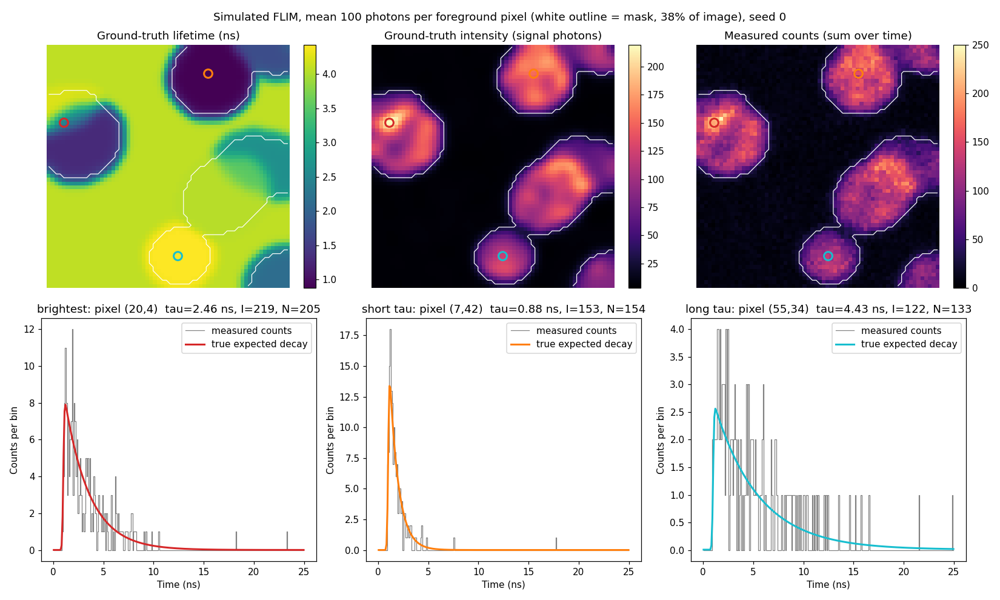

Learned: the photon level must refer to the cells, not the whole image, otherwise the same nominal level means very different data. Corrections: the v1 test set was overwritten by v2; v1 numbers are not comparable with later ones. The simulator ignores photons from the previous laser pulse and cuts the decay at 25 ns (for τ = 5 ns the mean arrival time is 4.80 ns instead of 5 ns); the MLE uses the same truncated model.

### 6.2 Classical baselines on simulator v2

Goal: per-pixel reference methods and a common evaluation before any network.

Settings: MLE with the exact forward model and known background (grid of 200 lifetimes from 0.1 to 8 ns with parabolic refinement); phasor with background subtraction and IRF correction; all 40 test images per level.

Result (`results/tables/baselines.csv`):

| Photons | MLE τ error | MLE τ bias | Phasor τ error | MLE intensity error |
|---|---|---|---|---|
| 10 | 24.3 % | −3.3 % | 28.8 % | 22.3 % |
| 100 | 7.6 % | −0.2 % | 9.2 % | 7.0 % |
| 1000 | 2.4 % | +0.0 % | 2.9 % | 2.3 % |

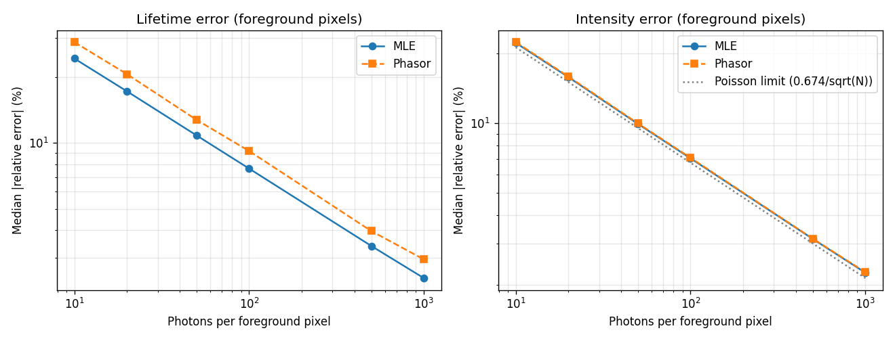

Learned: both errors fall roughly as 1/√N, as expected from Poisson statistics; the MLE is 15 to 20 % better than the phasor; both intensity estimates sit at the per-pixel Poisson limit. The grid MLE agreed with a reference fit within 0.2 % and took 1.1 s per image. At 10 photons 0.3 % of foreground pixels had no photon; the MLE returns NaN there and these pixels are reported as invalid.

### 6.3 DiffFLIM v1 with epsilon-prediction (failed)

Goal: a first conditional diffusion model, following the standard DDPM recipe with noise prediction.

Settings: the model of Section 5.3 (4.76 M parameters) with epsilon-prediction; 60 minutes of training on v2 data (19 599 steps, batch 16, learning rate 2e-4, EMA 0.999, bf16, 16 workers); DDIM with 50 steps.

Result: training ran normally (loss from 0.28 to 0.004), but sampling failed: on a 100-photon test image the lifetime error was 47.5 % and the intensity error 9769 %, against 7.4 % lifetime error for the MLE.

Learned: the author noised test targets to a known step and measured how well one denoising step recovered them. Up to step 800 the error of the recovered maps was about 0.03 (normalised units), at step 990 it was 0.57 for lifetime and 0.84 for intensity. With epsilon-prediction the clean maps are recovered as (x_t − √(1 − ᾱ) ε) / √ᾱ, and √ᾱ ≈ 0.01 near the end of the schedule, so small errors in ε become large errors in the maps. The epsilon loss there was only 0.0002, so the network was never forced to read the maps from the photon counts at high noise; it copied the signal already present in x_t. Starting the sampler later (steps 950 to 600) did not help. The two-minute smoke test had already shown poor sampling errors, but they were attributed to the short training; the problem was found only after the full hour. The fix was v-prediction.

### 6.4 DiffFLIM v1 with v-prediction

Goal: the same model with v-prediction, whose target is close to −x0 at high noise, so a wrong map is penalised directly.

Settings: as in 6.3 with v-prediction, 60 minutes (17 963 steps). Evaluation on the first 8 test images per level, 10 samples, 50 DDIM steps; the baselines on the same images.

Result (`results/tables/diffflim_v1.csv`, MLE-valid foreground pixels):

| Photons | DiffFLIM v1 τ | MLE τ | Binned MLE 5 × 5 τ | DiffFLIM v1 intensity | MLE intensity |
|---|---|---|---|---|---|
| 10 | 2.6 % | 24.9 % | 5.2 % | 5.8 % | 22.4 % |
| 100 | 1.1 % | 7.7 % | 2.0 % | 2.6 % | 7.0 % |
| 1000 | 0.7 % | 2.4 % | 0.8 % | 1.9 % | 2.3 % |

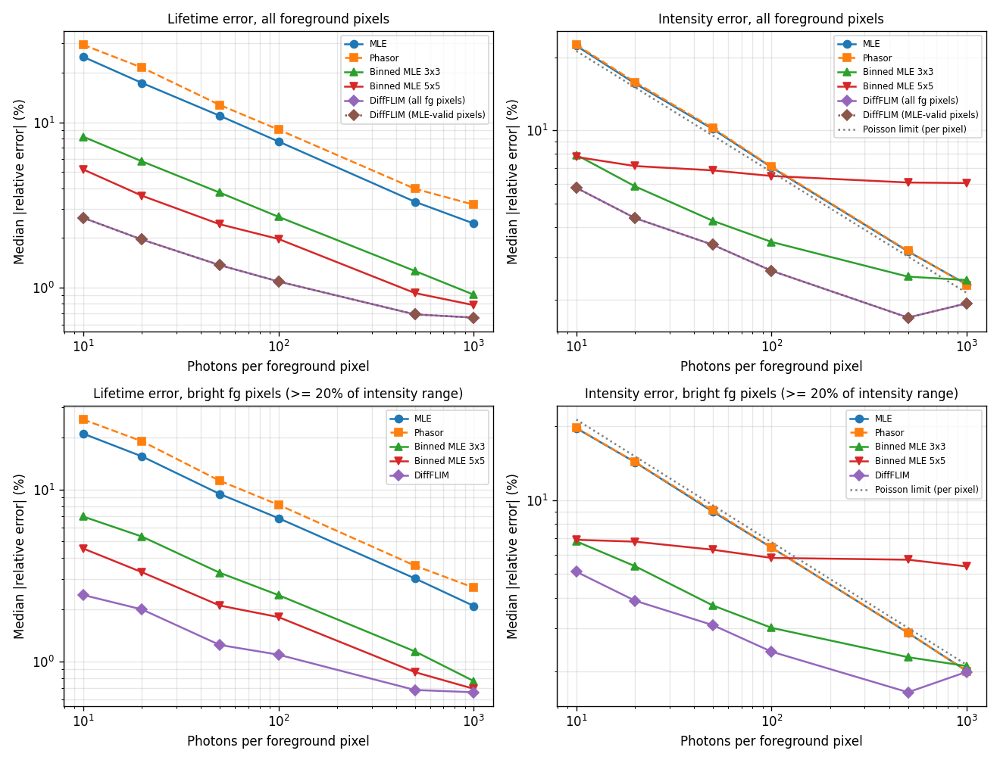

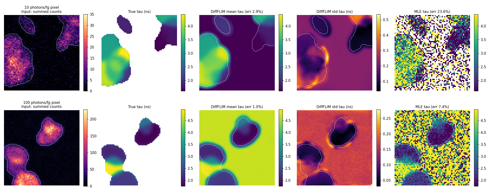

Learned: v-prediction made the model work (1.9 % lifetime error on the check image after five minutes). The numbers are optimistic: v2 lifetime maps are almost constant inside each cell, so any method that averages over neighbours does well. The binned MLE, added later, showed that a 5 × 5 neighbourhood alone came within a factor of two of DiffFLIM at 10 photons and matched it at 500 to 1000 photons. The uncalibrated 90 % intervals covered 81 to 87 % at 10 photons and 98 % at 1000 photons (`coverage_v1.csv`): the predicted spread hardly changed with the photon level.

### 6.5 Split-conformal calibration of DiffFLIM v1

Goal: correct the coverage of the v1 intervals with split conformal prediction, in code that can be reused for later models.

Settings: a v2 calibration set of 6 levels × 20 images (seeds 54321 + level); predictions with 10 samples on all calibration and test images; global factors and per-level factors interpolated linearly in log(estimated photons), with the `otsu_log` photon estimate.

Result: the global 90 % factor was 1.32 for the lifetime and 1.66 for the intensity; the per-level lifetime factor fell from 1.44 at 10 to 1.04 at 1000 photons. Coverage at 90 % on the test set (uncalibrated / global / per level, `coverage_calibrated_v1.csv`):

| Photons | Lifetime | Intensity |
|---|---|---|
| 10 | 0.86 / 0.77 / 0.81 | 0.82 / 0.82 / 0.90 |
| 100 | 0.95 / 0.90 / 0.89 | 0.90 / 0.90 / 0.90 |
| 1000 | 0.98 / 0.95 / 0.91 | 0.95 / 0.95 / 0.85 |

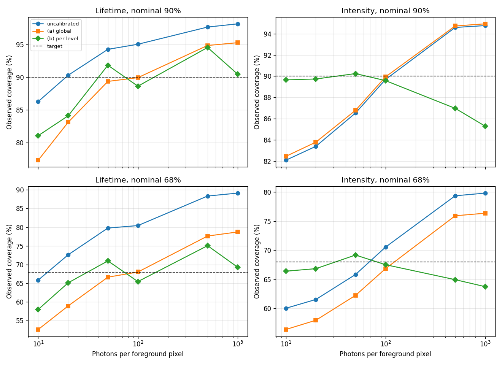

Learned: pooled over all levels both variants were on target, but per level the coverage scattered by 5 to 9 percentage points. Pixels of one image are strongly correlated, so 20 calibration images per level give noisy factors: the effective sample size is closer to the number of images than to the number of pixels. This led to larger calibration sets (100 images per level), a smooth (quadratic) factor curve and bootstrap intervals in the later calibrations.

### 6.6 Simulator v3 and the baselines on v3

Goal: realistic structure instead of blobs, following the FLIMngo simulation with real photon counts (Section 5.2): HPA cell crops, up to four lifetime components per pixel with per-pixel jitter, Perlin-noise amplitudes, twelve IRFs with laser jitter.

Settings: 30 fixed HPA test cells; test set 6 levels × 40 images; baselines with the image's own IRF as mono-exponential fits; phasor with the exact point-sampled inversion; "bright" pixels defined relative to the intensity range.

Result: the simulator produced 20.6 samples per second; all v3 tests passed. The true lifetime of a foreground pixel differed from the median of its 3 × 3 neighbourhood by 3.7 to 4.9 % in the median, a roughness that no smoothing method can recover. On v3 all baselines were much less accurate than on v2, and the mono-exponential fits were biased by +5 to +11 %, partly because on multi-component pixels they follow the intensity-weighted rather than the amplitude-weighted lifetime.

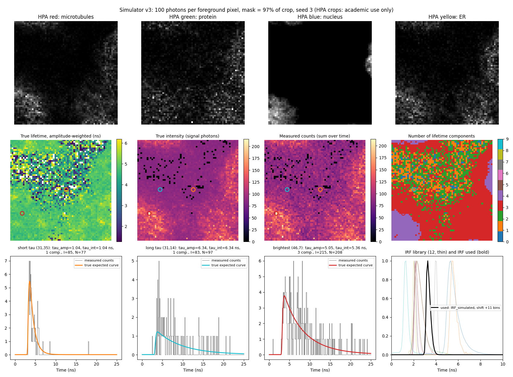

Learned: the plain phasor formula gave 0.754 ns for a true 0.8 ns, because the phasor of a point-sampled exponential corresponds to τ − dt/2; the exact inversion fixed this. Two IRF files needed `sdtfile` and `h5py`, which were installed after the user allowed it. The "bright" definition relative to the maximum selected all pixels on v3 and was changed to the range-based rule. Corrections: the baseline numbers of this first v3 test set were replaced after the test set was made paired (6.8).

### 6.7 DiffFLIM v1 on v3 data

Goal: check whether the model trained on blobs transfers to the realistic data.

Result: it did not. On the paired test set (8 images per level) the lifetime error was 27.7 to 35.6 %, the intensity was underestimated by 10.6 to 85.4 %, and the 90 % lifetime intervals covered only 20 to 43 % (`diffflim_v1_on_v3.csv`, `coverage_v1_on_v3.csv`). At 100 photons it produced an almost flat lifetime map.

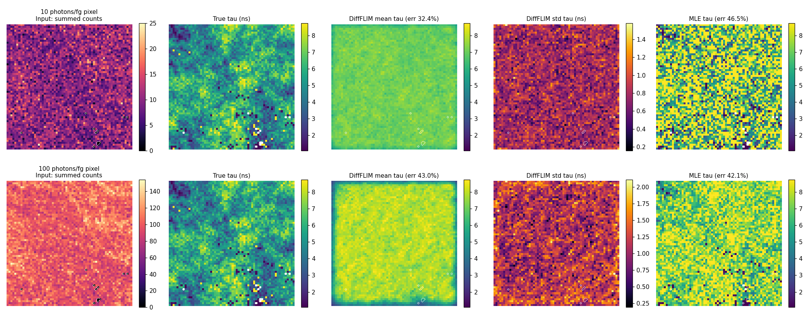

Learned: a learned prior is only as good as the similarity between training and test data, which is also the main open question for real data (Section 9).

### 6.8 Paired test set and correction of earlier numbers

Goal: remove differences in image content between photon levels from the comparison.

In the first v3 test set every photon level used different random crops, and only 19 of the 30 test IDs appeared. The error curves of the binned MLE were therefore not monotonic (they rose again at 20 and 500 photons). The author rebuilt the test set so that all levels contain the same 40 scenes and all 30 test IDs appear, rebuilt the calibration set in the same way (100 images per level from 20 calibration cells), and re-ran the baselines and DiffFLIM v1 on v3. The files `baselines_v3.csv` and `diffflim_v1_on_v3.csv` were overwritten.

| Photons | Binned MLE 5 × 5, first set | Binned MLE 5 × 5, paired set | MLE, first set | MLE, paired set |
|---|---|---|---|---|
| 10 | 12.4 % | 15.2 % | 31.0 % | 32.8 % |
| 100 | 8.8 % | 12.6 % | 11.6 % | 14.1 % |
| 1000 | 9.3 % | 12.3 % | 5.7 % | 7.6 % |

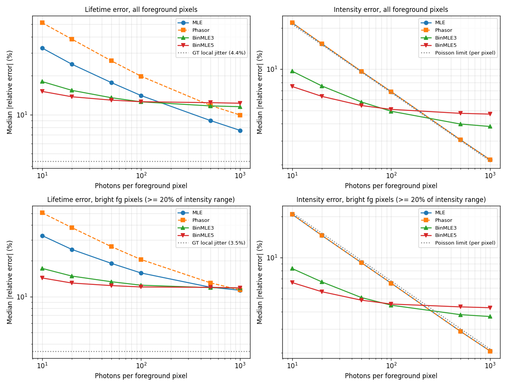

Learned: test-set content can change errors by several percentage points, more than many differences between methods. All later v3 results use the paired set; the earlier v3 numbers in the log are superseded. The ground-truth jitter is now the same at every level (4.39 % of τ on all foreground pixels, 3.5 % on bright pixels).

### 6.9 DiffFLIM v2 (3 h and 6 h)

Goal: train DiffFLIM on v3 data in a long run and calibrate it with v3 calibration cells.

Settings: the v1 architecture with lifetime range 0.1 to 12 ns; 360 minutes of training (186 116 steps, 8.6 iterations per second, 17 % data wait) on the 246 training cells with a snapshot after 180 minutes; evaluation on all 40 test images per level with 10 samples of 50 DDIM steps; calibration on the 20 calibration cells.

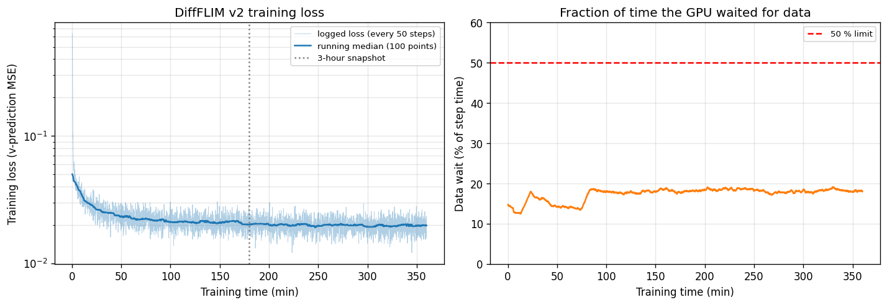

Result (50 DDIM steps, `diffflim_v2.csv`, `diffflim_v2_3h.csv`; all foreground / bright pixels):

| Photons | MLE | Binned MLE 5 × 5 | DiffFLIM v2 (3 h) | DiffFLIM v2 (6 h) | DiffFLIM v2 (6 h) intensity |
|---|---|---|---|---|---|
| 10 | 32.8 / 32.6 % | 15.2 / 14.4 % | 10.1 / 9.1 % | 9.8 / 8.7 % | 4.5 / 5.0 % |
| 100 | 14.1 / 15.8 % | 12.6 / 12.1 % | 6.9 / 6.4 % | 6.6 / 6.0 % | 2.9 / 3.9 % |
| 1000 | 7.6 / 11.3 % | 12.3 / 11.9 % | 4.7 / 4.8 % | 4.3 / 4.4 % | 2.1 / 2.6 % |

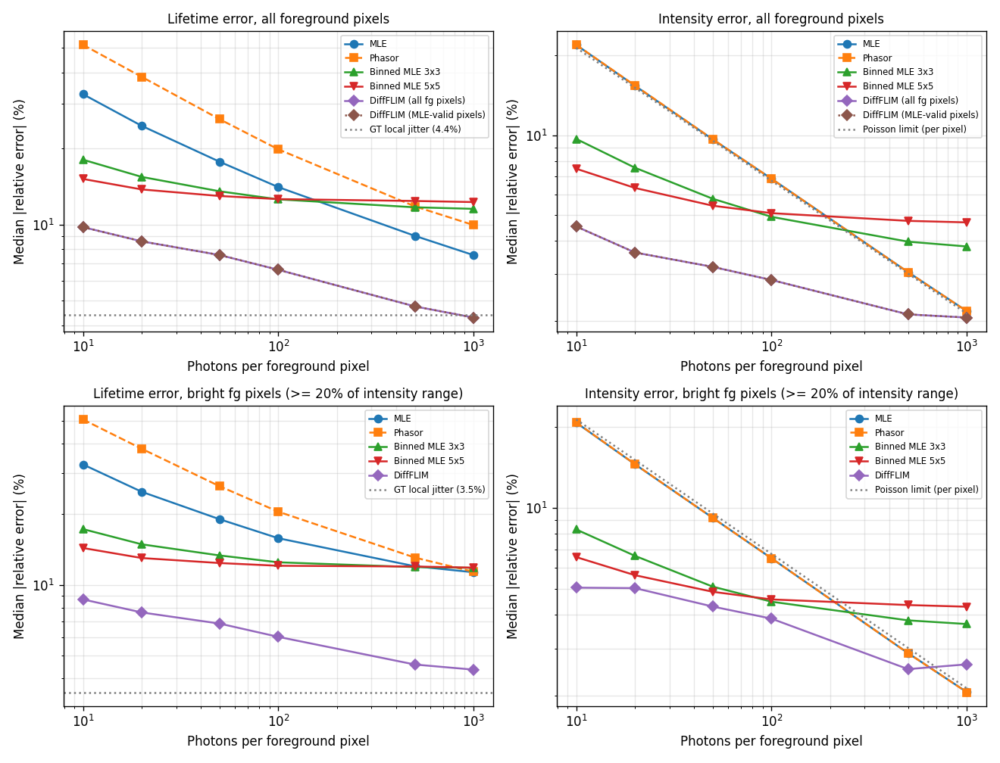

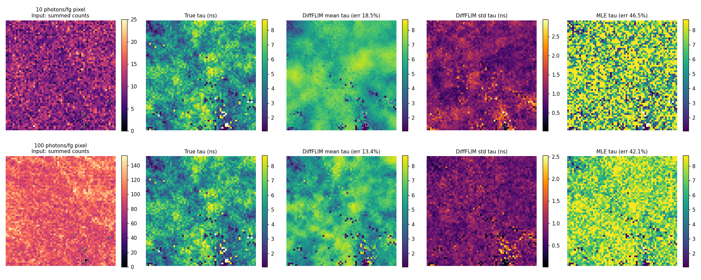

The lifetime bias was +1.0 to +3.1 %, against +7 to +11 % for the mono-exponential baselines. The uncalibrated 90 % intervals covered 78.1 % (lifetime) and 82.6 % (intensity) pooled; after calibration with 20 cells, 89.8 % and 87.7 %.


Learned: trained on v3, DiffFLIM was 1.55 to 1.9 times more accurate than the best classical baseline at every level. The loss hardly changed after the first hour, but the 6-hour model was still 0.3 to 0.4 points better than the 3-hour snapshot. At 1000 photons the error (4.3 %) is close to the ground-truth jitter (4.4 %), because the predicted mean map is smooth. The intensity intervals under-covered; the 90 % score quantile was 2.14 on the test cells and 1.95 on the calibration cells. Corrections made later: twelve bootstrap interval bounds in the log entry of this step had been copied from rounded console output and differed by 0.1 to 0.5 points from the saved file; they were corrected in the next log entry. The image-level intervals themselves turned out to be too narrow (6.11).

### 6.10 Pretrained FLIMngo

Goal: the published learned method as a baseline, run with its own preprocessing.

Settings: FLIMngo's network and weights from `external/FLIMngo`; each pixel's decay divided by its maximum, background set to zero with the ground-truth mask, 64 × 64 input; five preprocessing variants. The wrapper was first checked against FLIMngo's own demo (`tests/test_flimngo.py`).

Result (`flimngo_v3.csv`, lifetime error on all foreground pixels):

| Variant | 10 photons | 100 photons | 1000 photons |
|---|---|---|---|
| Ground-truth mask, normalised, 64 × 64 (main) | 12.4 % | 8.9 % | 7.0 % |
| Zero-padded to 256 × 256 | 12.6 % | 8.8 % | 6.9 % |
| Otsu mask from the counts | 15.4 % | 10.3 % | 7.5 % |
| No mask | 12.9 % | 12.1 % | 14.3 % |
| No normalisation | 12.6 % | 18.2 % | 78.8 % |

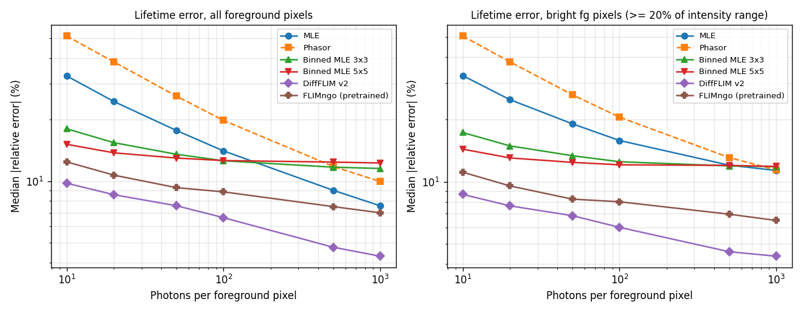

Learned: FLIMngo was better than every classical method (by 18 to 29 % up to 100 photons) with a small bias (−2.8 to +0.8 %), but DiffFLIM v2 was 1.27 to 1.63 times more accurate. Padding to its training size made no difference; the per-pixel normalisation is essential. FLIMngo needs 6.1 ms per image against 0.53 s for DiffFLIM at 50 steps. Corrections made later: the ground-truth mask gives FLIMngo information that DiffFLIM does not have; from 6.12 on, all learned methods get only a mask computed from the counts.

### 6.11 Extra calibration cells, better photon estimate and cell-level coverage

Goal: calibrate DiffFLIM v2 with more cells it never saw, improve the photon-level estimate, and quantify the uncertainty of the coverage at the level of cells.

Settings: the 54 samples completed after the v2 run started became extra calibration cells (`hpa_calib_extra_v2.txt`, 600 more calibration images); the new `otsu_adaptive` photon estimate (chosen on the calibration set); factors from all 74 calibration cells; a cell-level bootstrap (`coverage_cell_bootstrap.py`).

Result: the new photon estimate reduced the share of images estimated more than 20 % off from 14 % to 5 %. With 74 cells, the pooled 90 % coverage was 89.8 % (lifetime) and 88.1 % (intensity); the per-level factors kept every level within 1.6 and 2.8 points of 90 %, against 3.0 and 6.0 points for a single global factor. The 90 % score quantiles for the intensity were 1.95 (first calibration cells), 2.01 (extra cells) and 2.14 (test cells). Resampling the 30 test cells instead of images roughly doubled the width of the intervals:

| Quantity, 90 % | Coverage | Image-level interval | Test-cell interval | Joint interval (factors refitted) |
|---|---|---|---|---|
| Lifetime, global factor | 89.8 % | [88.9, 90.5] % | [88.3, 91.0] % | [88.1, 91.2] % |
| Intensity, global factor | 88.1 % | [87.0, 89.3] % | [85.7, 90.4] % | [85.2, 90.7] % |

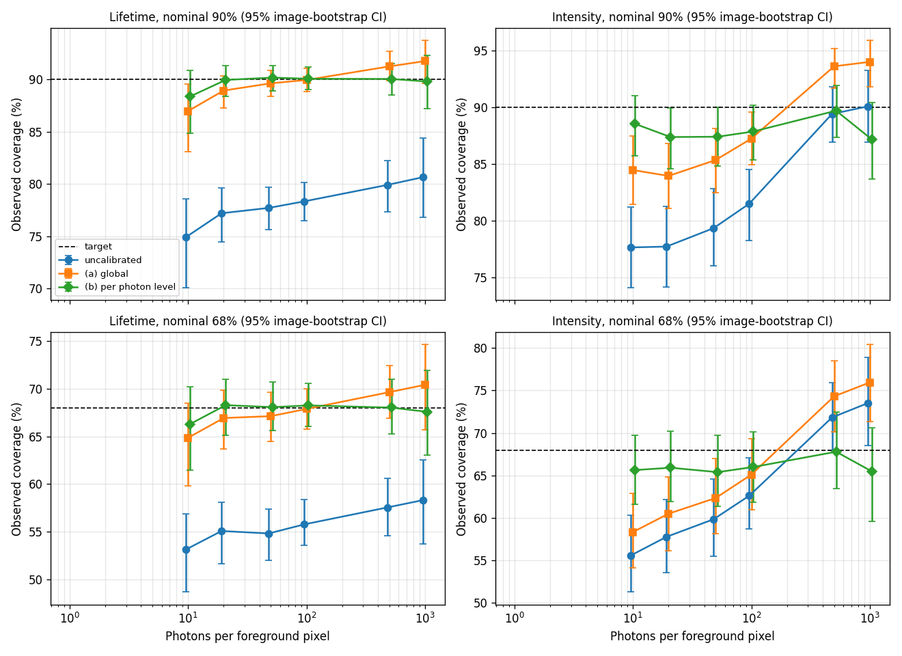

Learned: at the level of cells the intensity coverage of 88.1 % is consistent with 90 %; the earlier "under-coverage" came from intervals that treated images of the same cell as independent. Per level, the global factor is not consistent with 90 % (under-coverage of the intensity at 10 to 50 photons, over-coverage at 500 and 1000), so the per-level factors are the ones to report per photon level. Four calibration variants were kept for comparison (`v2_newest`, `v2_extra_oldest`, `v2_extraonly`, `v2_extra`; Section 8); the photon estimate changed the coverage by at most 0.1 points. The extra cells are excluded from training by default (Section 4.3).

### 6.12 Retrained FLIMngo (fair comparison)

Goal: answer whether DiffFLIM's advantage comes from the method or from the training data ("home advantage"): train the FLIMngo architecture on exactly the data DiffFLIM v2 saw, and give all learned methods the same information.

Settings: `train_flimngo.py` (Section 5.6): 246 training cells, photons 10 to 1000, 64 × 64, FLIMngo's loss and optimiser, batch 16, 180 minutes (the training time of the 3-hour DiffFLIM checkpoint), background mask `otsu_adaptive` computed from the counts in training and evaluation.

Result: the smoke test ran at 8.8 iterations per second. The 3-hour run made 88 837 steps (about 1.42 M images); the validation error fell to 7.7 % after 50 minutes and then stayed between 7.5 and 8.5 %; the best validation MSE (0.921 ns²) was reached after 130 minutes, and this checkpoint was used.

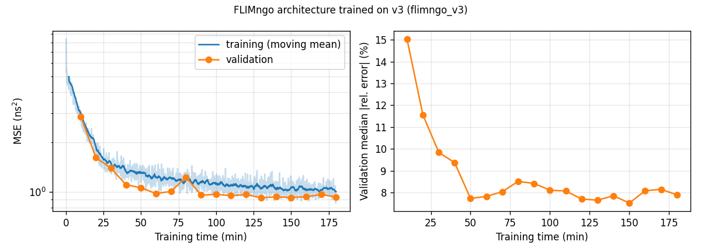

With the `otsu_adaptive` mask, the retrained FLIMngo reached 14.0, 9.9 and 8.1 % at 10, 100 and 1000 photons (pretrained with the same mask: 19.8, 12.7 and 10.3 %; DiffFLIM v2 3 h: 10.1, 6.9 and 4.7 %). Its bias was +4.5 to +6.9 %.

Learned: at equal training time and data, DiffFLIM was 1.4 to 1.7 times more accurate, so its advantage is not explained by the training data. The computed mask was a large part of the FLIMngo error: it kept only 74 to 81 % of the true foreground, because it had been tuned for the photon estimate. Both points were followed up in 6.14 and 6.15.

### 6.13 Speed trade-off

Goal: find out how much faster DiffFLIM can be with fewer DDIM steps or fewer samples, and at what cost.

Settings: 50, 20 and 10 steps × 10 and 5 samples; the first 10 test images per level (60 images, 10 cells); each setting recalibrated on all 1200 calibration images.

Result (`speed_tradeoff_v2.csv`, all levels pooled):

| DDIM steps | Samples | Time per image | τ error | Intensity error | τ coverage 90 % (none / global / per level) | Intensity coverage 90 % (none / global / per level) |
|---|---|---|---|---|---|---|
| 50 | 10 | 522 ms | 7.26 % | 2.72 % | 81.0 / 91.8 / 91.8 % | 85.7 / 90.8 / 90.7 % |
| 50 | 5 | 391 ms | 7.37 % | 2.87 % | 76.6 / 92.3 / 92.3 % | 77.6 / 88.9 / 88.9 % |
| 20 | 10 | 233 ms | 7.22 % | 2.70 % | 73.9 / 92.1 / 92.0 % | 81.8 / 91.1 / 91.0 % |
| 20 | 5 | 182 ms | 7.26 % | 2.83 % | 70.0 / 92.9 / 92.9 % | 73.4 / 89.2 / 89.1 % |
| 10 | 10 | 111 ms | 7.21 % | 2.70 % | 65.5 / 92.0 / 91.9 % | 78.0 / 91.3 / 91.1 % |
| 10 | 5 | 94 ms | 7.22 % | 2.82 % | 62.2 / 93.0 / 93.0 % | 69.6 / 89.4 / 89.2 % |

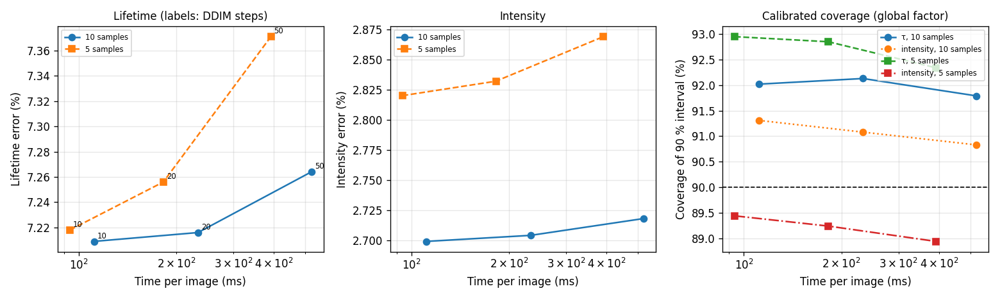

Learned: 10 steps with 10 samples are 4.7 times faster than 50 steps without loss of accuracy. Fewer steps make the samples less diverse (the uncalibrated coverage falls), but recalibration restores the coverage, which is why calibration factors are specific to the sampler setting. Five samples save little time (the samples run as one batch) and give noisier standard deviations. These 60 images are easier than the full test set for the lifetime calibration (91.8 % instead of 89.8 % at the same setting), so only the differences between settings are meaningful.

### 6.14 Recall-oriented mask for FLIMngo

Goal: give FLIMngo a background mask that keeps at least 95 % of the true foreground, chosen on the calibration sets only.

Settings: `select_flimngo_mask.py`, 90 candidates, rule fixed in advance (Section 5.6).

Result: 87 candidates met the recall target. The chosen rule, summed counts above 0.2 × their 99th percentile without smoothing, kept 98.1 % of the true foreground at 10 photons and 100 % from 50 photons on, and excluded 99.99 % of the background on the calibration sets (otsu_adaptive: recall 0.76 to 0.87). On the test set the recall was 0.979 to 1.000 with a precision of 0.9999 or higher. With this mask the pretrained FLIMngo reached its ground-truth-mask accuracy except at 10 photons (13.0 instead of 12.4 %), its error fell by 30 to 44 %, and it became the strongest deterministic baseline; the retrained FLIMngo improved by only 6 to 8 % (it had learned to fill in masked pixels) and was 0.3 to 1.2 points behind the pretrained one. DiffFLIM v2 remained 1.25 to 1.64 times more accurate than the best FLIMngo.

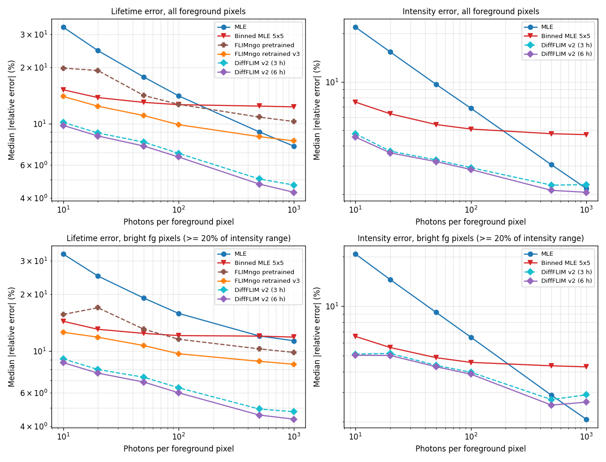

Learned: the near-perfect mask is a property of the v3 intensity mapping (Section 5.2) and will not be this clean on real data.

### 6.15 Bias analysis of the retrained FLIMngo

Goal: find the cause of the +4.5 to +6.9 % bias of the retrained FLIMngo without retraining.

Result (`flimngo_bias_breakdown.csv`, `flimngo_bias_checks.csv`): the bias depended on the checkpoint. The best-validation checkpoint (130 min) had +5.8 % on the test set (recall mask), the last checkpoint (180 min) +0.9 %. The difference between them was nearly an additive offset of 0.22 to 0.37 ns at every photon level and for every true lifetime above 2 ns; the same shift appeared on training cells (validation set: +1.2 % and −3.6 %). The validation MSE of the two checkpoints was almost the same (0.92 and 0.93 ns²). No preprocessing mismatch was found: training and evaluation input paths gave identical predictions, the mask did not change the bias, and background, IRF shift and IRF library matched between the training stream and the test set. The test scenes added about 4 points for both checkpoints (scene bootstrap for the best checkpoint [+3.5, +9.0] %), plausible as sampling with only 40 scenes. All methods, including DiffFLIM, overestimated short and underestimated long lifetimes.

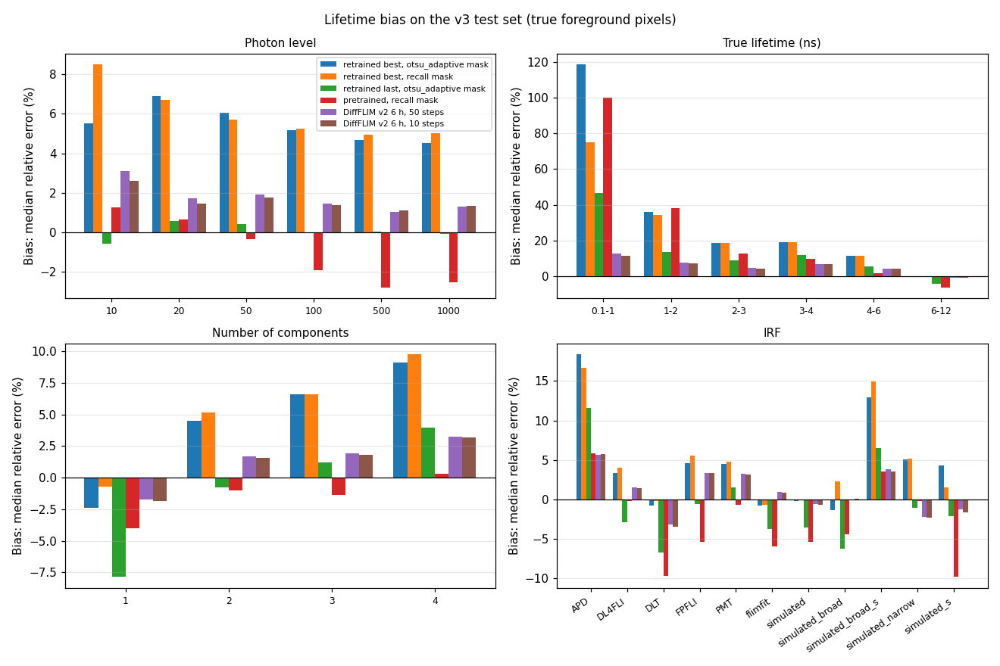

Learned: the most likely cause is a drift of the network's output offset under a constant learning rate of 0.01 without weight averaging, which the checkpoint selection on 64 validation images did not control. The fix (weight averaging or a decaying learning rate, a larger validation set, selection on the median relative error, logging the bias) needs retraining and was not done. As a sensitivity result only, the last checkpoint was more accurate (12.4, 8.5 and 6.0 % at 10, 100 and 1000 photons) than both the selected one and the pretrained FLIMngo; it is not used, because choosing it would select the model on the test set.

### 6.16 Ten DDIM steps as the default

Goal: make the faster setting the default for DiffFLIM evaluation and calibration.

Settings: `DEFAULT_SAMPLE_STEPS = 10`, `--steps` options in all scripts (50 remains available); full test set (240 images) and full recalibration with 74 cells at 10 steps; cell-level bootstrap.

Result: on the full test set, 10 steps gave the same or a slightly lower error than 50 steps (6 h: 9.5 versus 9.8 % at 10 photons, 4.3 versus 4.3 % at 1000), the same calibrated coverage (lifetime 90.0 %, intensity 87.6 % with per-level factors) and the same interval width (mean relative width of the 90 % interval 0.452 versus 0.456 for τ). Before calibration the 10-step intervals were narrower (63.0 instead of 78.1 % lifetime coverage), and with a single global factor the coverage at 1000 photons rose to 94.5 % (τ) and 96.5 % (intensity), so the per-level factors matter more with 10 steps.

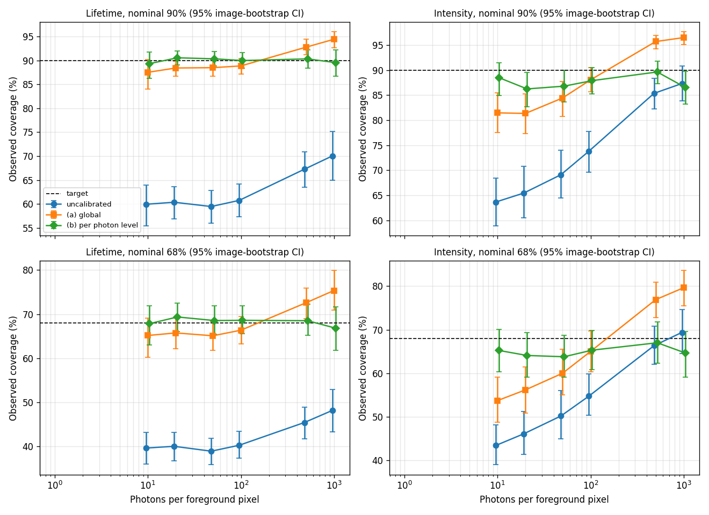

Learned: the sampler can be made five times faster without cost, provided the calibration is redone for the new setting. The refactored cell bootstrap with `--steps 50` reproduced its earlier output byte for byte.

### 6.17 First real data: FLIMngo's *C. elegans* recordings

Goal: a first test on measured data without training or tuning: whether the methods reproduce the biological result of FLIMngo's Fig. 8 (a shorter lifetime for amyloid-β-tagged mScarlet than for mScarlet alone in the neurons of unparalysed worms), how consistent each method is when the photons of a recording are split in two, and which properties of the real data lie outside what DiffFLIM v2 saw in training.

Settings: the 12 raw recordings in `external/FLIMngo/sample_data/celegans/raw_data/` (6 Aβ-mScarlet, 6 mScarlet; 1 s acquisitions; 256 × 256 pixels, 256 bins of 0.09765625 ns, the bin width of the v3 data); the fixed protocol of `scripts/eval_real_celegans.py` (Section 5.6); DiffFLIM v2 (6 h) with 10 DDIM steps × 10 samples and the `v2_extra_s10` calibration; no parameter was changed after the results were seen. The protocol was changed once before the results were used: in the first run the full recording and both halves were sampled with the same DiffFLIM seeds, which correlates the halves' predictions; with separate seeds the median difference between halves rose from 3.0 to 3.4 % and the simulated reference from 6.3 to 6.4 to 7.0 %. Only the corrected numbers are reported.

**The data.** The recordings contain 0.10 to 0.59 million photons in total. The recall-oriented mask (threshold 0.2 × the 99th percentile of the summed counts, 4.4 to 18.8 photons) selected 4100 to 10 000 pixels per recording; inside it, the median pixel had 10 to 20 photons in the Aβ recordings and 27 to 49 photons in the mScarlet recordings (10th percentile 5 to 10 and 15 to 22). In the Aβ recordings 6 to 47 % of the mask pixels had fewer than 10 photons. The photon level estimated for the per-level factors was 14 to 67 photons, inside the calibrated range (10.3 to 1020); for the halves it was 7 to 33, and one half (Aβ w1) fell below the range and was clamped and flagged. The recall mask contained every pixel of FLIMngo's manual mask in the Aβ recordings (and was 1.1 to 1.9 times larger) and 74 to 86 % of it in the brighter mScarlet recordings, where its threshold is higher.

The time axis agreed with the PMT IRF: the IRF peaks at bin 22, the pooled worm decay rises at bin 21 and peaks at bin 25, and the alignment chose a shift of 0 bins (pooled mono-exponential lifetime 3.03 ns). Two properties of the decays are not in the simulator: bins 0 to 6 are empty in every recording, and inside the worms the bins before the rise contain about 0.8 % and the last 20 bins about 1.3 % of the peak count per bin, an offset proportional to the signal (photons from the previous laser pulse or detector afterpulsing). The background outside the worms was low (0.00010 to 0.00045 counts per pixel and bin, 0.03 to 0.11 photons per pixel over the window).

**Test A: Aβ-mScarlet versus mScarlet.** Median lifetime inside the mask per recording; medians over the 6 recordings of each group and two-sided exact Mann–Whitney test (`real_celegans_groups_v2.csv`):

| Method | Aβ-mScarlet | mScarlet | Difference | U | p |
|---|---|---|---|---|---|
| MLE | 2.67 ns | 3.19 ns | −0.53 ns | 0 | 0.0022 |
| Binned MLE 5 × 5 | 2.72 ns | 3.24 ns | −0.52 ns | 0 | 0.0022 |
| FLIMngo pretrained | 2.84 ns | 3.34 ns | −0.50 ns | 1 | 0.0043 |
| DiffFLIM v2 | 2.72 ns | 3.07 ns | −0.35 ns | 2 | 0.0087 |
| FLIMngo, their masks, mean (notebook reproduction) | 2.81 ns | 3.26 ns | −0.45 ns | 0 | 0.0022 |

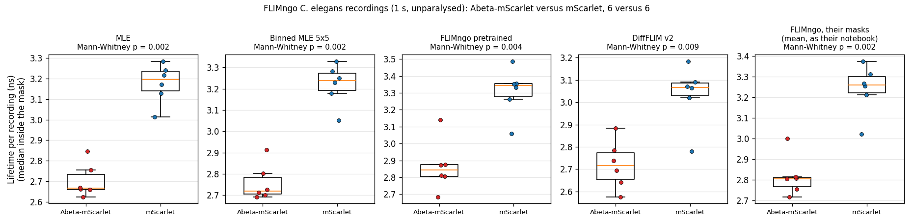

Every method found a shorter lifetime for Aβ-mScarlet, as FLIMngo reported, and every test was significant at the 1 % level. With only 6 recordings per group the smallest possible p value is 0.0022, which four methods reached (no overlap between the groups); FLIMngo had one and DiffFLIM two pairs in the wrong order (one mScarlet recording, w6, lies inside the Aβ range for DiffFLIM). The group difference of DiffFLIM (0.35 ns) was smaller than that of the other methods (0.45 to 0.53 ns), mainly because its mScarlet lifetimes were lower (3.07 against 3.19 to 3.34 ns), while its Aβ lifetimes matched the binned MLE. Without ground truth it cannot be decided which method is closer to the true lifetimes; on simulated data all learned methods pulled lifetimes towards the common values of their training data (Section 6.15).

**Test B: split-half consistency.** Median over the 12 recordings of the per-recording medians inside the mask (`real_celegans_splithalf_v2.csv`):

| Method | Halves A versus B | Half versus full data |
|---|---|---|
| MLE | 0.47 ns (16.4 %) | 0.48 ns |
| Binned MLE 5 × 5 | 0.10 ns (3.5 %) | 0.10 ns |
| FLIMngo pretrained | 0.14 ns (4.6 %) | 0.14 ns |
| DiffFLIM v2 | 0.10 ns (3.4 %) | 0.09 ns |

DiffFLIM was as consistent as the 5 × 5 binned MLE and more consistent than FLIMngo and the per-pixel MLE; all methods were less consistent on the dimmer Aβ recordings (DiffFLIM 4.2 % against 2.6 % for mScarlet). The calibrated 90 % intervals of DiffFLIM had a median half-width of 0.64 ns (18 to 27 % of the lifetime); the intervals of the two halves overlapped in 100 % of the mask pixels, and one half's mean lay inside the other half's interval in 99.9 %. These fractions are not coverages, because the two halves share the same truth: errors that do not depend on the photon noise, such as the pull of the learned prior, are common to both halves. On simulated test images with the same split (halves of 10, 25 and 50 photons, `real_celegans_splithalf_simref_v2.csv`), the same analysis gave 99.8 % overlap and 95 to 97 % "B in A" while the calibrated coverage against the truth was 91 to 92 % and the relative half-width 24 to 32 %. The real-data values are therefore what a calibrated model would show; they do not test the calibration.

On simulated data at comparable photon counts, the two halves of DiffFLIM differed by 6.4 to 7.0 %, about twice as much as on the real recordings. Either the real lifetime maps are smoother than v3 maps (which contain 4.4 % per-pixel jitter and up to four components per pixel), or DiffFLIM relies more on its prior on these data; a split-half test cannot distinguish the two.

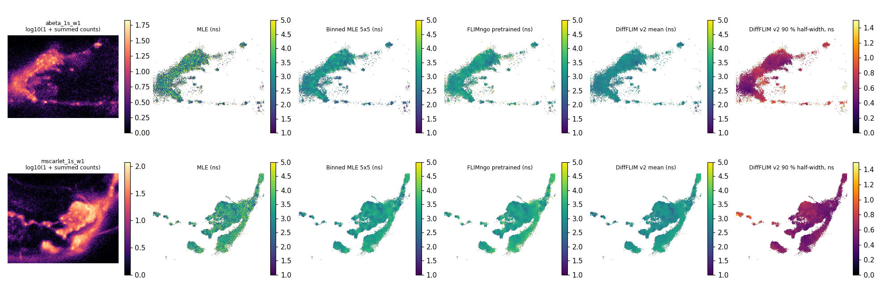

**Signs that the real data lie outside the training data.** (1) Photon counts at the bottom of the training range (10 to 1000 per foreground pixel): many Aβ pixels below 10 photons, one half below the calibrated range. (2) 256 × 256 images instead of 64 × 64 crops, processed in blended tiles; tiles that contain only background or worm edges are unlike training crops, which had at least 5 % foreground. (3) Background structure: empty first bins and a signal-proportional offset of about 1 % of the peak per bin, not simulated. (4) Moving worms and neuron morphology instead of HPA cell crops. (5) The recall mask includes isolated noise pixels in the dim Aβ recordings. In favour of the model: the bin width is the same, the PMT IRF is part of the training library and needed no shift, and the lifetimes (2.5 to 3.5 ns) lie in the middle of the training range.

Learned: on real data DiffFLIM reproduces the published biological difference, with consistency comparable to 5 × 5 binning but a smaller group difference than the other methods. Its intervals behave on the split-half test as they do on simulated data, but their calibration on real data cannot be checked without a sample of known lifetime.

### 6.18 DiffFLIM v3cells: more training cells

Question: does DiffFLIM improve when it is trained on more HPA cells? DiffFLIM v2 was trained on 246 cells; by the time of this run 386 training cells were available (Section 4.3).

Setup: DiffFLIM v2 was repeated with exactly the same settings (architecture, v-prediction, batch 16, learning rate 2e-4, warm-up 500, EMA 0.999, seed 0, 16 workers), with one change: the 386 training cells. For a fair comparison the run was stopped after the same number of optimiser steps as v2 (186,116), not after the same time, and a snapshot was kept at step 92,168, the step of the v2 3-hour snapshot. Both models and both snapshots went through the same post-training chain (`scripts/post_training_chain.sh`): v3 test set with 10 DDIM steps × 10 samples, calibration on the 74 calibration cells with each model's own factors, and the fixed real-data protocol. The second test set was not used.

Training ran at 7.3 iterations per second (v2: 8.6) and took 403 minutes; the data-wait fraction was 10 to 12 % (v2: 17 %), so the data loading was not the cause; other programs used the GPU during the run. The training loss was the same as that of v2 at the same step (for example 0.0212 against 0.0211 at step 79,150).

Simulated test set (`model_versions.csv`):

| Model | Training cells | Steps | Lifetime error 10 / 100 / 1000 photons | Lifetime error, all | Intensity error, all | Lifetime bias, all | Coverage 90 % lifetime / intensity |
|---|---|---|---|---|---|---|---|
| DiffFLIM v2, 3 h | 246 | 92,168 | 9.95 / 6.82 / 4.64 % | 6.74 % | 3.00 % | +1.70 % | 90.2 / 87.7 % |
| DiffFLIM v2, 6 h | 246 | 186,116 | 9.54 / 6.53 / 4.27 % | 6.40 % | 2.84 % | +1.51 % | 90.0 / 87.6 % |
| DiffFLIM v3cells, step 92k | 386 | 92,168 | 9.76 / 6.83 / 4.79 % | 6.76 % | 3.06 % | +1.73 % | 90.0 / 87.4 % |
| DiffFLIM v3cells, step 186k | 386 | 186,116 | 9.43 / 6.51 / 4.40 % | 6.39 % | 2.87 % | +1.67 % | 90.1 / 87.6 % |

The differences between the models are small, so they were tested in pairs on the same test images (`scripts/compare_versions.py`, `model_versions_paired.csv`): per image, the median absolute relative error; per pair, the mean difference over the images of a level, with a 95 % interval from 5000 resamples of the 30 test cells. At the same number of steps, v3cells minus v2 gave a lifetime error difference of −0.36 percentage points at 10 photons (interval −0.91 to +0.02) and between −0.09 and +0.09 points at the other levels (all intervals include zero); pooled −0.05 points (−0.39 to +0.23). For the intensity, the pooled difference was +0.01 points (−0.07 to +0.07); v3cells was slightly better at 50 photons (−0.10, interval −0.20 to −0.01) and slightly worse at 1000 photons (+0.21, interval +0.03 to +0.38). Between the snapshots at step 92,168 the pattern was the same, with the only clear difference at 10 photons (lifetime −0.43 points, interval −0.80 to −0.11). The lifetime bias at 1000 photons rose from +1.3 % (v2) to +2.0 % (v3cells). For comparison, doubling the number of steps reduced the pooled lifetime error by 0.47 points for v2 (interval −0.65 to −0.31) and by 0.48 points for v3cells (−0.77 to −0.24), at every photon level; the effect of training length was about ten times the effect of the additional cells. The coverage of the calibrated 90 % intervals did not change (90.0 to 90.2 % for the lifetime, 87.4 to 87.7 % for the intensity, all four models).

Real data (`real_celegans_*_<tag>.csv`):

| Model | Aβ-mScarlet | mScarlet | Difference | Mann–Whitney p | Split-half difference |
|---|---|---|---|---|---|
| DiffFLIM v2, 3 h | 2.66 ns | 3.09 ns | 0.43 ns | 0.0022 | 3.0 % |
| DiffFLIM v2, 6 h | 2.72 ns | 3.07 ns | 0.35 ns | 0.0087 | 3.4 % |
| DiffFLIM v3cells, step 92k | 2.83 ns | 3.18 ns | 0.35 ns | 0.0043 | 3.4 % |
| DiffFLIM v3cells, step 186k | 2.81 ns | 3.15 ns | 0.34 ns | 0.0043 | 2.8 % |

On the *C. elegans* recordings (fixed protocol, own calibration factors per model), both v3cells models found the shorter lifetime of Aβ-mScarlet. Both groups moved up by about 0.09 ns compared with DiffFLIM v2 (6 h), so the group difference stayed at 0.34 to 0.35 ns, still smaller than the 0.50 to 0.53 ns of the MLE, the binned MLE and FLIMngo. Without ground truth it is not known which absolute level is closer to the truth. With 6 against 6 recordings the exact Mann–Whitney p value can take only a few small values: 0.0022 when the groups are completely separated, 0.0043 with one and 0.0087 with two Aβ/mScarlet pairs in the wrong order; the change from 0.0087 (v2) to 0.0043 (v3cells) is one pair of recordings. The split-half difference was 2.8 % for v3cells against 3.4 % for v2, but 3.4 % for the v3cells snapshot against 3.0 % for the v2 snapshot, so the direction is not consistent between training lengths; the simulated reference of the same test (6.4 to 7.5 % for all four models) did not change either.

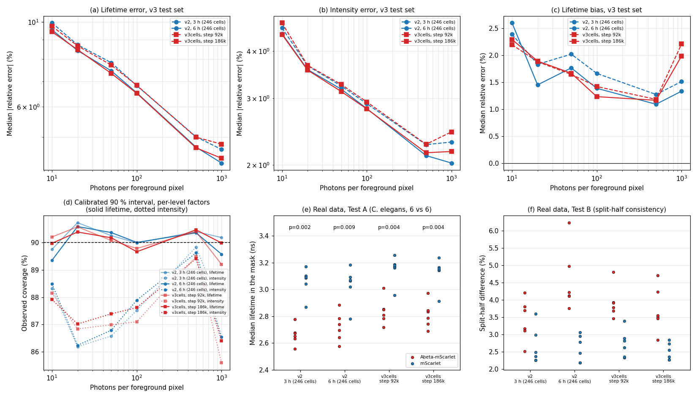

Learned: going from 246 to 386 training cells at the same number of steps did not change DiffFLIM measurably, neither on the simulated test set nor on the real recordings; the only consistent difference was a lower lifetime error at 10 photons (0.4 percentage points), and the intensity at 1000 photons was slightly worse. Training longer helped about ten times as much. Each setting was trained once with one seed, so the variation between runs with different seeds is unknown and could be of the same size as the differences seen here. DiffFLIM v2 (6 h) remains the model of the main comparison.

## 7. Results summary

All numbers in this section are on the fixed, paired v3 test set (30 HPA test cells, 40 images per photon level, 240 images in total), generated from `results/tables/compare_v2.csv`, `baselines_v3.csv`, `coverage_cellboot_v2_s10_n10.csv` and `speed_tradeoff_v2.csv`. Every method gets the same information: FLIMngo receives a background mask computed from the counts (`flimngo_recall`), DiffFLIM and the classical methods receive no mask. DiffFLIM uses 10 DDIM steps and 10 samples. The retrained FLIMngo is the best-validation checkpoint (130 minutes), as selected before testing.

### 7.1 Lifetime error

Median absolute relative error of the lifetime, all foreground pixels:

| Photons | MLE | Phasor | Binned MLE 3 × 3 | Binned MLE 5 × 5 | FLIMngo pretrained | FLIMngo retrained | DiffFLIM v2 (3 h) | DiffFLIM v2 (6 h) |
|---|---|---|---|---|---|---|---|---|
| 10 | 32.8 % | 51.4 % | 18.1 % | 15.2 % | 13.0 % | 14.2 % | 10.0 % | 9.5 % |
| 20 | 24.6 % | 38.4 % | 15.4 % | 13.8 % | 10.7 % | 11.5 % | 8.7 % | 8.4 % |
| 50 | 17.7 % | 26.1 % | 13.6 % | 13.0 % | 9.3 % | 10.2 % | 7.8 % | 7.5 % |
| 100 | 14.1 % | 19.9 % | 12.6 % | 12.6 % | 8.9 % | 9.3 % | 6.8 % | 6.5 % |
| 500 | 9.0 % | 11.8 % | 11.7 % | 12.4 % | 7.5 % | 7.8 % | 5.0 % | 4.7 % |
| 1000 | 7.6 % | 10.0 % | 11.5 % | 12.3 % | 7.0 % | 7.5 % | 4.6 % | 4.3 % |

Bright foreground pixels:

| Photons | MLE | Phasor | Binned MLE 3 × 3 | Binned MLE 5 × 5 | FLIMngo pretrained | FLIMngo retrained | DiffFLIM v2 (3 h) | DiffFLIM v2 (6 h) |
|---|---|---|---|---|---|---|---|---|
| 10 | 32.6 % | 50.7 % | 17.3 % | 14.4 % | 11.5 % | 13.8 % | 8.8 % | 8.4 % |
| 20 | 24.9 % | 38.0 % | 14.9 % | 13.0 % | 9.6 % | 11.1 % | 7.8 % | 7.5 % |
| 50 | 19.1 % | 26.4 % | 13.4 % | 12.4 % | 8.2 % | 10.0 % | 7.1 % | 6.8 % |
| 100 | 15.8 % | 20.5 % | 12.5 % | 12.1 % | 8.0 % | 9.3 % | 6.3 % | 5.9 % |
| 500 | 12.0 % | 13.1 % | 11.9 % | 12.0 % | 7.0 % | 8.3 % | 4.9 % | 4.6 % |
| 1000 | 11.3 % | 11.4 % | 11.8 % | 11.8 % | 6.5 % | 8.1 % | 4.7 % | 4.3 % |

Lifetime bias (median relative error), all foreground pixels:

| Photons | MLE | Phasor | Binned MLE 3 × 3 | Binned MLE 5 × 5 | FLIMngo pretrained | FLIMngo retrained | DiffFLIM v2 (3 h) | DiffFLIM v2 (6 h) |
|---|---|---|---|---|---|---|---|---|
| 10 | +9.6 % | −13.0 % | +10.8 % | +9.7 % | +1.3 % | +8.5 % | +2.4 % | +2.6 % |
| 20 | +10.6 % | +0.8 % | +9.9 % | +9.0 % | +0.7 % | +6.7 % | +1.8 % | +1.4 % |
| 50 | +10.7 % | +8.7 % | +9.2 % | +8.6 % | −0.4 % | +5.7 % | +2.0 % | +1.8 % |
| 100 | +10.0 % | +9.9 % | +8.8 % | +8.4 % | −1.9 % | +5.3 % | +1.7 % | +1.4 % |
| 500 | +8.0 % | +9.4 % | +8.2 % | +8.2 % | −2.8 % | +4.9 % | +1.3 % | +1.1 % |
| 1000 | +7.1 % | +8.8 % | +8.1 % | +8.1 % | −2.6 % | +5.0 % | +1.5 % | +1.3 % |

DiffFLIM v2 (6 h) had the lowest lifetime error at every photon level, on all foreground and on bright pixels: 1.25 to 1.64 times lower than the best FLIMngo (the pretrained network) and 1.6 to 1.9 times lower than the best classical method at each level. At equal training data and time, the 3-hour DiffFLIM was 1.3 to 1.6 times more accurate than the retrained FLIMngo. The classical mono-exponential fits are biased by +7 to +11 % because they do not model multi-exponential decays; the phasor fails at 10 photons (−13 % bias, 51 % error). The retrained FLIMngo's bias of +4.9 to +8.5 % comes from its selected checkpoint (Section 6.15).

### 7.2 Intensity error

FLIMngo predicts no intensity. All foreground pixels / bright pixels:

| Photons | MLE | Phasor | Binned MLE 3 × 3 | Binned MLE 5 × 5 | DiffFLIM v2 (3 h) | DiffFLIM v2 (6 h) |
|---|---|---|---|---|---|---|
| 10 | 21.9 / 20.8 % | 21.9 / 20.8 % | 9.7 / 8.3 % | 7.5 / 6.6 % | 4.6 / 5.0 % | 4.4 / 4.9 % |
| 20 | 15.3 / 14.5 % | 15.4 / 14.5 % | 7.5 / 6.6 % | 6.3 / 5.6 % | 3.7 / 5.2 % | 3.6 / 5.0 % |
| 50 | 9.6 / 9.2 % | 9.7 / 9.2 % | 5.8 / 5.1 % | 5.4 / 4.9 % | 3.2 / 4.3 % | 3.2 / 4.3 % |
| 100 | 6.9 / 6.5 % | 6.9 / 6.5 % | 4.9 / 4.5 % | 5.1 / 4.6 % | 2.9 / 3.9 % | 2.8 / 3.9 % |
| 500 | 3.1 / 2.9 % | 3.1 / 2.9 % | 4.0 / 3.8 % | 4.8 / 4.4 % | 2.3 / 2.7 % | 2.1 / 2.5 % |
| 1000 | 2.2 / 2.1 % | 2.2 / 2.1 % | 3.8 / 3.7 % | 4.7 / 4.3 % | 2.3 / 2.9 % | 2.0 / 2.6 % |

The intensity bias of DiffFLIM v2 (6 h) was between −1.0 and +1.5 %, that of the classical methods between −2.6 and 0 %. DiffFLIM had the lowest intensity error on all foreground pixels at every level; on bright pixels the per-pixel MLE was better at 1000 photons (2.1 against 2.6 %), because at that level the per-pixel Poisson noise is small and the smooth DiffFLIM map blurs fine intensity structure.

### 7.3 Coverage of the calibrated intervals

DiffFLIM v2 (6 h), 10 steps, 10 samples, calibrated on all 74 calibration cells with the `otsu_adaptive` photon estimate. Coverage on the test set over all photon levels, with 95 % intervals that resample the 30 test cells (factors fixed) and that resample calibration and test cells jointly (factors refitted):

| Quantity | Nominal | Calibration | Coverage | Test-cell interval | Joint interval |
|---|---|---|---|---|---|
| Lifetime | 90 % | none | 63.0 % | [59.8, 66.0] % | – |
| Lifetime | 90 % | global factor | 90.1 % | [88.6, 91.6] % | [88.3, 91.6] % |
| Lifetime | 90 % | per-level factors | 90.0 % | [88.5, 91.6] % | [88.2, 91.7] % |
| Lifetime | 68 % | none | 42.0 % | [39.2, 44.9] % | – |
| Lifetime | 68 % | per-level factors | 68.3 % | [65.3, 71.3] % | [64.8, 71.7] % |
| Intensity | 90 % | none | 74.1 % | [70.1, 78.2] % | – |
| Intensity | 90 % | global factor | 87.9 % | [85.2, 90.5] % | [84.6, 90.9] % |
| Intensity | 90 % | per-level factors | 87.6 % | [84.7, 90.4] % | [84.0, 90.7] % |
| Intensity | 68 % | none | 55.0 % | [50.5, 59.8] % | – |
| Intensity | 68 % | per-level factors | 65.0 % | [60.4, 69.8] % | [59.1, 69.9] % |

Coverage of the 90 % interval per photon level (joint interval in brackets):

| Photons | Lifetime, global | Lifetime, per level | Intensity, global | Intensity, per level |
|---|---|---|---|---|
| 10 | 87.5 [83.2, 90.3] % | 89.3 [85.4, 91.8] % | 81.5 [76.4, 86.0] % | 88.5 [84.5, 92.0] % |
| 20 | 88.4 [86.2, 90.1] % | 90.6 [88.6, 92.1] % | 81.3 [76.3, 85.8] % | 86.2 [81.9, 90.0] % |
| 50 | 88.5 [86.6, 90.1] % | 90.4 [88.5, 91.7] % | 84.4 [80.5, 88.2] % | 86.8 [83.1, 90.3] % |
| 100 | 88.9 [86.8, 90.5] % | 90.0 [88.1, 91.5] % | 88.0 [84.8, 90.8] % | 87.9 [84.6, 90.8] % |
| 500 | 92.8 [91.0, 94.3] % | 90.3 [87.9, 92.3] % | 95.7 [93.9, 97.1] % | 89.6 [86.5, 92.4] % |
| 1000 | 94.5 [92.6, 96.0] % | 89.6 [86.7, 92.4] % | 96.5 [94.9, 97.7] % | 86.5 [82.5, 90.3] % |

The uncalibrated intervals are far too narrow. After calibration, all pooled coverages are consistent with the nominal value at the level of cells. Per photon level, the global factor under-covers at low and over-covers at high photon levels, and several of its intervals exclude 90 %; with per-level factors every joint interval reaches 90 % (for the intensity at 20 photons the upper bound is exactly 90.0 %). The intensity coverage with per-level factors lies 0.4 to 3.8 points below 90 % at every level, within the cell-level uncertainty but always on the low side. The mean relative width of the calibrated 90 % lifetime interval (per-level factors) is 0.45 pooled, falling from 0.70 at 10 photons to 0.25 at 1000 photons.

### 7.4 Speed

Time per 64 × 64 image on the laptop GPU (RTX 4060 Laptop) or CPU:

| Method | Time per image | Notes |
|---|---|---|
| Phasor | about 0.01 s (CPU) | v2 data, one process |
| MLE (per pixel) | about 1.1 s (CPU) | v2 data, one process; MLE, phasor and both binned MLEs together about 10 s per image on v3 |
| FLIMngo (pretrained or retrained) | 6 to 7 ms (GPU) | network only, batch 1; 26 ms if padded to 256 × 256; preprocessing 2.9 ms on the CPU |
| DiffFLIM, 50 steps × 10 samples | 522 ms (GPU) | the setting used before 22 November 2026 |
| DiffFLIM, 20 steps × 10 samples | 233 ms (GPU) | |
| DiffFLIM, 10 steps × 10 samples | 111 ms (GPU) | current default |
| DiffFLIM, 10 steps × 5 samples | 94 ms (GPU) | intensity error 4 to 6 % higher, intensity coverage 2 points lower |

DiffFLIM is about 16 to 18 times slower than FLIMngo at the default setting but returns an intensity map and a calibrated uncertainty in addition to the lifetime. The DiffFLIM error and the calibrated coverage were the same at 10 and 50 steps (Section 6.13 and 6.16).

### 7.5 Real data (FLIMngo *C. elegans* recordings)

Twelve 1 s recordings of unparalysed worms, 10 to 49 photons per pixel inside the worms (median per recording), no ground truth; full protocol in Section 5.6 and results in Section 6.17.

| Method | Aβ-mScarlet | mScarlet | Mann–Whitney p | Split-half difference |
|---|---|---|---|---|
| MLE | 2.67 ns | 3.19 ns | 0.0022 | 16.4 % |
| Binned MLE 5 × 5 | 2.72 ns | 3.24 ns | 0.0022 | 3.5 % |
| FLIMngo pretrained | 2.84 ns | 3.34 ns | 0.0043 | 4.6 % |
| DiffFLIM v2 (10 steps × 10 samples) | 2.72 ns | 3.07 ns | 0.0087 | 3.4 % |

All methods find the shorter lifetime of Aβ-mScarlet reported by FLIMngo (6 versus 6 recordings). DiffFLIM is as consistent between two independent photon halves as the 5 × 5 binned MLE, with a smaller group difference (0.35 against 0.50 to 0.53 ns). Its calibrated 90 % intervals are 18 to 27 % of the lifetime wide, similar to simulated data at the same photon counts; whether they are calibrated on real data is not known.

### 7.6 Model versions: more training cells

DiffFLIM v3cells (386 training cells) against DiffFLIM v2 (246 cells), both after 186,116 steps, 10 DDIM steps × 10 samples (Section 6.18):

| | DiffFLIM v2 | DiffFLIM v3cells |
|---|---|---|
| Lifetime error 10 / 100 / 1000 photons | 9.54 / 6.53 / 4.27 % | 9.43 / 6.51 / 4.40 % |
| Intensity error, all levels | 2.84 % | 2.87 % |
| Coverage 90 %, lifetime / intensity | 90.0 / 87.6 % | 90.1 / 87.6 % |
| Real data: Aβ-mScarlet / mScarlet, p | 2.72 / 3.07 ns, 0.0087 | 2.81 / 3.15 ns, 0.0043 |
| Real data: split-half difference | 3.4 % | 2.8 % |

In paired tests on the same images, no difference was outside the 95 % cell-bootstrap interval except a slightly higher intensity error at 1000 photons for v3cells (+0.21 percentage points); the lifetime error at 10 photons was lower by 0.36 points (interval −0.91 to +0.02). Doubling the training steps reduced the lifetime error by about 0.5 points at every level for both cell counts.

## 8. Guide to every result file

The following guide is also saved as `results/README.md`, which is kept up to date whenever a result file is added or replaced.

This file explains every figure in `results/figures/` and every table in `results/tables/`: what it shows, how to read it, which data, model and version it belongs to, which script made it, and its status. It is kept up to date whenever a result file is added or replaced (rule in `CLAUDE.md`). State: 22 November 2026, 52 figures and 56 tables.

Status labels:

- **main result**: the current number or figure to quote for this question.
- **supporting check**: a valid result that supports or qualifies a main result (sensitivity analysis, older setting, diagnostic).
- **superseded**: replaced by a later result (other data, wrong information given to a method, older calibration); kept as a record and referenced in the project log.

Figures derived from HPA images (`simulate_v3_preview.png`, the `*_examples.png` of v3 models) show crops of Human Protein Atlas images and are for academic use only.

### Naming scheme and tags

File names are `<kind>_<tag>.<ext>`. The kind says what is shown (`error_vs_photons`, `calibration`, `coverage`, `diffflim`, ...), the tag says which model, data set or setting.

| Tag | Meaning |
|---|---|
| (no tag) | first versions on simulator v2 data (`baselines.csv`, `error_vs_photons.png`) |
| `v1` | DiffFLIM v1 (v-prediction, trained 60 min on simulator v2 data), evaluated on the v2 test set |
| `v1_on_v3` | DiffFLIM v1 (trained on v2) evaluated on the paired v3 test set without retraining |
| `v2` | DiffFLIM v2 (trained 360 min on simulator v3 data, `checkpoints/diffflim_v2.pt`), 50 DDIM steps; for calibration files: 20 calibration cells, photon estimate `otsu_log` |
| `v2_3h` | the 3-hour snapshot of the same run (`checkpoints/diffflim_v2_180min.pt`, step 92,168), 50 DDIM steps in `eval_diffflim.py` outputs; the calibration `v2_3h_extra_s10` and the real-data files use 10 DDIM steps |
| `v3cells` | DiffFLIM v3cells: the DiffFLIM v2 run repeated with all 386 training cells instead of 246, the same settings and the same number of steps (186,116; `checkpoints/diffflim_v3cells.pt`, 403 min); all outputs with 10 DDIM steps × 10 samples |
| `v3cells_3h` | its snapshot at step 92,168, the step of the v2 3-hour snapshot (`checkpoints/diffflim_v3cells_3h.pt`, 209 min) |
| `v3` | v3 test set (`baselines_v3.csv`, `flimngo_v3.csv`) or the retrained FLIMngo (`training_flimngo_v3.png`) |
| `baselines_v3` | classical baselines on the paired v3 test set |
| `v2_flimngo` | DiffFLIM v2 compared with the pretrained FLIMngo given the ground-truth mask |
| `compare_v2` | the main comparison: all methods, same information, DiffFLIM with 10 steps |
| `v2_newest` | calibration of DiffFLIM v2 with the 20 original calibration cells and the new photon estimate `otsu_adaptive` |
| `v2_extra_oldest` | calibration with all 74 cells (20 + 54 extra) and the old photon estimate `otsu_log` |
| `v2_extraonly` | calibration with the 54 extra cells only, `otsu_adaptive` |
| `v2_extra` | calibration with all 74 cells, `otsu_adaptive`, 50 DDIM steps |
| `v2_extra_s10` | the same with 10 DDIM steps and 10 samples (the main calibration) |
| `s10`, `s10_n10` | sampler setting: 10 DDIM steps (and 10 samples); also used in the cache names `data/processed/preds_v2_s{steps}_n{samples}_*.npz` |
| `cellboot` | coverage intervals from a bootstrap over HPA cells (`coverage_cellboot_*`) |
| `p100`, `p1000` | photon level of a preview figure (100 or 1000 photons per foreground pixel) |
| `real_celegans_..._<tag>` | real-data evaluation on FLIMngo's raw *C. elegans* recordings; the tag names the DiffFLIM model (`v2` = `checkpoints/diffflim_v2.pt`, also `v2_3h`, `v3cells`, `v3cells_3h`; 10 DDIM steps × 10 samples, calibration `<tag>_extra_s10`); the MLE, binned MLE and FLIMngo rows do not depend on the tag |
| `simref` | split-half reference computed on simulated data with the same protocol as a real-data test |
| `smoke` | two-minute smoke tests; their outputs (`diffflim_smoke.csv`, `coverage_smoke.csv`, `error_vs_photons_smoke.png`, `diffflim_smoke_examples.png`) were deleted and are no longer in `results/` |

Photon levels are always 10, 20, 50, 100, 500 and 1000 mean signal photons per foreground pixel.

No result file uses the second test set (`data/splits/hpa_test2.txt`, `data/raw/own/sim_v3_test2/`); it is reserved for the final evaluation. Result files made from it must carry the tag `test2`.

### Columns used in many tables

- `method`: `MLE`, `Phasor`, `BinMLE3`, `BinMLE5` (binned MLE with 3 × 3 or 5 × 5 neighbourhoods), `DiffFLIM`, `FLIMngo ...`.
- `photons`: photon level, or `all` for all levels pooled.
- `subset`: pixel set. `fg` or `all_fg` = all true foreground pixels; `mle_valid` = foreground pixels where the MLE is finite (at least one photon); `bright` = foreground pixels with true intensity at least 20 % of the crop's intensity range above its dimmest foreground pixel (in `diffflim_*.csv` additionally MLE-valid).
- `n_images`: images per photon level; `n_pixels`: number of pixels in the subset.
- `tau_mare_pct`, `int_mare_pct`: median absolute relative error of lifetime or intensity, in %.
- `tau_bias_pct`, `int_bias_pct`: median signed relative error, in % (positive = overestimate).
- `tau_invalid_frac`: fraction of subset pixels with a NaN or infinite lifetime estimate (excluded from the medians).
- `gt_jitter_median_ns`, `gt_jitter_median_pct`: median absolute difference between the true lifetime of a pixel and the median of its 3 × 3 foreground neighbourhood, in ns and in % of τ (roughness of the ground truth).
- `tau_mare_vs_tau_int_pct`: lifetime error measured against the intensity-weighted instead of the amplitude-weighted true lifetime (v3 only).
- Coverage values are fractions between 0 and 1; `nominal_coverage` is 0.9 or 0.68.

### Figures (`results/figures/`)

#### Simulator previews

- **`simulate_preview_p1000.png`**: one simulator v1 image at 1000 photons per pixel (photon level then defined over the whole image): true lifetime, true intensity, summed counts, and three example pixel histograms (grey steps) with their expected curves (coloured). Made by `scripts/simulate_preview.py --photons 1000` with the v1 code, which no longer exists. Status: superseded (simulator v1).
- **`simulate_preview_p100.png`**: the same layout for simulator v2 at 100 photons per foreground pixel, with the foreground mask as a white outline. Made by `scripts/simulate_preview.py --photons 100 --seed 0`. Status: supporting check.
- **`simulate_v3_preview.png`**: one simulator v3 sample at 100 photons. Top row: the four HPA channels of the crop. Middle row: true (amplitude-weighted) lifetime, true intensity, summed counts, number of lifetime components; circles mark three example pixels. Bottom row: their histograms with expected curves, and the 12 IRFs of the library (thin) with the IRF used (bold, with its shift). Made by `scripts/simulate_v3_preview.py --photons 100 --seed 3`. Status: supporting check. HPA-derived (academic use only).

#### Error against photon level

All error figures have the photon level on a logarithmic x-axis and the median absolute relative error (%) on a logarithmic y-axis. Where present, a grey dotted horizontal line in lifetime panels marks the median ground-truth jitter, and a grey dotted curve in intensity panels the per-pixel Poisson limit 0.674/√N (the median absolute relative error of a Poisson count with mean N).

- **`error_vs_photons.png`**: MLE and phasor lifetime and intensity error on the v2 test set (40 images per level). Made by the first version of `scripts/eval_baselines.py` (no arguments). Status: superseded (v2 data).
- **`error_vs_photons_v1.png`**: DiffFLIM v1 against MLE, phasor and binned MLE on the v2 test set (8 images per level, 50 DDIM steps). 2 × 2 panels: rows all foreground (baselines on MLE-valid pixels; DiffFLIM solid on all, dotted on MLE-valid pixels) and bright pixels; columns lifetime and intensity. Made by `scripts/eval_diffflim.py --ckpt checkpoints/diffflim_v1.pt --tag v1`. Status: superseded (v2 data).
- **`error_vs_photons_baselines_v3.png`**: MLE, phasor, binned MLE 3 × 3 and 5 × 5 on the paired v3 test set (40 images per level). 2 × 2 panels: rows all foreground and bright pixels, columns lifetime and intensity. Made by `scripts/eval_baselines.py --test-set data/raw/own/sim_v3_test --tag v3`. Status: supporting check (the same numbers appear in `compare_v2`).
- **`error_vs_photons_v1_on_v3.png`**: DiffFLIM v1 (trained on v2) on the paired v3 test set with the baselines, layout as `error_vs_photons_v1.png`, 8 images per level. Made by `scripts/eval_diffflim.py --tag v1_on_v3 --test-set data/raw/own/sim_v3_test`. Status: supporting check (shows that v1 does not transfer).
- **`error_vs_photons_v2.png`**: DiffFLIM v2 (6 h, 50 steps) with the baselines on the paired v3 test set, 40 images per level, layout as `error_vs_photons_v1.png`. Made by `scripts/eval_diffflim.py --ckpt checkpoints/diffflim_v2.pt --tag v2 --test-set data/raw/own/sim_v3_test --n-images 40 --steps 50`. Status: supporting check (50 steps; superseded for the main comparison by `error_vs_photons_compare_v2.png`).
- **`error_vs_photons_v2_3h.png`**: the same for the 3-hour snapshot (tag `v2_3h`). Status: supporting check.
- **`error_vs_photons_v3cells.png`**, **`error_vs_photons_v3cells_3h.png`**: DiffFLIM v3cells (386 training cells; final model and the snapshot at step 92,168) with the baselines, layout as `error_vs_photons_v1.png`, 40 images per level, **10 DDIM steps**. Made by `scripts/post_training_chain.sh` (`eval_diffflim.py --tag v3cells`). Status: supporting check (the model comparison is in `versions.png`).
- **`error_vs_photons_v2_flimngo.png`**: lifetime error only; left all foreground, right bright pixels; MLE, phasor, binned MLE 3 × 3 and 5 × 5, DiffFLIM v2 (6 h, 50 steps) and the pretrained FLIMngo with the ground-truth mask (crosses). Made by `scripts/eval_flimngo.py`. Status: superseded for the comparison (FLIMngo had the ground-truth mask, which DiffFLIM does not get); still valid as an upper bound for FLIMngo.
- **`error_vs_photons_compare_v2.png`**: the main comparison on the paired v3 test set (40 images per level). 2 × 2 panels: rows all foreground and bright pixels, columns lifetime and intensity. Lines: MLE (blue circles), binned MLE 5 × 5 (red triangles), FLIMngo pretrained (brown crosses, dashed) and FLIMngo retrained on v3 (orange crosses), both with the recall-oriented mask `flimngo_recall`, DiffFLIM v2 3 h (cyan diamonds, dashed) and 6 h (purple diamonds), both with 10 DDIM steps and 10 samples. FLIMngo has no intensity output and is absent from the intensity panels. Made by `scripts/eval_compare_v2.py`. Status: **main result**.

#### DiffFLIM examples

Each example figure has one row per photon level (10 and 100 photons, first test image) and five panels: input summed counts, true lifetime, DiffFLIM mean lifetime (with its error in the title), DiffFLIM standard deviation of the lifetime, and the MLE lifetime (with its error). The lifetime colour scale is the 1st to 99th percentile of the truth; the white outline is the foreground mask. All with 50 DDIM steps, except the v3cells figures (10 steps).

- **`diffflim_v1_examples.png`**: DiffFLIM v1 on v2 data. Made by `eval_diffflim.py --tag v1`. Status: superseded (v2 data).
- **`diffflim_v1_on_v3_examples.png`**: DiffFLIM v1 on v3 data (almost flat lifetime map at 100 photons). Tag `v1_on_v3`. Status: supporting check. HPA-derived.
- **`diffflim_v2_examples.png`**: DiffFLIM v2 (6 h) on v3 data. Tag `v2`. Status: supporting check (the main qualitative example). HPA-derived.
- **`diffflim_v2_3h_examples.png`**: the 3-hour snapshot. Tag `v2_3h`. Status: supporting check. HPA-derived.
- **`diffflim_v3cells_examples.png`**, **`diffflim_v3cells_3h_examples.png`**: DiffFLIM v3cells, final model and snapshot at step 92,168, 10 DDIM steps. Status: supporting check. HPA-derived.

#### Calibration and coverage

Two figure types are made by `scripts/calibrate_diffflim.py` for every calibration tag:

- `calibration_<tag>.png`: two panels (lifetime, intensity). x-axis: promised coverage of the interval (10 to 95 %); y-axis: observed coverage on the test set, all photon levels pooled. Circles: uncalibrated intervals mean ± z · std (Gaussian z); squares: global conformal factor; diamonds: per-level factors. The dashed diagonal is perfect calibration.
- `calibration_<tag>_vs_photons.png`: 2 × 2 panels; rows nominal 90 % and 68 %, columns lifetime and intensity. x-axis: photon level (log); y-axis: observed coverage (%) with 95 % image-bootstrap error bars; the three variants are slightly offset horizontally for readability; the dashed line is the target.

| Files | Model | Calibration set | Photon estimate | DDIM steps | Status |
|---|---|---|---|---|---|
| `calibration_v1.png`, `calibration_v1_vs_photons.png` | DiffFLIM v1 | v2 simulator, 20 images per level | `otsu_log`, linear interpolation | 50 | superseded (v2 data; made by an earlier version of the script whose table has no confidence intervals) |
| `calibration_v2.png`, `calibration_v2_vs_photons.png` | DiffFLIM v2 (6 h) | 20 calibration cells (600 images) | `otsu_log` | 50 | superseded (fewer cells, old estimate) |
| `calibration_v2_newest.png`, `calibration_v2_newest_vs_photons.png` | DiffFLIM v2 | 20 cells | `otsu_adaptive` | 50 | supporting check (effect of the photon estimate) |
| `calibration_v2_extra_oldest.png`, `calibration_v2_extra_oldest_vs_photons.png` | DiffFLIM v2 | 74 cells (1200 images) | `otsu_log` | 50 | supporting check |
| `calibration_v2_extraonly.png`, `calibration_v2_extraonly_vs_photons.png` | DiffFLIM v2 | 54 extra cells only | `otsu_adaptive` | 50 | supporting check (cells never seen by v2) |
| `calibration_v2_extra.png`, `calibration_v2_extra_vs_photons.png` | DiffFLIM v2 | 74 cells | `otsu_adaptive` | 50 | supporting check (main calibration before the 10-step default) |
| `calibration_v2_extra_s10.png`, `calibration_v2_extra_s10_vs_photons.png` | DiffFLIM v2 | 74 cells | `otsu_adaptive` | 10 | **main result** |
| `calibration_v2_3h_extra_s10.png`, `calibration_v2_3h_extra_s10_vs_photons.png` | DiffFLIM v2, 3 h | 74 cells | `otsu_adaptive` | 10 | supporting check (model versions) |
| `calibration_v3cells_extra_s10.png`, `calibration_v3cells_extra_s10_vs_photons.png` | DiffFLIM v3cells | 74 cells | `otsu_adaptive` | 10 | supporting check (model versions) |
| `calibration_v3cells_3h_extra_s10.png`, `calibration_v3cells_3h_extra_s10_vs_photons.png` | DiffFLIM v3cells, step 92,168 | 74 cells | `otsu_adaptive` | 10 | supporting check (model versions) |

The image-bootstrap error bars in these figures are too narrow (images of the same cell are not independent); cell-level intervals are in `coverage_cellboot_*.csv`.

#### Training curves

- **`loss_v2.png`**: training of DiffFLIM v2 (360 min). Left: training loss (MSE of the v-prediction) on a logarithmic axis against training time; light blue the values logged every 50 steps, dark blue the centred running median over 100 log entries, dotted vertical line the 3-hour snapshot. Right: percentage of each logging interval in which the GPU waited for data, with the 50 % limit as a dashed red line. Made by `scripts/plot_training_curves.py diffflim` from `logs/diffflim_v2.csv` (first made with an inline command; regenerated with the same data). Status: supporting check.
- **`training_flimngo_v3.png`**: training of the FLIMngo architecture on v3 (180 min). Left: training MSE (light blue: logged values; dark blue: moving mean over 20 log entries) and validation MSE (orange) in ns², logarithmic y-axis, against training time. Right: median relative lifetime error on the validation set. Made by `scripts/plot_training_curves.py flimngo` from `logs/flimngo_v3.csv` and `logs/flimngo_v3_val.csv` (identical to the first, inline-made version). Status: supporting check.

#### Speed, masks and bias

- **`speed_tradeoff_v2.png`**: DiffFLIM v2 (6 h) with 50, 20 and 10 DDIM steps (labels at the points) and 10 (circles) or 5 (squares) samples, on 60 test images from 10 cells. x-axis: time per image (ms, log). Panels: lifetime error, intensity error, and the coverage of the 90 % interval after calibration with the global factor (lifetime and intensity; dashed line at 90 %). Made by `scripts/speed_tradeoff_v2.py`. Status: **main result** for the speed question.
- **`flimngo_bias_breakdown.png`**: bar charts of the lifetime bias (median relative error, %) on the v3 test set, split by photon level, true lifetime (ns), number of decay components and IRF. Bars: retrained FLIMngo best checkpoint with the training mask and with the recall mask, last checkpoint with the training mask, pretrained FLIMngo with the recall mask, DiffFLIM v2 (6 h) with 50 and with 10 DDIM steps. Made by `scripts/analyse_flimngo_bias.py`. Status: supporting check.

#### Real data (FLIMngo *C. elegans* recordings)

Both figures are made by `scripts/eval_real_celegans.py` (protocol in its docstring) from the 12 raw `.sdt` recordings in `external/FLIMngo/sample_data/celegans/raw_data/` (6 Abeta-mScarlet, 6 mScarlet; 1 s, unparalysed worms; 256 x 256 pixels, 256 bins of 0.0977 ns). There is no ground truth.

- **`real_celegans_groups_v2.png`**: Test A. One panel per method (MLE, binned MLE 5 x 5, FLIMngo pretrained, DiffFLIM v2, and FLIMngo with its own manual masks and the mean statistic of its notebook, as a reproduction). Each dot is one recording: the median lifetime (ns) inside the recall-oriented mask; red Abeta-mScarlet, blue mScarlet; boxes show median and quartiles. The panel title gives the two-sided exact Mann-Whitney p value (6 versus 6 recordings; the smallest possible value is 0.0022). Status: **main result** for the biological comparison on real data.
- **`real_celegans_examples_v2.png`**: one Abeta-mScarlet (`abeta_1s_w1`) and one mScarlet (`mscarlet_1s_w1`) recording, cropped to the mask. Columns: log10(1 + summed counts), lifetime maps of MLE, binned MLE 5 x 5, FLIMngo pretrained and DiffFLIM v2 (colour range 1 to 5 ns, white outside the mask), and the calibrated 90 % half-width of DiffFLIM v2 (0 to 1.5 ns). Status: supporting check (qualitative).
- **`real_celegans_groups_<tag>.png`**, **`real_celegans_examples_<tag>.png`** for the tags `v2_3h`, `v3cells` and `v3cells_3h`: the same two figures with that DiffFLIM model and its own calibration factors (`calibration_factors_<tag>_extra_s10.csv`); the baseline panels are identical to the `v2` figures. Made by `scripts/post_training_chain.sh`. Status: supporting check (model versions).

#### Model versions

- **`versions.png`**: DiffFLIM v2 after 3 h and 6 h (246 training cells, blue) and DiffFLIM v3cells at the same steps, 92,168 and 186,116 (386 training cells, red); dashed lines and the left markers of each pair the earlier snapshot. (a) Lifetime and (b) intensity error per photon level on the v3 test set (median absolute relative error, true foreground, 40 images per level, 10 DDIM steps × 10 samples, log axes); (c) lifetime bias (median relative error, %); (d) observed coverage of the calibrated 90 % interval with per-level factors (74 calibration cells), lifetime solid and intensity dotted, target as dashed line; (e) real data, Test A: one dot per *C. elegans* recording, median lifetime in the mask, red Aβ-mScarlet, blue mScarlet, with the Mann–Whitney p value above each model; (f) real data, Test B: split-half difference per recording. Made by `scripts/plot_versions.py`. Status: **main result** for the effect of more training cells.

### Tables (`results/tables/`)

#### Baselines

- **`baselines.csv`**: MLE and phasor on the v2 test set (40 images per level). Columns: `method`, `photons`, `n_images`, `tau_mare_pct`, `tau_bias_pct`, `int_mare_pct`, `int_bias_pct`, `tau_invalid_frac`, `n_fg_pixels` (foreground pixels), `sec_per_image` (s per 64 × 64 image). Made by the first version of `scripts/eval_baselines.py`. Status: superseded (v2 data).
- **`baselines_v3.csv`**: MLE, phasor, binned MLE 3 × 3 and 5 × 5 on the paired v3 test set (40 images per level), subsets `fg` and `bright`. Columns: the common columns plus `tau_mare_vs_tau_int_pct`. Made by `scripts/eval_baselines.py --test-set data/raw/own/sim_v3_test --tag v3`. Status: **main result** for the classical baselines (read by `eval_compare_v2.py`).

#### DiffFLIM evaluations (`eval_diffflim.py`)

- **`diffflim_v1.csv`**, **`diffflim_v1_on_v3.csv`**, **`diffflim_v2.csv`**, **`diffflim_v2_3h.csv`**, **`diffflim_v3cells.csv`**, **`diffflim_v3cells_3h.csv`**: DiffFLIM (mean of 10 samples; 50 DDIM steps, the two v3cells files 10 steps) and the four baselines on the same images, subsets `all_fg` (DiffFLIM only), `mle_valid` and `bright`. Columns: the common columns. Data: v1 on the v2 test set (8 images per level); v1 on v3 (8 per level); v2 6 h and 3 h on v3 (40 per level). Status: v1 superseded (v2 data); v1_on_v3 supporting check; v2 and v2_3h supporting checks (50-step numbers; the main 10-step numbers are in `compare_v2.csv`); v3cells and v3cells_3h supporting checks (40 per level, made by `scripts/post_training_chain.sh`).
- **`coverage_v1.csv`**, **`coverage_v1_on_v3.csv`**, **`coverage_v2.csv`**, **`coverage_v2_3h.csv`**, **`coverage_v3cells.csv`**, **`coverage_v3cells_3h.csv`**: coverage of the **uncalibrated** intervals on the same images. Columns: `photons`, `subset` (`all_fg`, `bright`), `n_images`, `n_pixels`, `cov90_tau` and `cov90_int` (fraction of pixels whose truth lies within mean ± 1.645 std), `cov68_tau` and `cov68_int` (within mean ± 1.0 std), `median_rel_std_tau` and `median_rel_std_int` (median of std / mean). Status: superseded by the calibrated coverage tables (v1 and v1_on_v3 also by later data); kept as the uncalibrated reference.

#### Calibration (`calibrate_diffflim.py`)

- **`calibration_factors_<tag>.csv`** for the tags `v1`, `v2`, `v2_newest`, `v2_extra_oldest`, `v2_extraonly`, `v2_extra`, `v2_extra_s10`, `v2_3h_extra_s10`, `v3cells_extra_s10`, `v3cells_3h_extra_s10` (calibration set, photon estimate and steps as in the calibration figure table above). Columns: `quantity` (`tau` or `int`), `nominal_coverage`, `variant` (`global` or `per_level`), `photons` (`all` for global, else the nominal level), `photons_est_median` (median estimated photon level of the calibration images at that level, where the factor is placed on the photon axis), `factor` (the conformal quantile q of the scores |truth − mean| / std, dimensionless), `factor_curve` (value of the quadratic curve at that level, which is what test images use; not in `v1`, which used linear interpolation), `gaussian_z` (1.645 at 90 %, 0.994 at 68 %), `n_scores` (number of calibration pixels). Status: `v2_extra_s10` **main result**; `v2_extra` supporting check (50 steps); `v2_newest`, `v2_extra_oldest`, `v2_extraonly` supporting checks; `v2` and `v1` superseded; `v2_3h_extra_s10`, `v3cells_extra_s10` and `v3cells_3h_extra_s10` supporting checks (model versions; each model needs its own factors). Factors of one sampler setting must not be used for another.
- **`coverage_calibrated_<tag>.csv`** for the same tags: coverage on the v3 test set (v1: v2 test set). Columns: `photons` (level or `all`), `quantity`, `nominal_coverage`, `n_images`, `cov_none`, `cov_global`, `cov_per_level` (coverage of the uncalibrated interval and of the two calibrated intervals), `cov_<variant>_ci_lo` and `_ci_hi` (95 % image-bootstrap interval, 1000 resamples; not in `v1`), `relwidth_<variant>` (mean over foreground pixels of 2 · q · std / |truth|, the relative width of the interval). Status as for the factor files. The image-level intervals are too narrow; use `coverage_cellboot_*` for intervals.
- **`coverage_cellboot_v2_s10_n10.csv`**: coverage of DiffFLIM v2 (6 h, 10 steps, 10 samples, 74 calibration cells, `otsu_adaptive`) with intervals that resample HPA cells. Columns: `quantity`, `nominal_coverage`, `photons`, `variant` (`none`, `global`, `per_level`), `coverage`, `testcell_ci_lo` and `testcell_ci_hi` (95 % interval from 5000 bootstrap resamples of the 30 test cells, factors fixed), `joint_ci_lo` and `joint_ci_hi` (95 % interval from 500 resamples of the 74 calibration and the 30 test cells with refitted factors; empty for `none`), `n_test_cells`, `n_calib_cells`. Made by `scripts/coverage_cell_bootstrap.py`. Status: **main result** for coverage.
- **`coverage_cellboot_v2.csv`**: the same for 50 DDIM steps (`--steps 50`). Status: supporting check.

#### Comparison, FLIMngo and speed

- **`compare_v2.csv`**: the main comparison on the paired v3 test set (40 images per level). Columns: `method` (`FLIMngo pretrained`, `FLIMngo retrained v3`, `DiffFLIM v2 (3 h)`, `DiffFLIM v2 (6 h)`, `MLE`, `Binned MLE 5x5`), `mask` (FLIMngo only: `flimngo_recall`, the main recall-oriented mask, or `otsu_adaptive`, the precision-oriented mask the retrained FLIMngo was trained with), `ddim_steps` (DiffFLIM only: 10, the default, or 50), `photons`, `subset` (`fg`, `bright`), `n_images`, `tau_mare_pct`, `tau_bias_pct`, `int_mare_pct` and `int_bias_pct` (empty for FLIMngo), `tau_mare_inside_mask_pct` (FLIMngo only: lifetime error on true foreground pixels inside the computed mask), `mask_recall` (FLIMngo only: fraction of true foreground pixels inside the computed mask at that level). Made by `scripts/eval_compare_v2.py`. Status: **main result** (rows with `flimngo_recall` and `ddim_steps` 10); the other rows are supporting checks.
- **`flimngo_v3.csv`**: pretrained FLIMngo on the v3 test set with five preprocessing variants. Columns: `method`, `variant` (`main`: ground-truth mask, normalised, 64 × 64; `pad256`: zero-padded to 256 × 256; `otsu_mask`: Otsu mask on log counts; `no_mask`; `no_norm`: raw counts), `photons`, `subset`, `n_images`, `tau_mare_pct`, `tau_bias_pct`, `tau_mare_vs_tau_int_pct`, `tau_zero_frac` (fraction of pixels predicted as 0 ns or less), `tau_invalid_frac`, `n_pixels`, `sec_per_image_batched` (network time per image at batch 8, s), `sec_per_image_batch1_64` and `sec_per_image_batch1_256` (batch 1 at 64 × 64 and padded to 256 × 256, s). Made by `scripts/eval_flimngo.py`. Status: supporting check (sensitivity to preprocessing; the ground-truth mask is an upper bound).
- **`flimngo_mask_selection.csv`**: the 90 candidate masks for FLIMngo's input, scored on the two v3 calibration sets (1200 images). Columns: `candidate` (rule and parameters), `recall_<level>` (fraction of true foreground pixels kept), `bg_excluded_<level>` (fraction of true background pixels excluded), `min_recall` (smallest recall over the six levels), `mean_bg_excluded` (mean over levels), `p5_image_recall` (5th percentile of the per-image recall). Sorted: candidates meeting the 0.95 recall target first, then by `mean_bg_excluded`. Made by `scripts/select_flimngo_mask.py`. Status: supporting check (documents the choice of `flimngo_recall`).
- **`flimngo_bias_breakdown.csv`**: lifetime bias and error on the v3 test set, true foreground pixels, split by a factor. Columns: `method` (checkpoint and mask, pretrained FLIMngo, DiffFLIM v2 with 50 or 10 steps), `factor` (`all`, `photons`, `tau_gt_ns` true-lifetime bin, `n_components`, `irf`, `inside_otsu_adaptive_mask`), `group` (the value of the factor), `n_pixels`, `bias_pct` (median relative error, %), `mare_pct` (median absolute relative error, %), `bias_ns` (median of estimate − truth, ns), `mean_rel_pct` (mean relative error, %). Made by `scripts/analyse_flimngo_bias.py`. Status: supporting check.
- **`flimngo_bias_checks.csv`**: the mismatch checks of the bias analysis. Columns: `check` (name of the check), `training` (value on the training side or on training cells), `test` (value on the test set). Rows: the largest difference between the training and evaluation input paths (ns); percentiles of the true lifetime, shares of 1 to 4 components, IRF shares, IRF shift mean and standard deviation, and background per signal photon for the training stream and the test set; the bias on training-cell images per level and on the validation set for both checkpoints (%); and the 95 % scene-bootstrap interval of the test bias for four methods (%). Status: supporting check.
- **`speed_tradeoff_v2.csv`**: DiffFLIM v2 (6 h) with 50, 20 and 10 DDIM steps and 10 or 5 samples, on the first 10 test images per level. Columns: `steps`, `n_samples`, `photons` (level or `all`), `n_images`, `sec_per_image` (median time per image in s, GPU synchronised), `tau_mare_pct` and `int_mare_pct` (true foreground), `cov90_tau_none`, `cov90_tau_global`, `cov90_tau_per_level` (coverage of the 90 % interval before and after recalibrating this setting on 1200 calibration images), `factor90_tau_global` (the global 90 % factor of this setting), and the same four columns for intensity. Made by `scripts/speed_tradeoff_v2.py`. Status: **main result** for the speed question (only differences between settings are meaningful; the 60 images come from 10 cells).

#### Real data (`eval_real_celegans.py`)

- **`real_celegans_groups_v2.csv`**: Test A. Rows with `row_type` = `image` (one per recording and method): `method`, `file`, `group` (`abeta`, `mscarlet`), `mask` (`flimngo_recall`, or `FLIMngo manual` for the reproduction rows), `n_mask_px`, `photons_median`, `photons_p10`, `photons_p90` (summed counts per pixel inside the recall mask), `frac_mask_px_below_10` (fraction of mask pixels with fewer than 10 photons), `photons_est` (photon level estimated with `otsu_adaptive`, as used for the per-level factor), `photons_est_outside_calib` (1 if outside the calibrated range 10.3 to 1020, then clamped), `bg_per_bin` (background counts per bin and pixel, estimated outside the mask in bins 7 to 18), `irf_shift_bins` (shift of the PMT IRF used by the MLE fits), `median_tau_ns` and `mean_tau_ns` (lifetime inside the mask), `tau_q90_factor` (DiffFLIM only: calibrated 90 % factor). Rows with `row_type` = `test` (one per method): `statistic`, `n_abeta`, `n_mscarlet`, `median_abeta_ns`, `median_mscarlet_ns`, `difference_ns`, `U`, `p_value` (two-sided exact Mann-Whitney). Status: **main result**.
- **`real_celegans_splithalf_v2.csv`**: Test B. Each recording split into two halves by binomial thinning (p = 0.5). Rows `image` (per recording and method) and `median over recordings` (groups `all`, `abeta`, `mscarlet`). Columns: `n_px` (mask pixels valid in both halves and the full data), `n_px_invalid` (MLE: pixels without photons in a half), `photons_est_A`, `photons_est_B`, `median_tau_A_ns`, `median_tau_B_ns`, `median_tau_full_ns`, `mad_AB_ns` (median absolute difference between the two halves' lifetime maps), `mad_AB_rel_pct` (the same relative to their mean, %), `mad_A_full_ns`, `mad_B_full_ns` (each half against the full data); DiffFLIM only: `q90_A`, `q90_B` (factors), `photons_est_outside_calib`, `median_halfwidth90_A_ns`, `overlap90_frac` (fraction of pixels whose 90 % intervals of A and B overlap), `B_in_A90_frac`, `A_in_B90_frac` (one half's mean inside the other half's interval), `full_in_A90_frac`, `full_in_B90_frac`. These fractions are not coverages (the halves share the same truth); compare them with `real_celegans_splithalf_simref_v2.csv`. Status: **main result** for consistency.
- **`real_celegans_groups_<tag>.csv`**, **`real_celegans_splithalf_<tag>.csv`**, **`real_celegans_splithalf_simref_<tag>.csv`** for the tags `v2_3h`, `v3cells` and `v3cells_3h`: the same three tables with that DiffFLIM model and its own factors; the baseline rows are identical to the `v2` files. Made by `scripts/post_training_chain.sh`. Status: supporting check (model versions; summarised in `model_versions.csv`).
- **`real_celegans_splithalf_simref_v2.csv`**: the same split-half analysis for DiffFLIM v2 on simulated v3 test images with known truth (first 10 images at 20, 50 and 100 photons, i.e. halves of 10, 25 and 50). Columns: `photons_full`, `photons_half`, `n_images`, `mad_AB_rel_pct`, `overlap90_frac`, `B_in_A90_frac`, `coverage90_A_vs_truth` (calibrated coverage of half A against the truth), `median_halfwidth90_rel_pct` (relative 90 % half-width, %), `mare_A_vs_truth_pct` (lifetime error of half A, %). Status: supporting check (reference values for Test B).

#### Model versions

- **`model_versions.csv`**: one row per DiffFLIM model whose post-training chain has run: `v2`, `v2_3h`, `v3cells`, `v3cells_3h`. Columns: `model` (tag), `checkpoint`, `train_minutes`, `train_steps`, `n_train_ids` (number of HPA training IDs; from the checkpoint, or the frozen list for v2), `n_test_images` (images in the cached test predictions), `tau_mare_pct_10`, `_100`, `_1000`, `_all` and `int_mare_pct_*` (median absolute relative error on the true foreground of the v3 test set, 10 DDIM steps × 10 samples, %), `tau_bias_pct_all`, `cov90_tau_per_level` and `cov90_int_per_level` (pooled coverage of the calibrated 90 % interval, per-level factors, 74 calibration cells), `real_tau_abeta_ns`, `real_tau_mscarlet_ns`, `real_mannwhitney_p` (Test A on the *C. elegans* recordings), `real_splithalf_diff_pct` (Test B, median split-half difference). Made by `scripts/model_versions.py` from the files written by `scripts/post_training_chain.sh`. Status: **main result** for comparing model versions.
- **`model_versions_paired.csv`**: paired differences between model versions on the v3 test set. Rows: pairs `v3cells` − `v2`, `v3cells_3h` − `v2_3h` (more cells at the same step), `v2` − `v2_3h`, `v3cells` − `v3cells_3h` (more steps), for `quantity` `tau` and `int` and each `photons` level and `all`. Columns: `model_a`, `model_b`, `quantity`, `photons`, `n_images`, `mean_err_a_pct` and `mean_err_b_pct` (mean over images of the per-image median absolute relative error on the true foreground, %; 10 DDIM steps × 10 samples), `diff_a_minus_b_pct` (mean of the per-image differences, percentage points; negative = A better), `ci95_lo`, `ci95_hi` (95 % interval from 5000 resamples of the 30 test cells, seed 0). Made by `scripts/compare_versions.py`. Status: **main result** for the effect of more training cells (with `versions.png`).

## 9. Limitations and open points

**Mostly simulated data.** Every quantitative accuracy and coverage result in this report is on simulated data; the only real data so far are 12 short recordings of *C. elegans* without ground truth (Section 6.17), which test consistency and the biological group difference, not accuracy or calibration. Simulator v3 uses real cell structures and a published simulation recipe, but its lifetimes, amplitudes, IRFs, background and noise all come from a model. Real samples can contain effects that the simulator does not have: photons from the previous laser pulse (pile-up across the 25 ns window), detector afterpulsing and dark counts, spatially varying background, scattered light, motion, and lifetime distributions that do not follow the FLIMngo rules. How much of the accuracy and of the calibration carries over to real data is the main open question. The *C. elegans* recordings already show some of these effects: empty first time bins, a signal-proportional offset before the rise, motion, many pixels below 10 photons and images of 256 × 256 pixels that have to be processed in tiles.

**Home advantage and the retrained FLIMngo.** DiffFLIM v2 was trained on data from the same simulator as the test set, while the pretrained FLIMngo was trained on FLIMngo's own data. Part of DiffFLIM's advantage could therefore come from this "home advantage" rather than from the method. The retrained FLIMngo addresses this: it uses the same architecture as the published network but the same training cells, photon range, image size and training time as the 3-hour DiffFLIM checkpoint, and DiffFLIM was still 1.3 to 1.6 times more accurate. The comparison is not perfect: the retrained network was trained with the precision-oriented mask and has a checkpoint offset (next point), and with a good mask the published weights were more accurate than the retrained ones. The converse question, how DiffFLIM performs on data from another simulator, is open (Section 11).

**Checkpoint drift of the retrained FLIMngo.** With a constant learning rate of 0.01 and no weight averaging, the output level of the retrained network drifted by about 0.25 ns between checkpoints, and the validation set of 64 images did not detect it. The selected checkpoint has a bias of +4.9 to +8.5 %. The fix (weight averaging or learning-rate decay, a larger validation set, selection on the median relative error) needs a new training run, which has not been done.

**Masks.** The recall-oriented FLIMngo mask keeps 98 to 100 % of the foreground on v3 because FLIMngo's intensity mapping makes every foreground pixel at least about 20 % as bright as the brightest one and the background is weak and uniform. Real images have dim cell regions next to bright ones and structured background, so any mask computed from the counts will miss more foreground or include more background. FLIMngo's results on real data will depend on this choice; DiffFLIM does not use a mask at inference, but its photon-level estimate (for the per-level factors) uses the `otsu_adaptive` mask.

**32-bin compression of the input.** DiffFLIM sums groups of 8 time bins, so its input has 32 bins of 0.78 ns instead of 256 bins of 0.098 ns. This keeps the network small and fast, but it discards timing information that matters for short lifetimes (below about 1 ns) and for the shape of multi-exponential decays. It has not been tested whether finer binning improves the error; all methods overestimate short lifetimes (next points), DiffFLIM included.

**Ground-truth jitter floor.** In v3 every pixel's lifetime contains independent random jitter (median 4.4 % of τ relative to its 3 × 3 neighbourhood). A method that predicts smooth maps cannot reproduce this part of the ground truth, so errors near 4 % are close to a floor for such methods. DiffFLIM v2 reaches 4.3 % at 1000 photons; at high photon levels the comparison is therefore partly a comparison with simulator noise. Whether real lifetime maps contain comparable pixel-scale variation is unknown.

**Shared bias of all methods.** Split by true lifetime, every method overestimates short and underestimates long lifetimes: for DiffFLIM v2 about +12 % below 1 ns, +7 % at 1 to 2 ns and −1 % at 6 to 12 ns; for the pretrained FLIMngo +100 %, +38 % and −6 %. This is the typical pull of an estimator towards the most common values of its training data when the data alone are not decisive. Short lifetimes are rare in v3 (0.5 % of foreground pixels below 1 ns, 2.2 % between 1 and 2 ns), so the pooled bias hides this. Results for samples with mainly short lifetimes may be worse than the pooled numbers suggest.

**Number of test cells.** The test set has 30 HPA cells and 40 scenes, each shown at six photon levels. The cell-level intervals of the coverage are 3 to 6 percentage points wide, and a scene bootstrap of the retrained FLIMngo's bias gave an interval of [+3.5, +9.0] %. A second, reserved test set with 100 further cells (Section 4.3) will be used for the final evaluation. Differences of a few tenths of a percentage point between methods or settings are within this uncertainty; differences such as DiffFLIM against FLIMngo (1.8 to 3.5 points of lifetime error at every level, in the same direction on every pixel subset) are not.

**Calibration is valid on average, not per image.** The conformal guarantee holds for a random pixel averaged over images drawn like the calibration images. Single images can be strongly over- or under-covered (the factor needed by one image varied by a factor of two between images in the v1 analysis), and the guarantee does not transfer to data that differ from the calibration data, such as real measurements. Calibration factors are also specific to the sampler setting (number of steps and samples).

**Other simplifications.** The classical baselines are mono-exponential fits on multi-exponential data; no multi-exponential fit was implemented. Simulator v2 and v3 drop photons beyond the 25 ns window instead of wrapping them into the next period. Package versions are not pinned in `requirements.txt` (the versions used are listed in Section 10). Training is not bit-for-bit reproducible on the GPU (cuDNN autotuning, bfloat16 arithmetic and the order in which data-loader workers deliver batches).

**Data terms.** The HPA images are for academic use only. The v3 data sets and all figures derived from HPA crops (`simulate_v3_preview.png` and the v3 example figures) inherit this restriction and must not be published outside an academic context without checking the competition terms; the images themselves are never redistributed. The licences of the four public IRF repositories (Section 4.1) have not been checked.

## 10. Reproducibility

### 10.1 Environment and hardware

- Operating system: Windows 11 Pro (build 26200), Git Bash and PowerShell.
- CPU: Intel Core i9-13980HX (32 logical processors); 64 GB RAM.
- GPU: NVIDIA GeForce RTX 4060 Laptop GPU, 8 GB, driver 621.24, CUDA 12.1.
- Python 3.11.0 (system installation, no virtual environment).
- Packages (installed versions; `requirements.txt` lists the names without versions): torch 2.5.1+cu121, numpy 2.4.5, scipy 1.17.1, matplotlib 3.10.9, Pillow 12.2.0, h5py 3.16.0, sdtfile 2026.2.8, PyYAML 6.0.3, tqdm 4.67.3, markdown 3.10.2, xhtml2pdf 0.2.28, reportlab 5.1.0. Not installed although listed: tifffile, huggingface_hub (only needed for the unused FLIMngo data download). `pytest` is not installed; the tests run as plain scripts. PyMuPDF 2.1 was used only to check the rendered PDFs.
- External code: the FLIMngo repository in `external/FLIMngo/` (with `flimngo_pretrained_v13102024.pth`), read-only.
- Data: the HPA subset in `data/raw/hpa/train/` (Kaggle account and accepted competition rules needed).

### 10.2 Seeds

| What | Seed |
|---|---|
| HPA subset selection | 0 |
| HPA test / calibration / second test IDs | 2026 / 2027 / 2028 |
| v2 test set / v2 calibration set | 12345 + level / 54321 + level |
| v3 test set | scenes 31000, noise 31000 + level |
| v3 calibration set / extra calibration set / second test set | scenes 41000 / 51000 / 61000, noise + level |
| DiffFLIM and FLIMngo training | `torch.manual_seed(0)`; data-loader worker w uses seed 0 · 1000 + w |
| DiffFLIM sampling | test image i: 1000 + i; calibration image i: 5000 + i (`sim_calib`, `sim_v3_calib`), 7000 + i (`sim_v3_calib_extra`) |
| FLIMngo retraining | initialisation 0; validation set 777 |
| Image-level bootstrap (calibration) | 0 (1000 resamples) |
| Cell-level bootstrap | 2026 (5000 test-cell and 500 joint resamples) |
| Bias analysis | training stream 4242, training-cell images 888, scene bootstrap 7 |

### 10.3 Regenerating everything

The commands below rebuild every data set, checkpoint, table and figure in the order in which they depend on each other. Times are approximate for the hardware above. The fixed test and calibration sets already exist; the commands that create them skip existing files and must not be run with `--force` without asking first. Because the default number of DDIM steps is now 10, every command that reproduces a 50-step result needs `--steps 50`.

1. HPA images (hours, limited by Kaggle's rate limit): `python scripts/download_hpa_subset.py --n 1000`.
2. Splits: read from the files in `data/splits/` (never rewritten; they would only be drawn again if a file were missing).
3. Data sets:
   - v2 test set: `python -m src.data.simulate` (15 s).
   - v3 test, calibration and second test sets: `python -m src.data.simulate_v3` (about 2 minutes; changes nothing in `data/splits/`).
   - extra calibration set: `python -c "from src.data.simulate_v3 import make_calib_extra_set; make_calib_extra_set()"` (1 minute).
   - v2 calibration set: created by the first `calibrate_diffflim.py` run without `--calib-dir`.
4. Previews: `python scripts/simulate_preview.py --photons 100 --seed 0` and `python scripts/simulate_v3_preview.py --photons 100 --seed 3` (seconds). `simulate_preview_p1000.png` came from simulator v1 and cannot be regenerated with the current code.
5. Baselines: `python scripts/eval_baselines.py` (v2) and `python scripts/eval_baselines.py --test-set data/raw/own/sim_v3_test --tag v3` (about 4 minutes each with 12 workers).
6. Training (Section 5.6 for the exact commands): DiffFLIM v1 epsilon (60 min), DiffFLIM v1 (60 min), DiffFLIM v2 (360 min, snapshot at 180), FLIMngo on v3 (`python scripts/train_flimngo.py --minutes 180 --name flimngo_v3`, 180 min), DiffFLIM v3cells (186,116 steps, 403 min; its training list is stored in the checkpoint).
7. DiffFLIM evaluations (each with the baselines, `--steps 50` to reproduce the existing files):
   - `python scripts/eval_diffflim.py --ckpt checkpoints/diffflim_v1.pt --tag v1 --steps 50`
   - `python scripts/eval_diffflim.py --ckpt checkpoints/diffflim_v1.pt --tag v1_on_v3 --test-set data/raw/own/sim_v3_test --steps 50`
   - `python scripts/eval_diffflim.py --ckpt checkpoints/diffflim_v2.pt --tag v2 --test-set data/raw/own/sim_v3_test --n-images 40 --steps 50` (about 17 minutes)
   - the same with `--ckpt checkpoints/diffflim_v2_180min.pt --tag v2_3h`.
8. Calibrations (`--smooth --test-set data/raw/own/sim_v3_test` for all v2 tags; `C1 = data/raw/own/sim_v3_calib`, `C2 = data/raw/own/sim_v3_calib_extra`):
   - v1: `python scripts/calibrate_diffflim.py --steps 50`
   - v2: `--ckpt checkpoints/diffflim_v2.pt --tag v2 --calib-dir C1 --steps 50`
   - v2_newest: `--tag v2_newest --preds-tag v2 --calib-dir C1 --photon-estimator otsu_adaptive --steps 50`
   - v2_extra_oldest: `--tag v2_extra_oldest --preds-tag v2 --calib-dir C1,C2 --steps 50`
   - v2_extraonly: `--tag v2_extraonly --preds-tag v2 --calib-dir C2 --photon-estimator otsu_adaptive --steps 50`
   - v2_extra: `--tag v2_extra --preds-tag v2 --calib-dir C1,C2 --photon-estimator otsu_adaptive --steps 50`
   - v2_extra_s10 (main): `--tag v2_extra_s10 --preds-tag v2 --calib-dir C1,C2 --photon-estimator otsu_adaptive`

   About 13 minutes for the first 50-step run (1440 predictions), 3 minutes for the first 10-step run, under a minute when the predictions are cached.
9. Cell-level coverage: `python scripts/coverage_cell_bootstrap.py` and `python scripts/coverage_cell_bootstrap.py --steps 50` (1 minute each).
10. FLIMngo pretrained: `python scripts/eval_flimngo.py` (1 minute).
11. Speed: `python scripts/speed_tradeoff_v2.py` (25 minutes; `--plot-only` for the figure).
12. Mask selection: `python scripts/select_flimngo_mask.py` (16 s).
13. Comparison: `python scripts/eval_compare_v2.py` (2 to 6 minutes).
14. Bias analysis: `python scripts/analyse_flimngo_bias.py` (3 to 4 minutes).
15. Real data: `python scripts/eval_real_celegans.py` (about 7 minutes the first time, 20 s with cached predictions).
16. Training-curve figures: `python scripts/plot_training_curves.py` (1 s).
    Model versions (about 75 minutes): `bash scripts/post_training_chain.sh diffflim_v3cells v3cells`, `bash scripts/post_training_chain.sh diffflim_v3cells_3h v3cells_3h`, `bash scripts/post_training_chain.sh diffflim_v2_180min v2_3h noeval`, then `python scripts/compare_versions.py` and `python scripts/plot_versions.py`.
17. Tests: `python tests/test_simulate.py`, and the same for the other five test files (1 to 2 minutes in total).
18. Documents: `python scripts/export_log.py` (project log) and

```
python scripts/export_log.py docs/TECHNICAL_REPORT.md --toc --h2-pagebreak \
    --title "DiffFLIM: Uncertainty-Aware Fluorescence Lifetime Imaging from Low-Photon Data
             using Conditional Diffusion Models – Technical Report" \
    --subtitle "Matheshwaran Prakash, Otto-von-Guericke-Universität Magdeburg"
```

(the title is one argument; it is broken here only for the page width).

The whole pipeline needs about 18 hours of GPU time for training (60 + 60 + 360 + 180 + 403 minutes) and about 3 hours for evaluation and calibration.

## 11. Next steps

**Evaluation under FLIMngo's protocol.** FLIMngo reports the mean squared error of the lifetime in ns² over the foreground of each image, at its own photon conditions (its demo data use 10, 20, 50, 80 and 100 photon counts per pixel), and compares methods with a Kruskal–Wallis test (a rank-based test for differences between groups that does not assume normal distributions). Evaluating all methods in the same way, on the paired v3 test set and on FLIMngo's own demo samples, would make the comparison directly comparable with the published numbers.

**Retraining FLIMngo once more.** One training run with the fix from Section 6.15 (weight averaging or a decaying learning rate, at least 512 validation images from more scenes, selection on the median relative error, logging of the bias) would give a retrained baseline without the checkpoint offset. Training it with the recall-oriented mask would also remove the mismatch between its training and evaluation masks.

**Real data.** The first real-data evaluation, on FLIMngo's *C. elegans* recordings, is done (Section 6.17) and its protocol is fixed in `scripts/eval_real_celegans.py`. Next:

- FLUTE (Zenodo record 8046636): fluorescein solutions with a known, single lifetime of about 4 ns. Photon thinning (`thin()` in `src/data/simulate.py`) can turn a high-photon measurement into low-photon versions with a known answer, which tests accuracy and calibration on real noise and a real IRF.
- a real sample with a known answer at higher photon counts, thinned to low counts, to test accuracy and calibration on real data, which the *C. elegans* recordings (1 s, about 10 to 50 photons per pixel, no reference) cannot do;
- a model trained with the background structure seen in the real recordings (empty first bins, signal-proportional offset) and on larger images, if the next real-data tests show that these matter.

**An independent simulated test set.** The chair's own simulated data, made with a different simulator, would test DiffFLIM and FLIMngo on data that neither was designed around, and would address the converse of the home-advantage question.

**A physics or data-consistency step at sampling time.** At present DiffFLIM uses the measured counts only as network input. Adding a step that pushes each sample towards agreement with the measured histogram, using the Poisson likelihood and the measured IRF (as in posterior-sampling methods for diffusion models), could reduce the dependence on the learned prior, in particular for short lifetimes and for data that differ from the training data. This was planned from the start (Stage 4 in `README.md`). DynamicDPS (Kim et al., 2025) and supervised diffusion-based PET reconstruction (Webber et al., 2025) on the reading list (Section 4.1) are the closest examples of diffusion models combined with measurement models in other modalities; pixel super-resolved FLIM (Casteleiro Costa et al., 2025) is the closest learned FLIM reconstruction.

**Training length and run-to-run variation.** More training cells did not help at the same number of steps, while doubling the steps reduced the lifetime error by about 0.5 percentage points (Section 6.18). A longer run, and a repeat of one setting with another seed to measure the variation between runs, would show how much accuracy is left in training and which differences between versions are real.

**Final evaluation on the second test set.** The 100 cells of `hpa_test2.txt` (Section 4.3) are fixed and their paired test set is built, but nothing has been evaluated on them. They are to be used once, for the final numbers of the talk and the paper, after all methods and settings are frozen. With 130 test cells in total, the cell-level intervals of the coverage, currently 3 to 6 points wide, will narrow.

## Appendix: Glossary

**Amplitude-weighted lifetime.** For a pixel with several decay components of relative amplitudes a_i and lifetimes τ_i, the average Σ a_i τ_i. The ground truth of simulator v3 and of FLIMngo.

**Bias.** Here the median of (estimate − truth) / truth over pixels; positive values mean overestimation.

**bfloat16 (bf16).** A 16-bit floating-point format used on the GPU to save time and memory during training and sampling.

**Binned MLE.** An MLE fit of the summed histograms of a k × k neighbourhood of pixels; more photons per fit at the cost of spatial resolution.

**Bootstrap.** Estimating the uncertainty of a statistic by recomputing it on many random resamples (with replacement) of the data. A cell-level bootstrap resamples whole HPA cells, an image-level bootstrap single images.

**Calibration set.** Images with known ground truth that are used only to fit the conformal factors, never for training or testing.

**Conditional diffusion model.** A diffusion model that receives additional input (here the photon histograms) and generates outputs consistent with it.

**Conformal factor (q).** The quantile of the calibration scores |truth − mean| / std that turns mean ± q · std into an interval with the desired coverage.

**Coverage.** The fraction of pixels whose true value lies inside the predicted interval. A calibrated 90 % interval has a coverage of about 90 %.

**DDIM.** Denoising diffusion implicit models: a deterministic sampler that generates samples with far fewer steps than the 1000 training steps (here 10).

**DDPM.** Denoising diffusion probabilistic model: the standard formulation of diffusion models with a fixed noising process and a network trained to reverse it.

**EMA (exponential moving average) of weights.** A slowly updated copy of the network weights (each step moves it 0.1 % towards the current weights), which is used for sampling because it fluctuates less than the trained weights.

**Epsilon-prediction.** Training the diffusion network to predict the added noise ε.

**FLIM.** Fluorescence lifetime imaging microscopy: measuring the fluorescence lifetime in every pixel of an image.

**FLIMngo.** A published deep-learning method (Kapsiani et al., 2025) that predicts lifetime maps from TCSPC data with a YOLOv5-style network; used here as a learned baseline, pretrained and retrained.

**Foreground mask.** The pixels that belong to cells. The true mask comes from the simulator; computed masks (`otsu_adaptive`, `flimngo_recall`) are estimated from the counts alone.

**FWHM.** Full width at half maximum, a measure of the width of a peak such as the IRF.

**HPA.** Human Protein Atlas; here its microscopy images from a Kaggle competition, used as cell structures in simulator v3.

**Intensity.** The expected number of detected signal photons in a pixel (background excluded).

**Intensity-weighted lifetime.** Σ a_i τ_i² / Σ a_i τ_i, the lifetime that the mean photon arrival time measures; a mono-exponential fit tends to follow it.

**IRF (instrument response function).** The histogram measured for an infinitely short lifetime; the measured decay is the true decay convolved with it. Laser jitter shifts it by a few bins between measurements.

**Jitter (ground truth).** The pixel-to-pixel random variation of the true lifetime in simulator v3, measured against the 3 × 3 neighbourhood median.

**MARE.** Median absolute relative error, median of |estimate − truth| / truth, the main error measure in this report (in %).

**MLE (maximum likelihood estimation).** Choosing the lifetime and intensity under which the measured counts are most probable, given the Poisson noise model.

**Otsu threshold.** A threshold that splits a histogram of values into two classes with the largest difference between their means (weighted by class sizes).

**Mann–Whitney U test.** A rank-based test of whether values in one group tend to be larger than in another, without assuming normal distributions; with 6 against 6 values the smallest possible two-sided p value is 0.0022.

**Paired data set.** A data set in which the same scenes appear at every photon level, so that only the photon number and the noise differ between levels.

**Perlin noise.** Smooth random patterns made by adding upsampled random grids of different sizes; used to vary the amplitudes of the decay components across the image.

**Phasor.** A representation of a decay by the cosine and sine moments of its histogram at the laser frequency; gives a fast, fit-free lifetime estimate.

**Photon level.** In this project, the mean number of signal photons per foreground pixel of an image (10 to 1000).

**Photon thinning.** Keeping each detected photon independently with probability p; turns Poisson(λ) data into Poisson(p·λ) data, so low-photon data can be made from high-photon measurements.

**Poisson noise.** The randomness of photon counts: a count with expected value λ has variance λ, so the relative noise is 1/√λ.

**Precision and recall (of a mask).** Recall: fraction of true foreground pixels inside the mask. Precision: fraction of mask pixels that are true foreground.

**Split-half consistency.** Splitting the photons of one recording at random into two halves (binomial thinning with p = 0.5), which gives two independent recordings of the same sample with half the photons each, and comparing a method's results on the two halves. It measures precision without ground truth, but not bias.

**Split conformal prediction.** A method that uses a separate calibration set to rescale predicted uncertainties into intervals with guaranteed average coverage.

**TCSPC.** Time-correlated single photon counting: recording, for every detected photon, its arrival time after the laser pulse, and collecting these times into a histogram per pixel.

**Time bin.** One interval of the TCSPC histogram, here 0.0977 ns wide (256 bins over 25 ns).

**U-Net.** A convolutional network that reduces the image resolution step by step and then restores it, with direct connections between matching resolutions; the denoising network of DiffFLIM.

**v-prediction.** Training the diffusion network to predict v = √ᾱ · ε − √(1 − ᾱ) · x0, which is close to the clean image at high noise and makes the network use the conditioning input.

**Validation set.** Data used during training to choose a checkpoint, separate from the test set.

## References

- Angelopoulos, A. N., Bates, S. (2023). Conformal prediction: a gentle introduction. Foundations and Trends in Machine Learning 16(4), 494–591.
- Becker, W. (2005). Advanced Time-Correlated Single Photon Counting Techniques. Springer.
- Casteleiro Costa, P., Ghapandar Kashani, P., Liu, X., Chen, A., Portes, A., Bec, J., Marcu, L., Ozcan, A. (2025). Pixel super-resolved fluorescence lifetime imaging using deep learning. arXiv:2512.16266.
- Digman, M. A., Caiolfa, V. R., Zamai, M., Gratton, E. (2008). The phasor approach to fluorescence lifetime imaging analysis. Biophysical Journal 94(2), L14–L16.
- Ho, J., Jain, A., Abbeel, P. (2020). Denoising diffusion probabilistic models. NeurIPS 2020.
- Kapsiani, S., Läubli, N. F., Ward, E. N., Fernandez-Villegas, A., Mazumder, B., Kaminski, C. F., Kaminski Schierle, G. S. (2025). Deep learning for fluorescence lifetime predictions enables high-throughput in vivo imaging. Journal of the American Chemical Society 147, 22609–22621. doi:10.1021/jacs.5c03749.
- Kim, S., Tregidgo, H. F. J., Figini, M., Jin, C., Joshi, S., Alexander, D. C. (2025). Tackling hallucination from conditional models for medical image reconstruction with DynamicDPS. arXiv:2503.01075.
- Köllner, M., Wolfrum, J. (1992). How many photons are necessary for fluorescence-lifetime measurements? Chemical Physics Letters 200(1–2), 199–204.
- Nichol, A. Q., Dhariwal, P. (2021). Improved denoising diffusion probabilistic models. ICML 2021.
- Otsu, N. (1979). A threshold selection method from gray-level histograms. IEEE Transactions on Systems, Man, and Cybernetics 9(1), 62–66.
- Ouyang, W., Winsnes, C. F., Hjelmare, M., et al. (2019). Analysis of the Human Protein Atlas Image Classification competition. Nature Methods 16, 1254–1261.
- Perlin, K. (1985). An image synthesizer. SIGGRAPH 1985.
- Salimans, T., Ho, J. (2022). Progressive distillation for fast sampling of diffusion models. ICLR 2022.
- Song, J., Meng, C., Ermon, S. (2021). Denoising diffusion implicit models. ICLR 2021.
- Teneggi, J., Tivnan, M., Stayman, J. W., Sulam, J. (2023). How to trust your diffusion model: a convex optimization approach to conformal risk control. ICML 2023.
- Thul, P. J., Åkesson, L., Wiking, M., et al. (2017). A subcellular map of the human proteome. Science 356(6340), eaal3321.
- Vovk, V., Gammerman, A., Shafer, G. (2005). Algorithmic Learning in a Random World. Springer.
- Webber, G., Hammers, A., King, A. P., Reader, A. J. (2025). Supervised diffusion-model-based PET image reconstruction. arXiv:2506.24034 (preprint).

The entries for Casteleiro Costa et al., Kim et al., Webber et al. and Kapsiani et al. were provided by the author. The other bibliographic details were compiled for this report and still need to be checked against the original publications before they are used in the paper.
